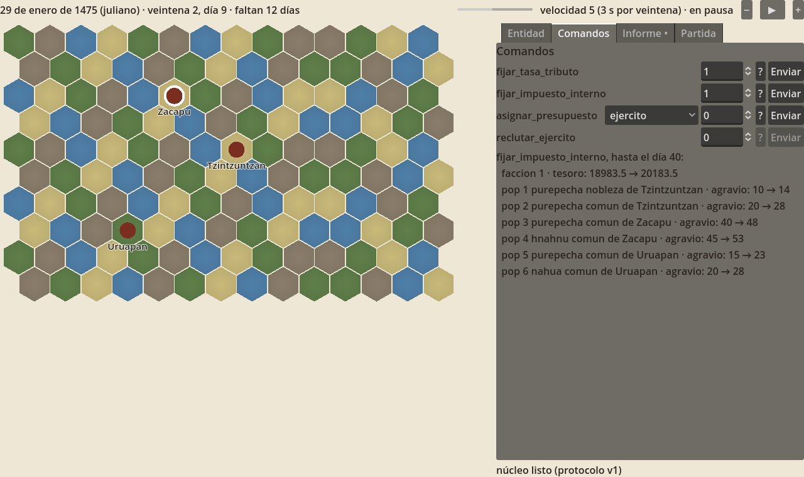

# Curicaueri: Flor y Canto

Juego de gran estrategia de código abierto sobre Mesoamérica de 1418 a 1607, jugado desde el reino purépecha. El prototipo HTML (`hito_0/`), terminado, cubre 1475–1530 y es la base del tutorial.

Son dos programas que hablan por un socket TCP local, con una línea de JSON por mensaje:

| Parte | Carpeta | Qué hace |
| --- | --- | --- |
| Núcleo (Haskell) | `nucleo/` | Decide todo el estado del juego. Ver `nucleo/README.md` |
| Cliente (Godot 4.3 o posterior) | `cliente/` | Dibuja y captura la entrada; nunca calcula reglas |
| Pruebas compartidas | `pruebas_compartidas/` | Archivos dorados del protocolo y casos del espejo, que leen las pruebas de los dos lados |
| Agentes externos | `agentes/` | Programas que deciden por una facción (Python y Mercury). Ver `agentes/README.md` |

El diseño está en `docs/arquitectura-prototipoV5.md` (qué es el juego) y `docs/arquitectura-funcional.md` (cómo se modela).



## Probarlo

1. Compila y arranca el núcleo con `cabal`:
   ```sh
   cd nucleo
   cabal build all
   cabal run nucleo -- --puerto 4646
   ```
   O sin `cabal-install`, solo con GHC y las bibliotecas instaladas (aeson, aeson-pretty, network, hspec, QuickCheck), paquete por paquete desde `nucleo/`:
   ```sh
   runghc Setup.hs configure --user --enable-tests
   runghc Setup.hs build && runghc Setup.hs test
   runghc Setup.hs register --inplace

   cd reglas
   runghc Setup.hs configure --user --enable-tests --package-db=../dist/package.conf.inplace
   runghc Setup.hs build && runghc Setup.hs test
   runghc Setup.hs register --inplace

   cd ../app
   runghc Setup.hs configure --user --package-db=../dist/package.conf.inplace --package-db=../reglas/dist/package.conf.inplace
   runghc Setup.hs build
   # el ejecutable queda en nucleo/app/dist/build/nucleo/nucleo
   ./dist/build/nucleo/nucleo --puerto 4646
   ```
   Si las pruebas fallan con `commitBuffer: invalid argument (cannot encode character …)`, la terminal no está en UTF-8: `export LANG=C.UTF-8`.
2. Abre `cliente/` en Godot (4.3 o posterior; probado en 4.3 y 4.7) y ejecuta el proyecto (F5). El cliente se conecta a `127.0.0.1:4646` y reintenta cada segundo hasta que el núcleo responde.

   También puede arrancar el núcleo él mismo. Desde el editor, pon `-- --lanzar-nucleo /ruta/al/nucleo` en el ajuste del proyecto `editor/run/main_run_args`; desde la línea de órdenes:
   ```sh
   godot --path cliente -- --lanzar-nucleo /ruta/al/nucleo --puerto 4646
   ```
3. La partida empieza en pausa. Con ▶ corre el reloj; con − y + cambia la velocidad, y la barra dice cuántos segundos dura una veintena. La barrita junto a la fecha avanza cada día hacia la siguiente veintena.
4. Haz clic en un altépetl: la pestaña **Entidad** muestra sus campos, los pops que lo habitan y sus magnitudes, con el desglose en el tooltip (ⓘ). La rueda del ratón acerca el mapa y el botón derecho lo arrastra.
5. En **Comandos**, el botón **?** consulta un comando sin aplicarlo: muestra qué cambiaría al llegar a la siguiente veintena, comparado con no darlo. **Enviar** lo aplica en el día siguiente; un valor fuera de rango vuelve como rechazo.
6. Al cerrar cada veintena, **Informe** se marca con un punto: resume los mayores cambios sin detener el juego.
7. En **Decisiones** aparecen las situaciones que presenta el guion, con su tipo, el plazo y un botón por opción. La pestaña se marca con un punto y el juego no se detiene; si vence el plazo, se toma la primera opción. Para verlo, arranca el núcleo con `--guion ../datos/guion_1475.json` (o con `../pruebas_compartidas/guion_integracion.json`, que presenta una el primer día).
8. En **Partida** se guarda y se carga por nombre. Las partidas quedan en `nucleo/partidas/` (o en la carpeta de `--partidas`); una partida cargada empieza en pausa.

Opciones del núcleo: `--ejes datos/ejes.json` (los ejes de poder activos viajan en el catálogo; en el prototipo no cambian el juego), `--grupos datos/grupos.json` (los grupos de poder: nombrar o destituir un gobernador mueve su poder y su lealtad; sin esta opción, nombrar solo cambia el gobernador), `--edificios datos/edificios.json` (las obras que se pueden construir; sin esta opción no hay ninguna; pide `--terrenos`, porque la troje baja la merma del maíz), `--terrenos datos/terrenos.json` (lo que rinde cada terreno: con ella, cada veintena el territorio produce maíz, pescado, sal, cobre, mantas y obsidiana, y el maíz se cosecha en su ventana de otoño), `--bienes datos/bienes_1475.json` (el precio de cada bien y cuáles puede designar una facción como moneda con `designar_moneda`; sin esta opción, todo se cuenta en valor), `--guion ARCHIVO` (los actos, las situaciones y el director del escenario; ver *Actos modulares*), `--agente "programa"` (un agente externo decide por la facción; ver `agentes/README.md`), `--sin-cliente --ticks N --volcar ARCHIVO --metricas` (correr sin cliente; con `--metricas`, imprime el criterio de variedad del hito 0 sobre lo que presentó el director), `--puerto N`, `--partidas CARPETA`, `--mapa 60x45` (mapa grande para la prueba de rendimiento), `--escala 7500x20` (altépetl y pops de prueba; con `--sin-cliente`, informa los milisegundos por tick: ver V5, *Escala de la simulación*) y `--velocidades 3000,1500,1000,500,150` (milisegundos por día de la velocidad 1 a la 5, para calibrar sin recompilar).

### Con Nix

`flake.nix` trae un entorno completo y varios mínimos, por si hay poco espacio:

| Orden | Qué trae | Para |
| --- | --- | --- |
| `nix develop` | GHC 9.4 con las bibliotecas, cabal, Godot, Python, Mercury, actionlint | Todo el proyecto |
| `nix develop .#nucleo` | Solo GHC 9.4 con las bibliotecas | Compilar con `runghc Setup.hs` |
| `nix develop .#haskell` | GHC 9.4 con las bibliotecas y cabal | `cabal build all` y `cabal test all` |
| `nix develop .#cliente` | Solo Godot | `probar_cliente.sh` con un núcleo ya compilado |
| `nix develop .#agentes` | Solo Python | `probar_agentes.sh` con un núcleo ya compilado |
| `nix develop .#mercury` | Solo Mercury | Compilar el agente de Mercury |
| `nix build` / `nix run . -- --puerto 4646` | El ejecutable del núcleo | Jugar sin preparar nada (sin pruebas: esas corren con cabal) |

Nix solo ve los archivos que git conoce: después de crear o mover un archivo, `git add` antes de `nix develop`. La primera vez se crea `flake.lock`, que fija la versión de nixpkgs; conviene guardarlo en el repositorio.

Fuera de NixOS, el Godot de Nix corre bien sin interfaz (las pruebas), pero para el editor con tarjeta gráfica suele hacer falta [nixGL](https://github.com/nix-community/nixGL) o usar el Godot del sistema: las pruebas toman el de `$GODOT` si está definido.

### Jugar con Nix

Requisitos: Linux en x86_64 (el flake solo define ese sistema) y Nix con flakes activados. Si no los tienes, añade a `~/.config/nix/nix.conf`:

```
experimental-features = nix-command flakes
```

Los pasos, desde una terminal:

1. Consigue el código y entra a la carpeta del proyecto:
   ```sh
   git clone https://github.com/LeoKonig/curicaueri.git
   cd curicaueri
   ```
2. Arranca el núcleo con el escenario de 1475. La primera vez compila todo y tarda varios minutos. Déjalo corriendo:
   ```sh
   nix run . -- --puerto 4646 \
     --escenario escenarios/tutorial_1475.json \
     --ejes datos/ejes.json \
     --grupos datos/grupos.json \
     --edificios datos/edificios.json \
     --terrenos datos/terrenos.json \
     --bienes datos/bienes_1475.json
   ```
   Los archivos de `datos/` se leen desde la carpeta donde ejecutas el comando, así que ejecútalo desde la raíz del proyecto. El escenario trae su guion (`datos/guion_1475.json`); `--guion` lo reemplaza. Para la campaña de 1418 a 1607 (contenido de juguete), usa `--escenario escenarios/campana_1418.json`, que termina con el cierre de 1607.
3. En otra terminal, desde la misma carpeta, abre el cliente. Usa el Godot del entorno de Nix:
   ```sh
   nix develop .#cliente --command sh -c '"$GODOT" --path cliente'
   ```
   Si Godot falla con `Could not initialize OpenGL ES`, `Required Vulkan instance extension` o `Unable to create DisplayServer`, el Godot de Nix no encuentra los controladores gráficos de tu sistema. Hay dos salidas:
   - **Lo más sencillo:** instala Godot 4.3 o posterior desde [godotengine.org](https://godotengine.org) y ábrelo con `godot --path cliente` desde la carpeta del proyecto, con el núcleo del paso 2 ya corriendo.
     En Wayland, Godot escribe avisos sobre X11 (`X11 Display is not available`) y sobre el icono de la ventana (`xdg-toplevel-icon protocol not found`). Son normales y se pueden ignorar: Godot cambia a Wayland solo.
   - **Con nixGL**, que pone los controladores del sistema al Godot de Nix. Toma la ruta del Godot del entorno y pásala por nixGL:
     ```sh
     GODOT_BIN=$(nix develop .#cliente --command sh -c 'echo "$GODOT"')
     nix run --impure github:nix-community/nixGL -- "$GODOT_BIN" --path cliente
     ```
     Esta variante no la he probado con tu tarjeta; si falla, usa la opción anterior.
4. La partida empieza en pausa. Pulsa ▶ para correr el reloj. Para detener el núcleo, vuelve a su terminal y pulsa Ctrl+C.

Para ver la pantalla final sin esperar a 1607, arranca el núcleo del paso 2 con el guion de prueba, que termina el día 11, en lugar de `datos/guion_1475.json`:

```sh
nix run . -- --puerto 4646 --guion pruebas_compartidas/guion_fin.json
```

Si prefieres un entorno con todo (compilar, pruebas, Godot y Python), usa `nix develop` en lugar de los comandos de los pasos 2 y 3: dentro del entorno, `cd nucleo && cabal build all && cabal test all` compila y prueba el núcleo, y `"$(cd nucleo && cabal list-bin nucleo)" --puerto 4646 …` lo arranca con las mismas opciones.

Notas:
- **Antes de `nix develop` o `nix run`**, cualquier archivo nuevo debe estar en git (`git add`): Nix solo ve los archivos que git conoce.
- **Godot con ventana:** el Godot de nixpkgs necesita los controladores gráficos del sistema. Fuera de NixOS suele fallar con `OpenGL ES 3.0`, `VK_KHR_surface` o `Unable to create DisplayServer`; en ese caso usa Godot 4.3 o posterior instalado en el sistema (`godot --path cliente`) o la variante con [nixGL](https://github.com/nix-community/nixGL) del paso 3.
- El cierre de 1607 (`datos/cierre_1607.json`) es el guion de la campaña de 1418: lo carga `escenarios/campana_1418.json`.

## Pruebas

```sh
cd nucleo && cabal test all                       # núcleo: motor (con los dorados) y reglas
GODOT=/ruta/a/godot NUCLEO=/ruta/al/nucleo ./probar_cliente.sh   # cliente
```

`NUCLEO=/ruta/al/nucleo ./probar_agentes.sh` prueba los agentes externos: los cuatro casos compartidos, la repetición exacta con el registro, un agente lento y uno que responde basura (y el agente de Mercury, si está compilado).

`probar_cliente.sh` corre cuatro pruebas sin interfaz gráfica:

| Prueba | Qué comprueba |
| --- | --- |
| `prueba_espejo.gd` | Los casos del espejo que genera Haskell, aplicados con el código real del cliente; el recálculo de cada valor efectivo; que cada tooltip muestre todas sus fuentes |
| `prueba_protocolo.gd` | Que el cliente lee todos los mensajes dorados del núcleo y que los que arma coinciden con los dorados; que el panel de decisiones arma un botón por opción y un selector para las cantidades |
| `prueba_integracion.gd` | Con el núcleo real: saludo, catálogo, mapa e instantánea; una consulta; un comando válido y uno rechazado con su secuencia; el reloj hasta la veintena 2; guardar en pausa y cargar |
| `prueba_decisiones.gd` | Con el núcleo y el guion de integración: llega una decisión, una respuesta inválida vuelve como error con su secuencia, la válida se acepta y llega `decision_cerrada` |

Y una prueba aparte, que necesita una tarjeta gráfica (no corre con `--headless`):

```sh
nucleo --puerto 4791 --mapa 60x45 &
godot --path cliente --script res://pruebas/prueba_rendimiento.gd -- --puerto 4791
```

Mide 8 segundos con la partida a la velocidad máxima, sin vsync, redibujando todo el mapa en cada fotograma (el peor caso), e imprime el fotograma medio, el percentil 99 y el nombre de la tarjeta. El criterio del hito 2 es que el 99 % de los fotogramas tarde menos de 16,7 ms con 2 700 hexágonos. Ver *Calibrar y medir* en `docs/calibrar.md`.

## Integración continua

`.github/workflows/pruebas.yml` corre todas las pruebas en GitHub Actions con cada `push` y cada *pull request*:

| Trabajo | Qué corre |
| --- | --- |
| núcleo | `cabal build all` y `cabal test all` en Linux con GHC 9.4 y 9.8. Como las pruebas comparan valores dorados del azar y del estado, este trabajo comprueba también que la partida sea la misma con otro compilador. macOS queda fuera por ahora: el enlazador del runner rechaza las dependencias |
| agentes | `probar_agentes.sh` con el agente de Python. El de Mercury se salta, porque no hay compilador de Mercury en la máquina de GitHub; se prueba a mano |
| cliente | `probar_cliente.sh` sin interfaz gráfica con Godot 4.3 (la versión mínima) y 4.7.2, con el ejecutable del núcleo que compiló el primer trabajo |

La prueba de rendimiento no corre ahí, porque necesita tarjeta gráfica.

Para activarla, sube el repositorio a GitHub:

```sh
git remote add origin git@github.com:USUARIO/curicaueri.git
git push -u origin main
```

## El contrato

Los nombres JSON están escritos a mano en `nucleo/src/Motor/Protocolo.hs` (mensajes) y `nucleo/reglas/src/Reglas/Comando.hs` (comandos), y en `cliente/red/protocolo.gd` del lado del cliente. Cada mensaje tiene su archivo dorado en `pruebas_compartidas/protocolo/`. Si alguien cambia la forma de un mensaje en un lado, falla una prueba en el otro.

| Dirección | Mensaje | Cuándo |
| --- | --- | --- |
| Cliente → núcleo | `hola` | Al conectar, con la versión del protocolo |
| Cliente → núcleo | `comando` | Un comando del juego con su número de secuencia; se aplica en el tick siguiente |
| Cliente → núcleo | `consulta` | Como un comando, pero solo pide la predicción |
| Cliente → núcleo | `control` | Pausa, velocidad, guardar o cargar |
| Cliente → núcleo | `responder` | La respuesta a una decisión, con su secuencia; se aplica en el tick siguiente |
| Cliente → núcleo | `interes` | Las entidades cuyo detalle quiere ver (los pops de un altépetl). Sin pedirlo no llega ningún detalle; el núcleo responde con `cambios` |
| Núcleo → cliente | `hola`, `catalogo`, `mapa`, `instantanea` | En respuesta al saludo, también al reconectar |
| Núcleo → cliente | `cambios` | Cada tick: el reloj, las entidades que cambiaron (completas), las eliminadas y los hechos; también al cambiar el interés |
| Núcleo → cliente | `reloj` | Tras una pausa o un cambio de velocidad |
| Núcleo → cliente | `prediccion` | La respuesta a una consulta: las diferencias, con y sin el comando, hasta la siguiente veintena |
| Núcleo → cliente | `aviso` | Partida guardada o cargada |
| Núcleo → cliente | `decision` | Una situación del guion espera respuesta: su tipo, la pregunta (opciones o cantidad) y el plazo. Se reenvían todas tras cada instantánea |
| Núcleo → cliente | `decision_cerrada` | La decisión ya no espera respuesta: se respondió o venció el plazo |
| Núcleo → cliente | `error` | Un comando o una consulta rechazados (con su secuencia), o un mensaje inválido |

## Escenarios

Un escenario es un archivo de `escenarios/` con sus fechas, su calendario, el mapa provisional, su guion y la lista de archivos de facciones de `datos/facciones/`. Cada facción declara su tipo, si empieza activa o aparece en una fecha (`"estado": "potencial"`, `"desde"`), si desaparece (`"hasta"`) y a quién pasa lo suyo (`"absorbente"`), su gobernante, sus personajes y sus altépetl con sus pops. El diseño está en la sección 17 del documento funcional.

| Archivo | Qué es |
| --- | --- |
| `escenarios/tutorial_1475.json` | El tutorial 1475–1530, con el reino purépecha de `datos/facciones/tutorial_1475.json`. Da exactamente el mismo estado que el tutorial escrito en el código, que la cáscara usa sin `--escenario` (una prueba lo comprueba) |
| `escenarios/campana_1418.json` | La campaña 1418–1607 con **contenido de juguete** (`datos/facciones/1418_*.json`, marcados `_provisional`): 43 facciones de todas las regiones de V5, de uno a tres altépetl cada una, sobre un mapa provisional de 40 × 30. Unas desaparecen absorbidas (Azcapotzalco en 1428, Tenochtitlan en 1521) y otras aparecen (Maní y Sotuta en 1450, la expedición castellana en 1519, las órdenes religiosas). El inventario con fuentes es T6 |

Al cargar se informan todos los errores juntos: ids repetidos, gobernantes y sujetos que no existen, cabeceras que faltan, celdas fuera del mapa, fechas fuera del escenario, absorbentes que no estarán activos. La campaña corre de punta a punta:

```sh
nucleo --sin-cliente --escenario escenarios/campana_1418.json --ticks 69500
```

Llega al 31 de diciembre de 1607 (tick 69396) y se detiene; sin datos tarda unos 8 s (0,1 ms por día) y con todos los de `datos/`, unos 35 s.

## Actos modulares

Los actos de la partida son datos, no código: un **guion** en JSON con fases, situaciones y los parámetros del director. El diseño está en V5, *Actos modulares*, y en la sección 11b del documento funcional.

| Archivo | Qué es |
| --- | --- |
| `datos/guion_1475.json` | Guion del **tutorial** 1475–1530: cuatro actos (1475, 1485, 1519, 1523), 37 situaciones y el fin el 14 de febrero de 1530. Los sucesos históricos salen de `docs/propuestas_cronica.md` y las decisiones recurrentes, del prototipo del hito 0. Cada situación dice en `_fuente` de dónde sale y con qué certeza; sus textos visibles (título, texto, opciones y costo) están en `cliente/textos/es.json`. Los números son de relleno hasta calibrar |
| `pruebas_compartidas/guion_integracion.json` | Una sola situación que sale el primer día, para la prueba del cliente |
| `nucleo/test/guion_juguete.json` | El guion del juego de juguete, con el que se prueban fases, director y métricas |

Para medir un guion sin cliente:

```sh
nucleo --sin-cliente --ticks 20200 --guion datos/guion_1475.json --metricas
```

Con el guion del tutorial, de 1475 al fin de 1530 salen 146 situaciones (unas 2,7 por año) si nadie responde. La parte máxima es 0,24, dentro del 25 %, y la novedad por década es `[4,2,3,4]`: cumple. «Mala cosecha» (T17) necesita maíz: solo sale si se cargan también los datos de producción (`--grupos datos/grupos.json --terrenos datos/terrenos.json --edificios datos/edificios.json --bienes datos/bienes_1475.json --ejes datos/ejes.json`); con ellos son 151 situaciones, parte máxima 0,23 y novedad `[3,2,3,4]`: también cumple. El acto II, que dura de 1485 a 1519, escalona sus tipos con ventanas de fechas (`desde_fecha` y `no desde_fecha`): obras y conquistas hasta 1500, señorío y milicia desde 1495, alianza, rebelión y sucesión desde 1505. Sin esa escalada, la novedad de las décadas siguientes cae y el arnés lo detecta.

**Cambiar o revisar un suceso histórico** es editar su situación en el guion (condición, ventana, opciones y efectos) y sus textos en `cliente/textos/es.json`; el motor no se toca. Las situaciones se encadenan con `ocurrio`: una opción emite un hecho (`{"tipo": "hecho", "tag": "taximaroa_fortificada"}`), la tabla `cronica` del guion lo anota y la condición de otra situación lo lee (`{"tipo": "ocurrio", "hecho": "taximaroa_fortificada", "dias": 1095}`). Lo que debe durar un tiempo va como `{"tipo": "modificador", …, "valor": "-5", "dias": 1095}`. El juego añade condiciones (`soberano`, `faccion_activa`, `personaje_vivo`) y efectos (`transferir_altepetl`, `cambiar_condicion`, `activar_faccion`, `absorber_faccion`, `consumir_bien`, `gastar_valor`) en `nucleo/reglas/src/Reglas/Propios.hs`; uno nuevo se programa ahí una vez y luego se usa desde los datos. Un suceso de la cadena histórica sale una sola vez (`"enfriamiento": 100000`) dentro de su ventana. Después de editar, `--metricas` dice si el guion sigue variado, y la prueba de protocolo del cliente comprueba que cada situación y cada opción tengan su texto.

## Licencia

Cada parte del repositorio tiene su propia licencia (ver [`LICENCIAS.md`](LICENCIAS.md)):

| Parte | Licencia |
| --- | --- |
| Código | GPL-3.0-or-later ([`LICENSE`](LICENSE)) |
| Datos del juego (`datos/`) | CC BY 4.0 ([`datos/LICENSE`](datos/LICENSE)) |
| Documentación (`docs/`) | CC BY 4.0 ([`docs/LICENSE`](docs/LICENSE)) |

El nombre y el logotipo son marcas y no se licencian con lo anterior ([`MARCAS.md`](MARCAS.md)). Para contribuir, lee [`CONTRIBUTING.md`](CONTRIBUTING.md) y acepta el [CLA](CLA.md).
