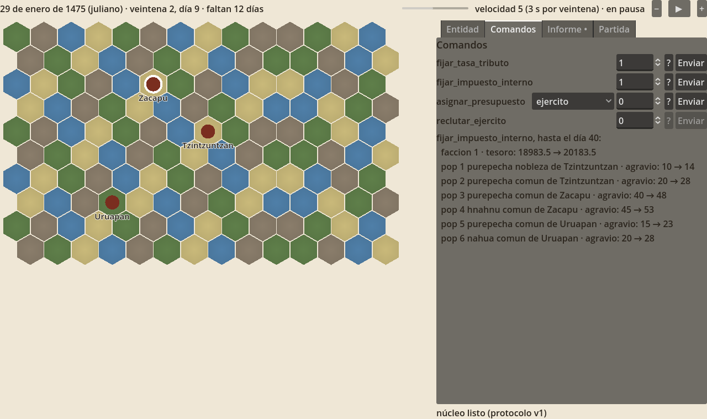

# Curicaueri: Flor y Canto

Juego de gran estrategia de código abierto sobre Mesoamérica. El prototipo es el reino purépecha de 1475 a 1530.

Son dos programas que hablan por un socket TCP local, con una línea de JSON por mensaje:

| Parte | Carpeta | Qué hace |
| --- | --- | --- |
| Núcleo (Haskell) | `nucleo/` | Decide todo el estado del juego. Ver `nucleo/README.md` |
| Cliente (Godot 4.3 o posterior) | `cliente/` | Dibuja y captura la entrada; nunca calcula reglas |
| Pruebas compartidas | `pruebas_compartidas/` | Archivos dorados del protocolo y casos del espejo, que leen las pruebas de los dos lados |
| Agentes externos | `agentes/` | Programas que deciden por una facción (Python y Mercury). Ver `agentes/README.md` |

El diseño está en `docs/arquitectura-prototipoV5.md` (qué es el juego) y `docs/arquitectura-funcional.md` (cómo se modela).



## Probarlo

1. Compila y arranca el núcleo con `cabal`:
   ```sh
   cd nucleo
   cabal build all
   cabal run nucleo -- --puerto 4646
   ```
   O sin `cabal-install`, solo con GHC y las bibliotecas instaladas (aeson, aeson-pretty, network, hspec, QuickCheck), paquete por paquete desde `nucleo/`:
   ```sh
   runghc Setup.hs configure --user --enable-tests
   runghc Setup.hs build && runghc Setup.hs test
   runghc Setup.hs register --inplace

   cd reglas
   runghc Setup.hs configure --user --enable-tests --package-db=../dist/package.conf.inplace
   runghc Setup.hs build && runghc Setup.hs test
   runghc Setup.hs register --inplace

   cd ../app
   runghc Setup.hs configure --user --package-db=../dist/package.conf.inplace --package-db=../reglas/dist/package.conf.inplace
   runghc Setup.hs build
   # el ejecutable queda en nucleo/app/dist/build/nucleo/nucleo
   ./dist/build/nucleo/nucleo --puerto 4646
   ```
   Si las pruebas fallan con `commitBuffer: invalid argument (cannot encode character …)`, la terminal no está en UTF-8: `export LANG=C.UTF-8`.
2. Abre `cliente/` en Godot (4.3 o posterior; probado en 4.3 y 4.7) y ejecuta el proyecto (F5). El cliente se conecta a `127.0.0.1:4646` y reintenta cada segundo hasta que el núcleo responde.

   También puede arrancar el núcleo él mismo. Desde el editor, pon `-- --lanzar-nucleo /ruta/al/nucleo` en el ajuste del proyecto `editor/run/main_run_args`; desde la línea de órdenes:
   ```sh
   godot --path cliente -- --lanzar-nucleo /ruta/al/nucleo --puerto 4646
   ```
3. La partida empieza en pausa. Con ▶ corre el reloj; con − y + cambia la velocidad, y la barra dice cuántos segundos dura una veintena. La barrita junto a la fecha avanza cada día hacia la siguiente veintena.
4. Haz clic en un altépetl: la pestaña **Entidad** muestra sus campos, los pops que lo habitan y sus magnitudes, con el desglose en el tooltip (ⓘ). La rueda del ratón acerca el mapa y el botón derecho lo arrastra.
5. En **Comandos**, el botón **?** consulta un comando sin aplicarlo: muestra qué cambiaría al llegar a la siguiente veintena, comparado con no darlo. **Enviar** lo aplica en el día siguiente; un valor fuera de rango vuelve como rechazo.
6. Al cerrar cada veintena, **Informe** se marca con un punto: resume los mayores cambios sin detener el juego.
7. En **Decisiones** aparecen las situaciones que presenta el guion, con su tipo, el plazo y un botón por opción. La pestaña se marca con un punto y el juego no se detiene; si vence el plazo, se toma la primera opción. Para verlo, arranca el núcleo con `--guion ../datos/guion_1475.json` (o con `../pruebas_compartidas/guion_integracion.json`, que presenta una el primer día).
8. En **Partida** se guarda y se carga por nombre. Las partidas quedan en `nucleo/partidas/` (o en la carpeta de `--partidas`); una partida cargada empieza en pausa.

Opciones del núcleo: `--ejes datos/ejes.json` (los ejes de poder activos viajan en el catálogo; en el prototipo no cambian el juego), `--guion ARCHIVO` (los actos, las situaciones y el director del escenario; ver *Actos modulares*), `--agente "programa"` (un agente externo decide por la facción; ver `agentes/README.md`), `--sin-cliente --ticks N --volcar ARCHIVO --metricas` (correr sin cliente; con `--metricas`, imprime el criterio de variedad del hito 0 sobre lo que presentó el director), `--puerto N`, `--partidas CARPETA`, `--mapa 60x45` (mapa grande para la prueba de rendimiento) y `--velocidades 3000,1500,1000,500,150` (milisegundos por día de la velocidad 1 a la 5, para calibrar sin recompilar).

### Con Nix

`flake.nix` trae un entorno completo y varios mínimos, por si hay poco espacio:

| Orden | Qué trae | Para |
| --- | --- | --- |
| `nix develop` | GHC 9.4 con las bibliotecas, cabal, Godot, Python, Mercury, actionlint | Todo el proyecto |
| `nix develop .#nucleo` | Solo GHC 9.4 con las bibliotecas | Compilar con `runghc Setup.hs` |
| `nix develop .#haskell` | GHC 9.4 con las bibliotecas y cabal | `cabal build all` y `cabal test all` |
| `nix develop .#cliente` | Solo Godot | `probar_cliente.sh` con un núcleo ya compilado |
| `nix develop .#agentes` | Solo Python | `probar_agentes.sh` con un núcleo ya compilado |
| `nix develop .#mercury` | Solo Mercury | Compilar el agente de Mercury |
| `nix build` / `nix run . -- --puerto 4646` | El ejecutable del núcleo | Jugar sin preparar nada (sin pruebas: esas corren con cabal) |

Nix solo ve los archivos que git conoce: después de crear o mover un archivo, `git add` antes de `nix develop`. La primera vez se crea `flake.lock`, que fija la versión de nixpkgs; conviene guardarlo en el repositorio.

Fuera de NixOS, el Godot de Nix corre bien sin interfaz (las pruebas), pero para el editor con tarjeta gráfica suele hacer falta [nixGL](https://github.com/nix-community/nixGL) o usar el Godot del sistema: las pruebas toman el de `$GODOT` si está definido.

## Pruebas

```sh
cd nucleo && cabal test all                       # núcleo: motor (con los dorados) y reglas
GODOT=/ruta/a/godot NUCLEO=/ruta/al/nucleo ./probar_cliente.sh   # cliente
```

`NUCLEO=/ruta/al/nucleo ./probar_agentes.sh` prueba los agentes externos: los cuatro casos compartidos, la repetición exacta con el registro, un agente lento y uno que responde basura (y el agente de Mercury, si está compilado).

`probar_cliente.sh` corre cuatro pruebas sin interfaz gráfica:

| Prueba | Qué comprueba |
| --- | --- |
| `prueba_espejo.gd` | Los casos del espejo que genera Haskell, aplicados con el código real del cliente; el recálculo de cada valor efectivo; que cada tooltip muestre todas sus fuentes |
| `prueba_protocolo.gd` | Que el cliente lee todos los mensajes dorados del núcleo y que los que arma coinciden con los dorados; que el panel de decisiones arma un botón por opción y un selector para las cantidades |
| `prueba_integracion.gd` | Con el núcleo real: saludo, catálogo, mapa e instantánea; una consulta; un comando válido y uno rechazado con su secuencia; el reloj hasta la veintena 2; guardar en pausa y cargar |
| `prueba_decisiones.gd` | Con el núcleo y el guion de integración: llega una decisión, una respuesta inválida vuelve como error con su secuencia, la válida se acepta y llega `decision_cerrada` |

Y una prueba aparte, que necesita una tarjeta gráfica (no corre con `--headless`):

```sh
nucleo --puerto 4791 --mapa 60x45 &
godot --path cliente --script res://pruebas/prueba_rendimiento.gd -- --puerto 4791
```

Mide 8 segundos con la partida a la velocidad máxima, sin vsync, redibujando todo el mapa en cada fotograma (el peor caso), e imprime el fotograma medio, el percentil 99 y el nombre de la tarjeta. El criterio del hito 2 es que el 99 % de los fotogramas tarde menos de 16,7 ms con 2 700 hexágonos. Ver *Calibrar y medir* en `docs/calibrar.md`.

## Integración continua

`.github/workflows/pruebas.yml` corre todas las pruebas en GitHub Actions con cada `push` y cada *pull request*:

| Trabajo | Qué corre |
| --- | --- |
| núcleo | `cabal build all` y `cabal test all` en Linux con GHC 9.4 y 9.8, y en macOS con GHC 9.4. Como las pruebas comparan valores dorados del azar y del estado, este trabajo comprueba también que la partida sea la misma en otra plataforma y con otro compilador |
| agentes | `probar_agentes.sh` con el agente de Python. El de Mercury se salta, porque no hay compilador de Mercury en la máquina de GitHub; se prueba a mano |
| cliente | `probar_cliente.sh` sin interfaz gráfica con Godot 4.3 (la versión mínima) y 4.7.2, con el ejecutable del núcleo que compiló el primer trabajo |

La prueba de rendimiento no corre ahí, porque necesita tarjeta gráfica.

Para activarla, sube el repositorio a GitHub:

```sh
git remote add origin git@github.com:USUARIO/curicaueri.git
git push -u origin main
```

## El contrato

Los nombres JSON están escritos a mano en `nucleo/src/Motor/Protocolo.hs` (mensajes) y `nucleo/reglas/src/Reglas/Comando.hs` (comandos), y en `cliente/red/protocolo.gd` del lado del cliente. Cada mensaje tiene su archivo dorado en `pruebas_compartidas/protocolo/`. Si alguien cambia la forma de un mensaje en un lado, falla una prueba en el otro.

| Dirección | Mensaje | Cuándo |
| --- | --- | --- |
| Cliente → núcleo | `hola` | Al conectar, con la versión del protocolo |
| Cliente → núcleo | `comando` | Un comando del juego con su número de secuencia; se aplica en el tick siguiente |
| Cliente → núcleo | `consulta` | Como un comando, pero solo pide la predicción |
| Cliente → núcleo | `control` | Pausa, velocidad, guardar o cargar |
| Cliente → núcleo | `responder` | La respuesta a una decisión, con su secuencia; se aplica en el tick siguiente |
| Núcleo → cliente | `hola`, `catalogo`, `mapa`, `instantanea` | En respuesta al saludo, también al reconectar |
| Núcleo → cliente | `cambios` | Cada tick: el reloj, las entidades que cambiaron (completas), las eliminadas y los hechos |
| Núcleo → cliente | `reloj` | Tras una pausa o un cambio de velocidad |
| Núcleo → cliente | `prediccion` | La respuesta a una consulta: las diferencias, con y sin el comando, hasta la siguiente veintena |
| Núcleo → cliente | `aviso` | Partida guardada o cargada |
| Núcleo → cliente | `decision` | Una situación del guion espera respuesta: su tipo, la pregunta (opciones o cantidad) y el plazo. Se reenvían todas tras cada instantánea |
| Núcleo → cliente | `decision_cerrada` | La decisión ya no espera respuesta: se respondió o venció el plazo |
| Núcleo → cliente | `error` | Un comando o una consulta rechazados (con su secuencia), o un mensaje inválido |

## Actos modulares

Los actos de la partida son datos, no código: un **guion** en JSON con fases, situaciones y los parámetros del director. El diseño está en V5, *Actos modulares*, y en la sección 11b del documento funcional.

| Archivo | Qué es |
| --- | --- |
| `datos/guion_1475.json` | Guion **ilustrativo** del escenario: tres actos (1475, 1485, 1519) y siete situaciones que mueven el agravio de los pops. Muestra la forma; el contenido real sale del hito 0 |
| `pruebas_compartidas/guion_integracion.json` | Una sola situación que sale el primer día, para la prueba del cliente |
| `nucleo/test/guion_juguete.json` | El guion del juego de juguete, con el que se prueban fases, director y métricas |

Para medir un guion sin cliente:

```sh
nucleo --sin-cliente --ticks 18250 --guion datos/guion_1475.json --metricas
```

Con el guion ilustrativo, en 50 años salen 61 situaciones. La parte máxima es 0,21, dentro del 25 %, pero la novedad por década es `[2,0,0,1]` y no cumple. Es a propósito: el acto II dura de 1485 a 1519 sin situaciones que se desbloqueen a mitad del acto, y el arnés lo detecta. Para que cumpla hacen falta situaciones con `"condicion": {"tipo": "desde_fecha", ...}` dentro de cada acto largo, como en el guion de juguete.
