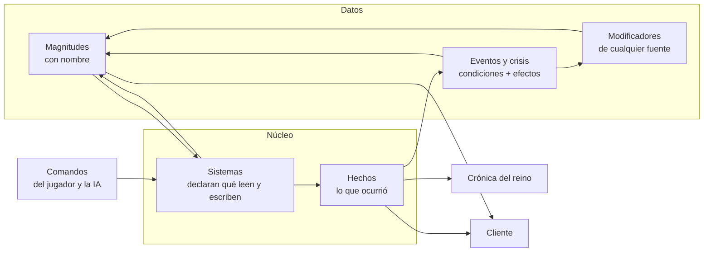
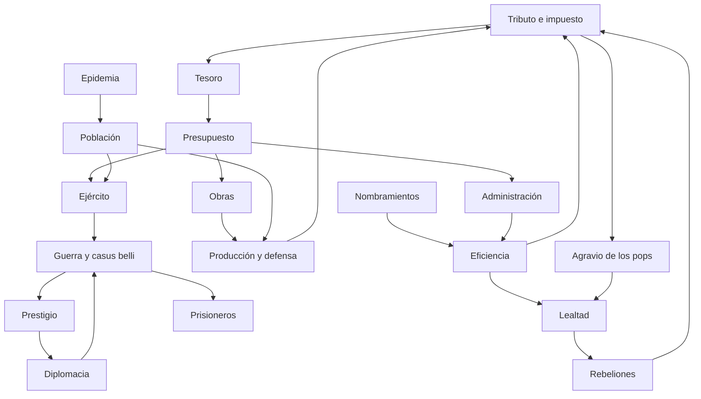
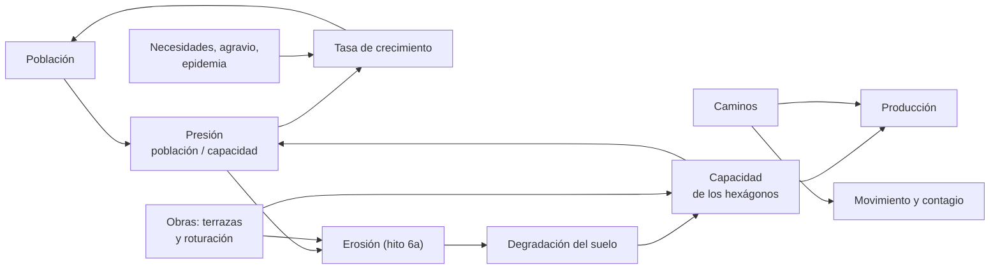
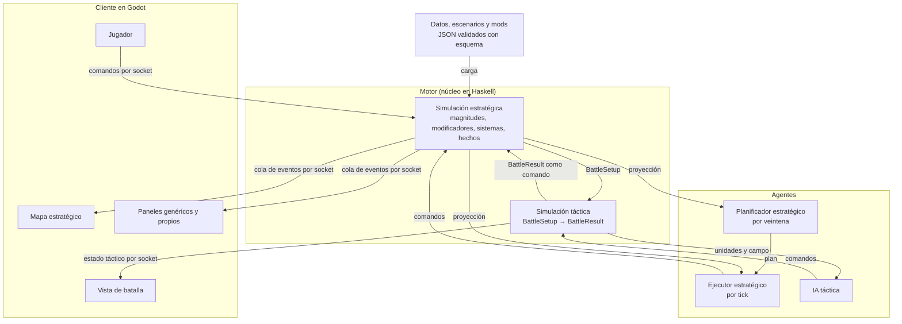
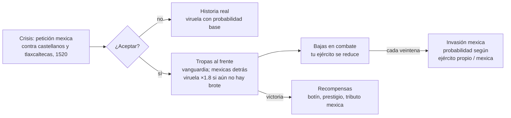

# Curicaueri: Flor y Canto — diseño y arquitectura del prototipo: el reino purépecha, siglo XVI (Haskell + Godot)

21 de octubre de 2026 (revisado el 23, el 24 y el 27 de octubre) · Leonardo Gómez

## Visión

El jugador debe recordar **"la vez que construí el reino purépecha que sobrevivió (o no) a la conquista"**, no "la vez que sobreviví a la conquista". Es un juego de gran estrategia en la línea de Victoria II y Europa Universalis: la crisis de 1520 es el clímax de lo que el jugador construyó, no el contenido principal.

**Frase guía:** *cada veintena el jugador inclina el reino; cada año ve las consecuencias; cada década decide qué reino será.*

**Juego completo:** al menos toda Mesoamérica, de 1475 (poco antes de la batalla de Taximaroa, que las fuentes sitúan hacia 1476–1479; fecha por verificar) a 1605 (fundación de Port Royal en Acadia y publicación de la primera parte del Quijote).

**Prototipo:** el reino purépecha de 1475 a 1530, en tres actos. Se convertirá en el tutorial del juego completo.

| Acto | Años | Pregunta del jugador | Qué enseña |
| --- | --- | --- | --- |
| I. Sobrevivir | 1475–1485 | ¿Puedo resistir a la Triple Alianza y consolidar el reino? | Guerra, tributo, lealtad, presupuesto de emergencia |
| II. Construir | 1485–1519 | ¿Qué reino quiero dejar a mi sucesor? | Administración, construcción, diplomacia, pops |
| III. Resistir | 1519–1530 | ¿Sobrevive lo que construí? | Crisis, sucesión, epidemia, vasallaje |

## Tres reglas que gobiernan todo el diseño

1. **Recortar contenido, nunca sistemas.** El prototipo es el juego completo con menos datos: menos territorio, menos años, menos eventos. No existe código exclusivo del prototipo. Pasar al juego completo es añadir datos y sistemas, nunca reescribir los que ya existen.
2. **Todo se conecta por magnitudes, modificadores y hechos.** Ninguna mecánica llama directamente a otra. Las mecánicas se comunican escribiendo y leyendo magnitudes con nombre, aportando modificadores y emitiendo hechos. Así, cada mecánica nueva se enchufa a las existentes y el juego se vuelve más denso sin volverse frágil.
3. **Toda palanca tiene costo y consecuencia visible.** Cada decisión del jugador cuesta algo y su efecto aparece en la interfaz, con el desglose de por qué. Un comando sin costo no es una decisión.

## La rebanada vertical: qué es igual y qué se recorta

| Igual en el prototipo y en el juego completo | Se recorta solo con datos |
| --- | --- |
| Núcleo, orden de sistemas, protocolo, esquemas | Región jugable (máscara sobre el mapa global) |
| Interfaz de grafo del mapa e ids de celda globales | Facciones jugables |
| Catálogo de comandos | Años de inicio y fin |
| Sistema de magnitudes, modificadores y hechos | Eventos, edificios, personajes |
| Sistema de eventos y de crisis | Sistemas activos (los reservados son pasos vacíos) |
| Contrato `BattleSetup` / `BattleResult` | Capa táctica activa o no |

**Reglas concretas**

1. **Sin `if prototipo`.** Los recortes viven en el archivo de escenario: fecha inicial y final, estado inicial, máscara de región jugable, facciones jugables y sistemas activos.
2. **Escenarios, no versiones.** El mismo núcleo carga cualquier escenario. El prototipo tiene dos: la campaña 1475–1530 y el escenario de crisis 1519–1530, que conserva el demo que ya resultó divertido.
3. **Mapa global desde el día 1, como grafo.** El núcleo no sabe de hexágonos: procesa un grafo de celdas y conexiones (ver *El mapa como grafo*). En el prototipo, el grafo lo genera una malla hexagonal de Mesoamérica y Michoacán es una máscara. Ampliar el territorio es ampliar la máscara y añadir datos; cambiar la forma del mapa es cambiar de proveedor de grafo.
4. **Sistemas genéricos sobre facciones.** Purépechas, Triple Alianza, castellanos y chichimecas usan exactamente los mismos sistemas y comandos. "Jugable" es una bandera de datos.
5. **Frentes abstractos genéricos.** Cualquier región fuera de la máscara puede tener un frente abstracto (en el prototipo, la guerra del Valle de México). Cuando esa región entra en la máscara, el frente se reemplaza por simulación en el mapa con los mismos datos de fuerzas.
6. **Orden de sistemas del juego completo desde el principio.** Los pasos aún no implementados existen como pasos vacíos. Implementar una mecánica es rellenar su paso, no reordenar el ciclo.
7. **Catálogo completo de comandos declarado.** Los comandos aún no implementados se rechazan con el motivo `no_implementado`, pero el contrato no cambia.
8. **Esquemas que solo crecen.** Un campo nuevo siempre trae valor por defecto. Nada se renombra ni se borra sin una migración versionada. Así, datos, mods y guardados antiguos siguen siendo válidos.

## Arquitectura de extensión: cómo se añade y se conecta una mecánica

Una mecánica es la suma de cinco piezas. Cada pieza tiene un lugar fijo, así que añadir complejidad no obliga a tocar lo demás.



**1. Magnitudes.** Toda cantidad del juego es una magnitud con nombre ligada a un tipo de entidad: `altepetl.lealtad`, `faccion.prestigio`, `asentamiento.reservas_asedio`, `pop.agravio`. Cada magnitud se declara en `datos/magnitudes.json` con su tipo (entero o punto fijo), rango, valor base, clave de localización y formato de despliegue. Una magnitud nueva no exige tocar el cliente para mostrarse.

**2. Modificadores.** Cualquier fuente (edificio, personaje nombrado, política, tecnología, evento, terreno, estación) puede aportar modificadores a una magnitud. El valor efectivo es:

```math
\text{valor} = (\text{base} + \textstyle\sum \text{sumandos}) \times (1 + \textstyle\sum \text{porcentajes})
```

Los porcentajes se suman en vez de multiplicarse entre sí, para que acumular fuentes no dispare los valores. Cada modificador conserva su fuente, de modo que la interfaz puede mostrar el desglose completo: "lealtad 62: base 50, +10 yácata, +8 gobernador eficiente, −6 impuesto alto". Ese desglose es la consecuencia visible de la regla 3.

**Invariante: la explicación es el cálculo.** El valor efectivo de una magnitud nunca se guarda aparte: siempre se calcula a partir de su base y su lista de modificadores. Así, el desglose no puede quedar incompleto, porque si una fuente no estuviera en la lista tampoco estaría en el valor. Una propiedad de QuickCheck lo comprueba para toda magnitud de todo estado generado. Los sistemas que escriben magnitudes escriben la base o aportan modificadores, nunca el valor efectivo. Un edificio, rasgo o política nuevos suelen ser solo datos:

```json
{
  "id": "fortaleza",
  "tipo": "edificio",
  "costo": {"tesoro": 400, "veintenas": 6},
  "requisitos": [{"terreno_en": ["montana", "colina"]}],
  "modificadores": [
    {"magnitud": "asentamiento.reservas_asedio", "sumar": 4},
    {"magnitud": "asentamiento.produccion", "porcentaje": -5}
  ]
}
```

**3. Sistemas.** Un sistema es un módulo de Haskell que declara qué magnitudes lee, cuáles escribe, su cadencia y su paso en el ciclo:

```haskell
data Sistema = Sistema
  { nombre   :: Text
  , cadencia :: Cadencia                 -- Diario | Veintena
  , lee      :: Set Magnitud
  , escribe  :: Set Magnitud
  , ejecutar :: Rng -> Estado -> (Estado, [Hecho])
  }
```

Al cargar, el núcleo valida las declaraciones: avisa si un sistema lee algo que ningún sistema anterior escribe en ese tick, o si dos sistemas escriben la misma magnitud en el mismo paso. Las magnitudes que un sistema no declara no las puede tocar.

**4. Hechos.** Cuando algo ocurre, el sistema emite un hecho: `guerra_declarada`, `edificio_terminado`, `personaje_murio`, `rebelion_iniciada`, `tributo_impagado`, `terreno_modificado`, `capacidad_superada`, `suelo_degradado`, `modificador_terminado` (con la razón: expiró, se canceló, su fuente desapareció, fue reemplazado o dejó de cumplirse su condición). Los hechos son el sistema nervioso del juego: los consumen los eventos (como condiciones), otros sistemas en el tick siguiente, la crónica y el cliente. Así, una mecánica nueva puede reaccionar a todo lo que ya existe sin que lo existente sepa de ella.

**5. Eventos, condiciones y fórmulas con nombre.** Las condiciones y efectos de los eventos operan sobre magnitudes y hechos. Las fórmulas del juego son funciones puras de Haskell, cada una con un nombre y parámetros que vienen de constantes. Los datos pueden elegir qué fórmula usar y con qué parámetros, pero no escribir fórmulas nuevas:

```json
{"formula": "agravio_por_impuesto", "args": {"peso_impuesto": "AGRAVIO_POR_IMPUESTO", "peso_eficiencia": 20}}
```

Esto cubre la mayor parte del ajuste de balance sin parser, sin gramática y sin errores de sintaxis. Un lenguaje de expresiones en datos se descarta por ahora: el parser es lo fácil, pero sus mensajes de error, la validación de referencias, la tentación de añadirle `min`, `if` y más, la documentación y las pruebas son un costo de mantenimiento permanente. Solo se justifica cuando alguien que no programa en Haskell (un modder o un colaborador) necesite escribir fórmulas nuevas. **Se decide en el hito 6**, con datos de cuántas veces se recompila por sesión de balance; el prototipo de mesa del hito 0 da la primera señal.

**Receta para añadir una mecánica nueva**

1. Declarar sus magnitudes en `magnitudes.json`.
2. Escribir el sistema (lee, escribe, cadencia) y colocarlo en su paso reservado del ciclo.
3. Declarar sus comandos en el protocolo y sus hechos en `hechos.json`.
4. Añadir en datos los modificadores, eventos y constantes que la conectan con lo demás.
5. Si necesita una vista propia, añadir un panel; si no, el cliente ya muestra sus magnitudes y desgloses con los paneles genéricos.

## Las palancas

Cada palanca es un bucle cerrado: decisión → costo → consecuencia visible → nueva decisión. Cada una tiene una versión mínima, que entra al prototipo, y una completa, que llega después **con el mismo esquema**: la versión completa añade magnitudes, modificadores o rondas, no reemplaza nada.

| Palanca | Qué decide el jugador | Costo | Mínimo (prototipo) | Completo (juego) |
| --- | --- | --- | --- | --- |
| Tesoro y presupuesto | Tasa de tributo, impuesto interno y reparto del gasto entre ejército, administración, obras, diplomacia y culto | Más ingreso sube el agravio; gastar de más vacía el tesoro y baja la moral; descuidar el culto baja la legitimidad | Un tesoro, dos tasas, cinco partidas | Mercado y precios |
| Nombramientos | Gobernadores y capitanes entre los personajes disponibles | Los no nombrados se resienten; un mal nombramiento baja recaudación y lealtad | Personajes con habilidad de administración, mando y diplomacia; eficiencia por altépetl | Facciones cortesanas que reaccionan |
| Construcción | Qué edificio levantar y dónde | Tesoro y veintenas de obra; el asentamiento produce menos mientras construye; la roturación es irreversible | Siete obras: yácata, mercado, fortaleza, troje, camino, y terrazas y roturación sobre hexágonos (ver *La tierra y la gente*) | Edificios desbloqueados por difusión tecnológica |
| Guerra con casus belli y treguas | Cuándo y contra quién ir a la guerra | Guerra sin casus belli cuesta prestigio y relaciones; tras la paz hay tregua | Tres casus belli (tributo impagado, alianza rota, guerra ritual, ver *Temporada de guerra y guerra ritual*), tregua de 10 veintenas | Crisis con rondas entre potencias, esferas de influencia |

**Indicadores.** No son palancas: el jugador no los decide, pero resultan de sus decisiones y pesan en ellas.

| Indicador | De qué resulta | Qué lo baja | Mínimo (prototipo) | Completo (juego) |
| --- | --- | --- | --- | --- |
| Prestigio | Victorias, tributos cobrados, obras y eventos | Baja con derrotas, tributos impagos y humillaciones | Una magnitud por facción | Ranking, estatus de potencia y esferas |
| Legitimidad | Culto, los rituales, las victorias y la yácata (ver *Legitimidad y culto*) | Baja con derrotas, hambrunas y culto descuidado; el ritual con prisioneros sube el agravio de los pops no purépechas | Una magnitud por facción, con modificadores temporales | Panteón completo, legitimidad por señor, sincretismo |

Las palancas ya existentes siguen: tributo entre altépetl, sucesión y personajes, prisioneros, diplomacia entre facciones y altépetl. Terrazas y roturación amplían la palanca de construcción; no son una palanca nueva.

**Regla de oro.** No se añade una palanca nueva hasta que la anterior tenga costo, consecuencia visible y una prueba que la valide. Las cuatro de arriba entran en ese orden; los dos indicadores llegan con ellas.

## El reino conectado

Las palancas no son paneles independientes: forman un solo sistema. Este es el bucle principal del prototipo:



Cada flecha es una magnitud que un sistema escribe y otro lee, o un modificador que una fuente aporta. Añadir una mecánica es añadir nodos y flechas a este grafo.

## La tierra y la gente: caminos, crecimiento y erosión

Tres mecánicas forman un solo bucle: la gente presiona la tierra, la tierra degradada sostiene a menos gente, y las obras del jugador (caminos, terrazas, roturación) cambian cuánta gente puede sostener y cuánto se degrada. Entran al prototipo **en tres etapas con hitos separados**, porque cada una mueve los números de la anterior: un sistema, una medición, un ajuste.

| Etapa | Qué añade | Hito | Por qué en ese orden |
| --- | --- | --- | --- |
| Caminos, terrazas y roturación | Obras con modificadores y una obra que cambia el terreno; ningún sistema nuevo | 3 | Son datos: edificios, modificadores y un efecto nuevo |
| Crecimiento | Sistema de demografía: tasa de crecimiento por modificadores, capacidad y presión | 3b | Mueve todos los números (ingresos, agravio, necesidades, ejército); se hace con las constantes del hito 3 ya ajustadas y antes de fijar los umbrales del hito 4 |
| Erosión | Sistema de degradación del suelo | 6a | En 10 años es casi invisible; se valida con la campaña de 55 años |

**Puerta entre etapas.** Una etapa no empieza hasta que la anterior pasa su criterio (ver *Hitos*) con sus constantes ajustadas. Si el crecimiento no funciona, la erosión no se escribe: sin población que presione la tierra no hay nada que medir. Ninguna etapa entra al prototipo de mesa del hito 0, donde primero se validan las palancas sin demografía.



La capacidad es una magnitud del hexágono. La presión de un asentamiento es el cociente entre su población y la capacidad de los hexágonos que lo rodean (las que están dentro de `RADIO_PRODUCCION_KM`, las mismas que usa la producción). Ambas son derivadas: se recalculan en el paso 16 y las leen los sistemas en la veintena siguiente, por la misma razón que el paso 8 lee los valores del tick anterior.

### Caminos (hito 3)

Un camino tiene tres efectos, y ninguno exige un sistema nuevo:

- **Velocidad.** Aporta un modificador al costo de movimiento de los hexágonos de la ruta de menor costo entre dos asentamientos con camino (ya previsto en *Combate estratégico*).
- **Ingreso.** Aporta un modificador porcentual a la producción del asentamiento, activo solo si el asentamiento más cercano por ruta también tiene camino. Es la razón económica mínima para construirlos; valor propuesto: +4%.
- **Contagio.** Sin código: la epidemia ya viaja por las rutas de menor costo, así que un camino acelera la viruela (ver *Lo construido pesa en la crisis*).

Quedan fuera, con lugar reservado, la **línea de suministros** (mantenimiento del ejército según su distancia a territorio propio) y el **comercio entre ciudades**. Son sistemas, no mejoras de un edificio: el comercio es el paso 6 reservado, y los suministros se resuelven con el abasto de *La coerción como cadena* (hito 4), donde el camino es un aporte más al flujo. El modificador de ingreso no es un parche que luego se tire: cuando llegue el mercado, sigue ahí y solo se revisa su valor.

Para esto, el modificador gana dos campos opcionales (con valor por defecto, como exige la regla 8): `condicion`, que se evalúa en el paso 16 (así que un modificador puede durar hasta una veintena después de que su condición deja de cumplirse, por diseño) y, al dejar de cumplirse, termina el modificador con el hecho `modificador_terminado` y la razón `condicion`; y `alcance`, que dice a qué entidades llega (por defecto, la propia; `ruta`, los hexágonos de la ruta de menor costo, que se recalcula cada veintena en el paso 16: si otra obra cambia la ruta, el modificador se mueve a las celdas nuevas).

```json
{
  "id": "camino",
  "tipo": "edificio",
  "costo": {"tesoro": 150, "veintenas": 4},
  "requisitos": [],
  "modificadores": [
    {"magnitud": "celda.costo_movimiento", "porcentaje": -30, "alcance": "ruta"},
    {"magnitud": "asentamiento.produccion", "porcentaje": 4, "condicion": {"vecino_con": "camino"}}
  ]
}
```

Los costos y porcentajes de estos ejemplos son de relleno; se fijan en el hito 0.

### Terrazas y roturación (hito 3)

Son obras sobre una **celda** (no sobre un asentamiento) dentro de `RADIO_PRODUCCION_KM` de un asentamiento propio. Usan `ConstruirEdificio` con un hexágono de destino: no hay comando nuevo.

| Obra | Costo | Efecto | Consecuencia visible |
| --- | --- | --- | --- |
| Terrazas | Tesoro y 5 veintenas de obra | +10 de capacidad en el hexágono; desde el hito 6a, también menos erosión | El desglose de `celda.capacidad` muestra "+10 terrazas"; sube la producción y baja la presión |
| Roturación | Tesoro y 3 veintenas de obra; irreversible en el prototipo | El hexágono pasa de bosque a llano: sube su capacidad base, bajan los recursos propios del bosque y, desde el hito 6a, sube su erosión base | La consulta de predicción muestra el costo antes de confirmar ("+capacidad, −recursos del bosque"); el mapa lo repinta y la crónica registra `terreno_modificado` |

La capacidad base, los recursos y la erosión base de un hexágono salen de una tabla por terreno (`datos/terrenos.json`), así que cambiar de terreno cambia las tres sin escribir valores sueltos. El terreno modificado es estado almacenado (la lista de hexágonos cuyo terreno difiere del de los datos); los datos del mapa no se reescriben. Esto rompe la suposición de que la geografía nunca cambia: ver *Riesgos*.

```json
{
  "id": "terrazas",
  "tipo": "edificio",
  "ambito": "celda",
  "costo": {"tesoro": 200, "veintenas": 5},
  "requisitos": [{"terreno_en": ["colina", "montana"]}],
  "modificadores": [
    {"magnitud": "celda.capacidad", "sumar": 10}
  ]
}
```

```json
{
  "id": "roturacion",
  "tipo": "obra_terreno",
  "ambito": "celda",
  "costo": {"tesoro": 100, "veintenas": 3},
  "requisitos": [{"terreno_en": ["bosque"]}],
  "al_terminar": [
    {"tipo": "cambiar_terreno", "a": "llano"}
  ]
}
```

`ambito` (por defecto, `asentamiento`) y `al_terminar` (lista de efectos, por defecto vacía) son campos nuevos de `Edificio`; `cambiar_terreno` entra al conjunto cerrado de efectos y emite el hecho `terreno_modificado`. En el hito 6a se añade a `terrazas` el modificador `{"magnitud": "celda.tasa_erosion", "porcentaje": -60}`.

### Crecimiento (hito 3b)

Un sistema de demografía en el paso 11, cadencia de veintena:

- **Tasa.** `pop.tasa_crecimiento`, por veintena. Su base es `TASA_CRECIMIENTO_ANUAL` dividida entre 18 (propuesta de partida: 1% anual, a calibrar con la estimación de población que se elija). Todo lo demás son modificadores con su fuente en el desglose: subsistencia no cubierta (negativo, fuerte), necesidad cotidiana no cubierta (negativo, leve), agravio alto, hambruna, saqueo o asedio, epidemia y, por presión, la fórmula con nombre `crecimiento_por_presion`: frena la tasa desde `PRESION_FRENO` (propuesta: 0.8), la anula en presión 1.0 y la vuelve negativa por encima, de modo que la población vuelve hacia lo que la tierra sostiene.
- **Aplicación.** El tamaño se multiplica por 1 más la tasa, con un piso `POP_MINIMO`: sin colapso de asentamientos, un pop no desaparece. El tamaño sigue siendo entero; un campo nuevo `resto_crecimiento` (en milésimas, por defecto 0) guarda la fracción para que una tasa pequeña no se pierda por redondeo en un pop chico.
- **Un solo escritor.** El sistema de demografía es el único sistema que escribe `pop.tamano`. La epidemia deja de restar población directamente: aporta un modificador negativo a la tasa durante la veintena, y la mortalidad por grupo sigue como hasta ahora. Los cambios puntuales de población de los eventos (refugiados, mala cosecha) usan el efecto `ajustar_poblacion`, que no escribe `pop.tamano`: deja un ajuste pendiente que el sistema de demografía aplica en el paso 11 de la siguiente veintena. Así se mantiene un solo escritor.
- **Orden dentro del paso 11.** Epidemia, crecimiento y erosión corren en ese orden: la epidemia aporta sus modificadores, el crecimiento los lee y actualiza el tamaño, y la erosión (cuando exista) lee la presión de la veintena anterior.
- **Hecho.** `capacidad_superada`, cuando la presión de un asentamiento cruza 1.0 hacia arriba; dispara la decisión recurrente de *presión sobre la tierra*.
- **Escenarios.** El sistema se activa por escenario. El escenario de crisis lo activa: lo que el jugador construyó (necesidades cubiertas, poco agravio) decide qué tan rápido se recupera la población tras la viruela.

### Erosión (hito 6a)

Un sistema de degradación del suelo en el paso 11, cadencia de veintena:

- **Magnitudes.** `celda.degradacion` (de 0 a 100, almacenada: la base la escribe el sistema) y `celda.tasa_erosion` (su base sale de la tabla de terrenos; modificadores: terrazas −60%, y por presión la fórmula `erosion_por_presion`).
- **Regla.** Cada veintena, en las celdas dentro de `RADIO_PRODUCCION_KM` de un asentamiento: si la presión del asentamiento supera `PRESION_UMBRAL_EROSION` (propuesta: 0.8), la degradación sube según la tasa; si está por debajo, se recupera despacio (`RECUPERACION_SUELO`). La tierra empieza a degradarse antes de que la gente deje de crecer, y ese desfase es el que el jugador puede corregir con obras.
- **Efecto.** El sistema aporta a `celda.capacidad` un modificador porcentual `erosion`, de instancia estable por hexágono y valor actualizado cada veintena. El desglose queda: "capacidad 62: base 80, −12 erosión, +10 terrazas", y se mantiene la regla de que la explicación es el cálculo.
- **Espiral.** Menos capacidad sube la presión, la presión frena y luego revierte el crecimiento, y la población baja hacia lo que la tierra degradada sostiene. No hay colapso: el piso `POP_MINIMO` lo impide.
- **Hechos.** `suelo_degradado`, cuando la degradación de un hexágono cruza `DEGRADACION_AVISO` o `DEGRADACION_GRAVE`.
- **Sin azar.** El sistema no usa generador aleatorio y escribe solo `celda.degradacion`.
- **Costo del cliente.** Solo cambian los hexágonos habitados (12 asentamientos × 19 celdas en un radio de 10 km de la malla hexagonal: unos 230, no los 2 700 del mapa), así que el mensaje de veintena sigue siendo pequeño. El mapa gana un modo de color por capacidad o degradación sobre la misma malla.
- **Escala.** Se calibra para que en 55 años de presión sostenida se pierda una fracción visible de capacidad y en 10 años casi nada. La historiografía no está cerrada: O'Hara y otros (1993) atribuyen una erosión acelerada de la cuenca de Pátzcuaro a la agricultura prehispánica, y Fisher y otros (2003) cuestionan parte de esas conclusiones y describen un patrón local alrededor de los asentamientos prehispánicos y otro regional, dominante en el periodo hispánico. El prototipo modela el primero (dentro del radio de producción de cada asentamiento); el patrón regional del juego completo se añade con modificadores de la tasa (ganado, arado, tala), no con otro sistema.

### Qué queda diferido

| Mecánica | Qué le falta | Cuándo se reabre |
| --- | --- | --- |
| Colapso de asentamientos | Crecimiento y epidemia validados, y definir qué es "colapso" (abandono, pérdida de lealtad sostenida, población bajo un umbral) | Después del hito 6a; paso 11 reservado |
| Línea de suministros | Ejércitos que pasen tiempo lejos de territorio propio | Cubierta por el abasto con reserva y flujo (*La coerción como cadena*), desde el hito 4 |
| Comercio entre ciudades | Bienes, precios y rutas: es el sistema de mercado | Paso 6 reservado, juego completo |
| Acueductos y obras hidráulicas (por ejemplo, el de Chapultepec para la Triple Alianza) | Crecimiento: su efecto sería un modificador a la tasa por salud pública | Tras el hito 3b, como edificio de datos sin sistema nuevo |

## Población, asentamientos y territorio

La población no flota entre las celdas: vive en una jerarquía de asentamientos. En la cuenca de Pátzcuaro, la población estaba muy nucleada en centros grandes, con una minoría en asentamientos menores junto a sus campos (Pollard, *Taríacuri's Legacy*; las proporciones exactas deben verificarse en la obra antes de fijarlas como constantes). Esa minoría dispersa es la más expuesta a incursiones y saqueos.

### Tres niveles de población

| Nivel | Qué es | Dónde vive en el modelo | Exposición |
| --- | --- | --- | --- |
| Cabecera | Centro del señorío: élite, templos, mercado | Asentamiento con rango `cabecera` | Baja: guarnición y, a veces, fortaleza |
| Sujetos | Pueblos subordinados con núcleo propio | Asentamientos con rango `sujeto` | Media |
| Población dispersa | Estancias y caseríos junto a las parcelas | Pops con `residencia: dispersa` dentro de cada asentamiento | Alta: primera víctima de incursiones y saqueos |

- **Estado almacenado, un solo escritor por causa.** La población dispersa no es una fracción derivada: si lo fuera, una incursión que la diezma se "rellenaría" sola en el siguiente recálculo. Solo la mueven sistemas concretos: crecimiento, fuga, reocupación, migración y pérdidas.
- **Proporción objetivo derivada, movimiento lento.** Cada veintena se calcula una proporción ideal de población dispersa según la tierra disponible en `RADIO_PRODUCCION_KM` y la seguridad. Los pops se acercan a ella poco a poco (`RITMO_DISPERSION`): con seguridad la gente sale a vivir junto a sus campos; con incursiones se refugia en el núcleo (**fuga**) y vuelve cuando pasa el peligro (**reocupación**).
- **El rango de asentamiento es una lista que crece.** Cabecera y sujeto en el prototipo; villa española, real de minas, estancia ganadera, presidio, misión y pueblo de indios en el periodo novohispano.

### Incursiones, saqueo, requisa y leva

| Acción | Qué pasa | Costo para quien la sufre | Costo para quien la hace | Hito |
| --- | --- | --- | --- | --- |
| Incursión (chichimecas, frontera mexica) | Golpea primero a la población dispersa: muertos, cautivos, cosechas y trojes quemadas | Población dispersa, producción, agravio; fuga al núcleo | Riesgo de chocar con la guarnición; gana prisioneros y bienes | 4 |
| Saqueo de un asentamiento tomado (`Saquear`) | Bienes del almacén, prisioneros, trojes destruidas | Tesoro, población, agravio alto y duradero | Prestigio ante los suyos, relación peor con los neutrales | 4 |
| Requisa del ocupante (`Requisar`) | Toma comida y hombres del territorio ocupado | Producción y población local | Agravio de los ocupados, que alimenta rebeliones | 4 |
| Leva propia (`ReclutarEjercito`) | Recluta en un altépetl, repartido entre sus pops trabajadores | Producción mientras dure la campaña (más en temporada agrícola) y agravio si la leva es alta | Tesoro de mantenimiento | 3 |

La leva no depende de dónde esté el ejército: en el reino purépecha se organizaba desde arriba, a través de los señores y de los funcionarios que contaban a la gente por grupos de casas (*Relación de Michoacán*). Lo que depende de la ocupación es la requisa del enemigo.

**Una sola mecánica para retirar gente de la producción.** La leva militar del prototipo y el repartimiento de trabajo del periodo novohispano son lo mismo: retirar pops trabajadores con un costo en producción y agravio. Se implementa una vez, como `retirar_trabajadores`, con un motivo (leva, trabajo obligatorio) y una duración.

### La influencia cuesta recursos; la población se pierde despacio

- **Tierras perdidas, producción perdida.** Una celda del radio de producción bajo control enemigo produce menos para su asentamiento (`PRODUCCION_CELDA_ENEMIGA`), y una en disputa, algo menos (`PRODUCCION_CELDA_DISPUTADA`): los campos se abandonan o se trabajan con miedo. Perder influencia cuesta recursos de inmediato. Es un modificador con fuente visible en el desglose.
- **La población no desaparece de golpe.** Un asentamiento que pierde sus tierras primero refugia a su gente en el núcleo, luego sube su presión sobre la tierra, luego pierde población por emigración. Es más realista que un descuento instantáneo y da tiempo al jugador para reaccionar.

### Migración

- **Entre asentamientos, por las rutas del grafo,** cada veintena y a ritmo bajo (`RITMO_MIGRACION`).
- **Empuja:** presión sobre la tierra, inseguridad, agravio alto, hambruna.
- **Atrae:** tierra disponible, seguridad, legitimidad alta, cercanía por el grafo.
- **Cruza fronteras entre facciones.** Caso histórico del prototipo: el reino purépecha asentó en su frontera oriental a grupos otomíes y matlatzincas que huían de la Triple Alianza, como colonos y guardias de frontera. Entra como evento y decisión ("colonos de frontera"), con pops `hnahnu` y un asentamiento nuevo.
- **Hechos:** `migracion` cuando un flujo supera un umbral; pasa a la crónica.

**Población e influencia se retroalimentan.** La fuerza F de cada fuente de influencia depende de su población: si la gente migra hacia un reino, su influencia crece; si la pierde, sus fronteras retroceden. Tres frenos impiden que el rico se haga cada vez más rico: la presión sobre la capacidad de la tierra, la carga administrativa y la exposición de la frontera.

### Aristocracia baja, carga administrativa y señoríos locales

- **Nobleza local como estrato.** Un pop `nobleza_local` en cada asentamiento importante (en purépecha, los señores principales). Su lealtad pesa más que su tamaño: media en el tributo y en la leva. Si se resiente, baja la eficiencia del altépetl y sube el riesgo de rebelión. Es la versión mínima de las facciones cortesanas, y la misma clase que en el periodo novohispano serán los caciques y principales de los pueblos de indios.
- **Carga administrativa.** `faccion.carga_administrativa` crece con el número de asentamientos sujetos, su distancia a la capital y la identidad distinta de sus pops, y se cubre con la partida de administración y con gobernadores hábiles. Si no se cubre, baja la eficiencia de todos los altépetl. Es el freno natural a la expansión.
- **Señoríos locales.** Un sujeto que crece mucho, lejos de su cabecera y con nobleza local fuerte puede pedir convertirse en señorío propio (decisión recurrente). En el modelo purépecha, centralizado, el cazonci lo acepta nombrando al señor o lo niega con riesgo de rebelión; en la Triple Alianza, hegemónica, el mismo sistema deja al señor local en su lugar.
- **Nuevos centros, nunca espontáneos.** Un asentamiento nuevo nace por obra del jugador (`FundarAsentamiento` sobre tierra libre) o por un evento (colonos de frontera). El colapso de asentamientos sigue diferido.

### Etapas

| Hito | Qué entra |
| --- | --- |
| 3 | Rango de asentamiento (cabecera y sujeto), nobleza local como estrato, carga administrativa, leva con `retirar_trabajadores` |
| 3b | Residencia dispersa como estado almacenado, proporción objetivo, fuga y reocupación, migración interna |
| 4 | Incursiones, saqueo, requisa, producción reducida en celdas enemigas o disputadas |
| 6 | Migración entre facciones, colonos de frontera, petición de señorío local, fundación de asentamientos |
| Juego completo | Colapso de asentamientos, colonización libre, migración hacia los reales de minas, congregaciones |

## Una veintena en la vida del cazonci

Esto es lo que el jugador ve y decide en el acto II, en tiempo real con pausa. Si el hito 4 no produce esta experiencia, el problema es de diseño, no de implementación.

1. **Llega el informe de la veintena.** El panel de tesoro muestra lo recaudado y lo gastado; una línea en rojo avisa que el tesoro bajará a cero en tres veintenas si nada cambia.
2. **El mapa cuenta lo que pasó.** La influencia purépecha retrocede un poco en el noreste: una banda chichimeca saqueó un asentamiento fronterizo. La obra de la fortaleza en Taximaroa avanza a 4 de 6 veintenas.
3. **Aparece una decisión recurrente.** Zacapu tiene agravio alto por el tributo y pide una rebaja con plazo de dos veintenas. Aceptar baja los ingresos; ignorarla arriesga una rebelión. El costo de cada opción se ve antes de elegir.
4. **El jugador investiga.** Abre el altépetl de Zacapu y pasa el cursor sobre la lealtad: "base 50, −12 tributo alto, −8 gobernador ineficiente, +5 yácata". El problema no es solo el tributo; es el gobernador.
5. **Decide.** Sustituye al gobernador por un personaje con más habilidad administrativa, aunque su linaje se resienta, y baja el tributo de Zacapu a medias.
6. **Ajusta el presupuesto.** Para compensar, recorta la partida de diplomacia y la pasa a obras, porque quiere terminar la fortaleza antes de la temporada seca.
7. **Mira a los vecinos.** El panel de diplomacia muestra que la Triple Alianza reunió un ejército mayor que el suyo y que no hay tregua vigente; el riesgo de ataque sube. Considera reclutar, pero el tesoro no alcanza.
8. **Reanuda el tiempo.** Tres veintenas después, la rebelión no ocurre, la fortaleza se termina y la crónica lo registra. El jugador ya piensa en la década: reino de fortalezas en la frontera oriental, o caminos y mercados.

## Decisiones recurrentes

El acto II no se sostiene solo con presión sistémica: entre ataques, rebeliones y sucesiones, el jugador necesita elecciones con costo que nazcan del estado de su reino. Las decisiones recurrentes son eventos que se disparan por condiciones sobre magnitudes y hechos, no por una ventana histórica, y tienen un tiempo de espera (`enfriamiento`) para no repetirse. No exigen un sistema nuevo: son situaciones del guion, con un tipo del vocabulario cerrado, y las presenta el director con los efectos existentes (ver *Actos modulares*).

| Decisión | Condición | Opciones y costo |
| --- | --- | --- |
| Petición de rebaja | Agravio de un altépetl sobre un umbral | Rebajar el tributo (menos ingresos) o ignorarla (riesgo de rebelión al vencer el plazo) |
| Señorío pide autonomía | Lealtad media y distancia alta a la capital | Conceder a cambio de tributo extra (más ingresos, menos control) o negarla (más lealtad de los demás, menos ingresos) |
| Excedente en el tesoro | Tesoro sobre un umbral | Invertir en una obra, enviar regalos a un vecino o bajar impuestos |
| Capitán ambicioso | Un capitán con mucha habilidad de mando y sin guerra | Darle una campaña de frontera (prestigio y riesgo) o relegarlo (su lealtad baja) |
| Mala cosecha | Producción de maíz bajo un umbral | Abrir las trojes (menos reservas), comprar a un vecino (tesoro) o no hacer nada (agravio y mortalidad) |
| Refugiados de la frontera | Saqueo chichimeca en un asentamiento | Acogerlos en otro asentamiento (pops nuevos con agravio) o rechazarlos |
| Tributario moroso | Un altépetl sujeto no paga tributo | Exigir con amenaza (prestigio en juego), perdonar (prestigio baja) o declarar guerra con casus belli |
| Heredero en duda | Cazonci o señor mayor sin heredero designado | Designar ahora (un pretendiente se resiente) o esperar (riesgo de disputa) |
| Petición de señorío | Un sujeto grande, lejano y con nobleza local fuerte | Aceptarlo con un señor nombrado por el cazonci (más carga administrativa) o negarlo (riesgo de rebelión) |
| Colonos de frontera | Refugiados de una facción vecina llegan a la frontera | Asentarlos como guardias de frontera (pops nuevos, asentamiento nuevo, recelo de la facción de origen) o rechazarlos |
| Presión sobre la tierra | Un asentamiento supera su capacidad (hecho `capacidad_superada`) | Construir terrazas (tesoro y veintenas), roturar un hexágono de bosque (más capacidad ahora, menos bosque y más erosión después) o no hacer nada (crecimiento frenado, agravio y hambre) |

Las ocho primeras se implementan en los hitos 3 y 4, porque son las que sostienen el acto II; la de presión sobre la tierra entra con el crecimiento (hito 3b).

## La IA mínima (hito 4)

Sin una IA que decida por razones legibles, el acto II se siente arbitrario. Cada facción de IA aplica cuatro reglas; sus umbrales y preferencias salen de la personalidad de la facción (ver más abajo):

1. **Evaluación de poder.** Calcula su poder relativo frente a cada vecino (ejército, tesoro y prestigio, con los pesos de su personalidad). Ataca si es mayor que su `umbral_ataque` (propuesta: 1.3) y no hay tregua; espera entre 0.8 y 1.3; busca alianza o acepta sujeción por debajo de 0.8.
2. **Oportunismo.** El umbral de ataque baja si el vecino está en rebelión, epidemia o sucesión disputada.
3. **Respuesta a crisis.** Interviene en una crisis si su poder relativo y su relación con la facción amenazada lo justifican.
4. **Gestión económica.** Fija sus tasas, construye cuando el tesoro supera un umbral y recluta cuando su ejército cae por debajo de otro.

**La IA es un agente, no parte del motor** (ver *Motor y agentes*). Cada facción de IA es una función pura que lee una proyección de solo lectura del estado con un generador propio y produce decisiones, igual que el jugador; nunca muta el estado.

**Dos niveles desde el hito 4.** Aunque en el prototipo ambos sean reglas simples, la IA estratégica se separa en dos piezas:

| Nivel | Qué decide | Frecuencia | Interfaz |
| --- | --- | --- | --- |
| Planificador | Objetivos: a quién atacar, con quién aliarse, qué construir, dónde concentrar el ejército | Cada veintena | `planificar :: Proyeccion -> Rng -> Plan` |
| Ejecutor | Convierte el plan vigente en comandos: mover ejércitos, reclutar, responder a lo inmediato | Cada tick (paso 0) | `ejecutar :: Plan -> Proyeccion -> Rng -> [Comando]` |

Las cuatro reglas de arriba viven en el planificador; el ejecutor solo las lleva a la práctica. El plan vigente de cada facción es estado almacenado y visible en modo de depuración ("la Triple Alianza planea atacar Taximaroa porque su poder relativo es 1,4"), y sus cambios pueden pasar a la crónica. Cada nivel tiene su generador (`hash(semilla, "plan", faccion, veintena)` y `hash(semilla, "ejec", faccion, tick)`).

En el prototipo, los dos niveles están en Haskell dentro del proceso del núcleo. En el juego completo, cuando la IA de las otras civilizaciones deba comparar planes, alianzas y obras en lugar de aplicar reglas, el planificador es candidato a Mercury: se llamaría una vez por veintena por facción, con una proyección resumida, sin tocar el motor ni el ejecutor.

### El cerebro como módulo desde el hito 1a

Las decisiones de las facciones viven en un módulo de agentes desde el primer hito, aunque al principio no decida nada. Así, las reglas de la IA entran después sin tocar el motor, y el motor queda probado contra agentes antes de que exista una IA de verdad.

| Agente | Qué hace | Para qué sirve | Hito |
| --- | --- | --- | --- |
| Nulo | Devuelve un plan vacío y ningún comando | Comprueba que el motor llama a los agentes en el paso 0 y que una partida avanza sin ellos | 1 |
| Aleatorio | Emite comandos válidos e inválidos al azar con su propia semilla | Prueba de determinismo (misma semilla, misma partida) y de que el motor valida y rechaza lo que recibe; nunca se usa en una partida real | 1 |
| Reglas | Las cuatro reglas en el planificador y el ejecutor | La IA mínima del prototipo | 4 |
| Planificador en Mercury | Compara planes, alianzas y obras | IA estratégica del juego completo | Después del prototipo |

El jugador entra por el mismo camino: sus comandos llegan desde Godot y el motor los trata igual que los de cualquier agente.

**Lo que no va en el cerebro.** Las reglas del mundo (cuánto se produce, cuándo hay rebelión, cómo avanza un asedio, cuánto dura un modificador) son del motor, no de los agentes. Si el cerebro calculara consecuencias, nada garantizaría que la IA y el jugador estén sujetos a las mismas reglas.

**La personalidad es un dato.** Las cuatro reglas son código; sus umbrales y preferencias, datos. Cada facción de IA declara su personalidad en `datos/personalidades/`:

```json
{
  "id": "triple_alianza",
  "agresividad": 70,
  "pesos_poder": {"ejercito": 60, "tesoro": 20, "prestigio": 20},
  "umbral_ataque": 1.3,
  "preferencias": {"guerra": 60, "obras": 20, "diplomacia": 20},
  "tolerancia_riesgo": 50,
  "oportunismo": 40
}
```

Así, la Triple Alianza y una facción purépecha de IA se comportan distinto sin código nuevo, y un modder puede crear facciones con otro carácter. Las personalidades se validan con esquema como el resto de los datos; un valor fuera de rango falla al cargar. La regla de la Triple Alianza contra el reino (la fórmula de invasión, que solo depende de la proporción de ejércitos) no se toca con la personalidad.

**Excepción: la Triple Alianza contra el reino.** Para decidir atacar al reino purépecha, la Triple Alianza no usa la regla 1: usa la fórmula de invasión de la crisis de 1520, que solo depende de la proporción de ejércitos (ni alianzas ni prestigio la cambian). Las reglas 2 a 4 sí le aplican.

## Lo construido pesa en la crisis

Para que el jugador recuerde el reino que construyó, cada palanca del acto II debe tener consecuencias concretas en el acto III. Estos ganchos son parte del diseño, no detalles de balance:

| Lo que el jugador construyó | Cómo pesa en 1519–1530 |
| --- | --- |
| Fortalezas en la frontera oriental | Más reservas de asedio: mexicas o castellanos tardan más en tomar la plaza |
| Trojes llenas | La población y el ejército resisten mejor la hambruna que sigue a la epidemia |
| Caminos | Ejércitos y abasto más rápidos, pero la viruela también se propaga más rápido |
| Señoríos leales | Pocos se ofrecen como aliados a los castellanos; los descontentos sí lo hacen |
| Gobernadores eficientes | Recaudación suficiente para sostener el ejército durante la crisis |
| Prestigio alto | Mejores condiciones al negociar vasallaje o alianza |
| Heredero designado | La muerte del cazonci por viruela no abre una disputa sucesoria |
| Tesoro acumulado | Margen para pagar ejército y regalos cuando se cae la recaudación |
| Terrazas y buena capacidad | Más población y producción sostenidas antes de la crisis: más tributo, más reclutas y más margen cuando cae la cosecha |
| Población con necesidades cubiertas y poco agravio | Recupera su tamaño más rápido después de la viruela (desde el hito 3b) |
| Suelo degradado por presión sostenida | Menos capacidad y producción: la hambruna que sigue a la epidemia golpea más fuerte (desde el hito 6a) |

**Presión sistémica en el acto II.** De 1485 a 1519 hay pocos sucesos documentados de Michoacán para llenar 34 años con eventos escritos. El acto II se sostiene con las decisiones recurrentes, la IA mínima y la presión que generan los propios sistemas: la Triple Alianza como IA con los mismos sistemas, incursiones en la frontera chichimeca, sucesiones, rebeliones por agravio y eventos genéricos por condiciones. Los sucesos documentados (guerras de frontera hacia el occidente y el norte, presión mexica) se añaden como eventos a partir de Pollard y la *Relación de Michoacán*.

## La crónica del reino

La crónica es lo que convierte una partida en una historia. Es un registro de solo añadir, parte del estado almacenado, donde los sistemas y eventos escriben entradas a partir de hechos importantes: "1491: Tangáxoan nombró gobernador de Zacapu a…", "1503: se terminó la fortaleza de Taximaroa", "1520: la viruela llegó a Tzintzuntzan".

- Cada entrada guarda tick, tipo, entidades involucradas y una clave de localización con parámetros.
- La pantalla final no solo muestra cifras: cuenta la historia del reino con la crónica y señala qué decisiones pesaron en la crisis (usando los ganchos de la tabla anterior).
- El jugador puede consultar la crónica en cualquier momento.

## Alcance del prototipo

**Dentro**

- Campaña 1475–1530 y escenario de crisis 1519–1530
- Michoacán y su entorno como región jugable (10 a 12 asentamientos principales: Tzintzuntzan, Pátzcuaro, Ihuatzio, Zacapu, Uruapan, Taximaroa…) y la frontera chichimeca al norte; el Valle de México como frente abstracto
- Sistema de magnitudes, modificadores, hechos y fórmulas con nombre
- Las cuatro palancas y los dos indicadores en su versión mínima
- Caminos con tres efectos, terrazas y roturación (hito 3), crecimiento de población (hito 3b) y erosión del suelo (hito 6a, solo en el escenario de campaña: el de crisis funciona con el sistema activo o inactivo, y el plan de respaldo lo desactiva): tres etapas con criterio propio (ver *La tierra y la gente*)
- Pops con agravio, identidad, lealtad y dos niveles de necesidades (subsistencia y cotidiana)
- Tributo entre altépetl, personajes y sucesión, prisioneros
- Triple Alianza, castellanos y chichimecas como IA con los mismos sistemas
- Sistema general de crisis, con la petición mexica de 1520 como primer caso
- Epidemia de viruela, guerra del Valle de México como frente abstracto, cadena histórica hasta 1530
- Combate con resolución automática
- Crónica del reino y pantalla final

**Fuera, con lugar reservado** (paso vacío en el ciclo, comandos declarados, esquema preparado para crecer)

- Facciones cortesanas, políticas y reformas
- Ranking, estatus de potencia y esferas de influencia
- Mercado y precios (paso 6) y colapso de asentamientos (paso 11); la línea de suministros pasa al abasto diario del paso 2 (ver *La coerción como cadena*); tercer nivel de necesidades (prestigio)
- Religión completa y difusión tecnológica
- Capa táctica jugable (el contrato `BattleSetup` / `BattleResult` ya está fijo)
- Otras regiones jugables, multijugador, arte final y sonido

## Principios de arquitectura

La regla central: la simulación es un programa en Haskell, separado de Godot. Godot dibuja y envía comandos; nunca decide nada del estado del juego. Cualquiera de los dos lados puede cambiar sin tocar el otro mientras respete el protocolo.

1. **Núcleo en Haskell, cliente en Godot.** El núcleo es un ejecutable independiente que recibe comandos y publica los cambios de cada tick en una cola de eventos. Godot lo arranca como proceso hijo y se comunica con él por un socket local (ver *Núcleo y protocolo*).
2. **Data-driven en JSON.** Magnitudes, asentamientos, personajes, ejércitos, pops, bienes, edificios, modificadores, eventos y escenarios viven en archivos JSON validados contra un esquema al cargar; el mapa usa capas empaquetadas. Los textos visibles usan claves de localización, no texto directo. Cada archivo declara su `version_esquema`.
   - **Mezcla de mods.** Los mods se cargan en orden declarado. Una entidad con el mismo `id` reemplaza entera a la anterior (no hay mezcla profunda), y los arreglos también se reemplazan enteros. Para borrar, el mod declara `"eliminar": true`. Cada reemplazo se avisa en el registro de carga. Los modificadores son la excepción natural: un mod puede *añadir* modificadores a una magnitud sin reemplazar la entidad que los recibe.
   - **Conjunto cerrado de efectos y fórmulas.** Los eventos solo pueden usar los tipos de efecto de la tabla del sistema de eventos y las fórmulas con nombre; no hay scripting general. Un tipo de efecto o una fórmula nuevos se añaden en un solo módulo de Haskell.
3. **Determinista.** Orden fijo de sistemas; dentro de cada sistema, iteración por id, nunca por el orden de un diccionario; comandos ordenados por tick, facción y número de secuencia; y un generador aleatorio por sistema que se resiembra en cada tick con `hash(semilla, sistema, tick)`. Así, añadir una tirada en un sistema no altera a los demás ni a los ticks siguientes. Todo valor que afecta al estado se guarda en enteros o punto fijo, nunca en coma flotante.
4. **Todo cambio es un comando.** Jugador e IA emiten los mismos comandos, y el resultado de una batalla táctica entra igual (`AplicarResultadoBatalla`).
5. **Estado almacenado separado del derivado.** Pops (con el resto de su crecimiento), personajes, tesoros, ejércitos, tributos, obras, treguas, modificadores activos, la degradación del suelo, los terrenos modificados y la crónica se almacenan. La influencia, el dueño de cada hexágono, los sujetos efectivos, la eficiencia, el agravio ponderado del altépetl, la capacidad y la presión de cada asentamiento y los casus belli válidos se recalculan cada veintena; el control se calcula al consultarlo. Nada de esto se guarda.
   - **Caché de valores efectivos.** El valor efectivo de una magnitud se calcula al leerlo y se guarda en una caché que se invalida, por entidad y magnitud, cuando cambia su base o su lista de modificadores. No basta con una caché calculada al inicio del tick: los sistemas escriben a mitad del tick y los que corren después deben ver esos cambios. La caché no se guarda en las partidas ni es estado autoritativo, así que el invariante "la explicación es el cálculo" se mantiene.
6. **Guardado.** Se serializa solo el estado almacenado y el derivado se recalcula al cargar. Los generadores no se guardan, porque se resiembran por tick. La semilla y el registro de comandos sirven para repeticiones y pruebas. Cada guardado lleva la versión del juego y de los esquemas; un guardado antiguo se migra si hay migración y, si no, se rechaza con un aviso claro.
7. **Haskell idiomático primero, optimización después.** El núcleo se escribe con funciones puras y estructuras persistentes. Solo los sistemas que el perfil señale (`-prof`) pasan a vectores sin boxing y a la mónada `ST`.
8. **Strictness y GC desde el inicio.** `StrictData` en todo el núcleo, mapas estrictos (`Data.Map.Strict`, `Data.IntMap.Strict`) y compilación con `-threaded`. La simulación corre en su propio hilo, separado del hilo del socket. En el prototipo todo es secuencial; la paralelización se decide en el juego completo si el perfil lo pide.
9. **Toda palanca tiene costo y consecuencia visible.** Cada comando declara su costo (en constantes o en datos) y los hechos que produce. La interfaz muestra el costo antes de confirmar y el desglose de modificadores después.
10. **Recortar contenido, nunca sistemas**, y **conectar por magnitudes, modificadores y hechos** (ver las tres reglas al principio).

## Motor y agentes

El proyecto separa tres papeles. Lo que decide el papel es lo que hace la pieza, no el proceso ni el lenguaje en que corre.

| Papel | Qué hace | Quiénes | Puede mutar el estado |
| --- | --- | --- | --- |
| **Motor** | Es dueño del estado; aplica comandos; ejecuta los sistemas en orden fijo; calcula consecuencias, hechos y estado derivado; orquesta el tick y llama a los agentes | Simulación estratégica, simulación táctica, eventos y crisis, narrador, crónica, validación de datos y mapas | Sí, es el único |
| **Agentes** | Deciden en nombre de una facción o de unas unidades: leen una proyección de solo lectura y devuelven planes o comandos | Jugador (a través de Godot), planificador y ejecutor estratégicos de cada facción de IA, IA táctica | No |
| **Cliente** | Dibuja lo que el motor publica y captura la entrada del jugador | Godot | No |

**Regla para clasificar una pieza:** si determina *qué pasa* en el mundo (cuánto se produce, quién gana un asedio, cuándo sale un evento), es motor. Si decide *qué hace* una facción (a quién atacar, qué construir, a dónde mover), es agente. Por eso la selección de eventos y la simulación de batalla son motor, aunque usen azar, y la fórmula con la que la Triple Alianza decide invadir es agente, aunque sea una sola fórmula.

**Consecuencias**

- **Los agentes son intercambiables.** El motor no distingue entre el jugador y la IA: los dos entregan comandos, y el motor los valida y aplica igual. Un agente puede estar en el mismo proceso (Haskell) o en otro (Mercury, en el juego completo) sin que el motor cambie.
- **El motor orquesta a los agentes.** Los llama en un punto fijo del tick, con una proyección y una semilla propia, y espera su respuesta; así la partida sigue siendo determinista aunque un agente viva en otro proceso.
- **Un agente nunca ve más de lo que le corresponde.** La proyección puede limitar la información (por ejemplo, ejércitos fuera de la vista de esa facción) sin tocar el motor.

| Agente | Contrato | Frecuencia | Prototipo | Juego completo |
| --- | --- | --- | --- | --- |
| Jugador | Comandos por socket desde Godot | Cuando el jugador actúa | Godot | Godot |
| Planificador estratégico | `Proyeccion -> Rng -> Plan` | Cada veintena | Haskell, en el proceso del núcleo | Candidato a Mercury, en proceso aparte |
| Ejecutor estratégico | `Plan -> Proyeccion -> Rng -> [Comando]` | Cada tick | Haskell, en el proceso del núcleo | Haskell, en el proceso del núcleo |
| IA táctica | `(unidades, campo) -> [Comando]` | Cada tick táctico | No existe (resolución automática) | Candidato a Mercury, en proceso aparte |

## Capas y módulos

El motor está en el centro: los agentes le envían comandos y el cliente dibuja lo que publica.



Datos y comandos entran al motor; Godot solo dibuja lo que el motor publica. La batalla táctica se simula en el motor (Haskell), para que siga siendo determinista; lo que puede vivir en otro proceso es la IA que decide por las unidades.

## Núcleo y protocolo

El núcleo y el cliente son dos programas que hablan por un socket TCP local; el protocolo es el único contrato entre ellos.

**Proceso.** Godot arranca el ejecutable del núcleo con `OS.create_process` y se conecta con `StreamPeerTCP` a `127.0.0.1`. Mientras el núcleo arranca, el cliente reintenta la conexión unos segundos antes de dar error. Si el núcleo se cae, el cliente muestra el error y puede reiniciarlo desde la última partida guardada.

**Mensajes**

| Dirección | Mensaje | Contenido |
| --- | --- | --- |
| Cliente → núcleo | `comando` | Un comando del jugador; el núcleo le asigna tick y número de secuencia |
| Cliente → núcleo | `consulta` | Predicción: el costo y el efecto de un comando sobre el estado actual antes de confirmarlo (¿cuánto cuesta este edificio?, ¿qué pasa si declaro esta guerra?) |
| Cliente → núcleo | `control` | Pausa, velocidad, guardar, cargar; no entra al registro de comandos |
| Núcleo → cliente | `catalogo` | Al conectar: magnitudes, comandos, hechos y paneles declarados, con sus claves de localización |
| Núcleo → cliente | `instantanea` | Estado visible completo, incluidos los modificadores activos de cada magnitud; al conectar, al reconectar y al cargar |
| Núcleo → cliente | `cambios` | Las entidades que cambiaron en el tick, cada una con su estado visible completo, y los hechos del tick (paso 18) |
| Núcleo → cliente | `decision` | Un evento o crisis que espera respuesta del jugador, con el costo visible de cada opción |
| Núcleo → cliente | `error` | Comando rechazado (incluido `no_implementado`) o dato inválido, con el motivo |
| Núcleo → cliente | `batalla_inicio` | Una batalla va a empezar: el `BattleSetup`, la predicción de la resolución automática y la elección de jugarla o resolverla (capa táctica) |
| Cliente → núcleo | `batalla_eleccion` | Jugar la batalla o resolverla automáticamente |
| Núcleo → cliente | `batalla_estado` | Estado táctico completo al entrar a la batalla o al reconectar |
| Núcleo → cliente | `batalla_cambios` | Cambios del tick táctico (10 Hz); deltas finos, el único mensaje que puede pasar a formato binario |
| Cliente → núcleo | `batalla_comando` | Una orden táctica del jugador a un regimiento (mover, cargar, mantener, retirarse) |
| Núcleo → cliente | `batalla_resultado` | El `BattleResult`, que el motor aplica como comando al volver al mapa estratégico |

**Catálogo.** Como el núcleo envía al conectar qué magnitudes, comandos y hechos existen, el cliente puede mostrar una mecánica nueva en sus paneles genéricos sin cambiar su código. Los paneles propios solo hacen falta cuando una mecánica necesita una vista especial.

**Reloj.** El núcleo es dueño del tick. Pausa y velocidad son mensajes de control: cambian cuándo corre el siguiente tick, no lo que pasa en él. Un comando emitido en pausa durante el tick T se aplica en el paso 1 del tick T+1. **El jugador es un agente asíncrono:** sus comandos llegan por el socket en cualquier momento y se encolan para el siguiente tick. **Los agentes de IA son síncronos:** el motor los llama en el paso 0 y espera su respuesta antes de seguir.

**Mensajes de batalla.** Viajan por el mismo socket, marcados con su canal, y su contrato se fija desde ahora aunque se implementen con la capa táctica. Si la IA táctica vive en otro proceso (Mercury), el motor le reenvía las unidades y el campo y recibe sus comandos; el cliente no habla con ella.

**Formato.** Para el prototipo, una línea de JSON por mensaje. Toda la serialización vive en el módulo `Protocolo/`; si la batalla táctica lo necesita, pasar `cambios` a un formato binario toca un solo módulo del núcleo y el lector del cliente. Godot no trae soporte nativo para Protobuf ni FlatBuffers, solo complementos de terceros.

**Entidades completas, no deltas finos.** En la capa estratégica, cada entidad que cambió en un tick se envía completa: sus magnitudes con base y lista de modificadores activos. El cliente **reemplaza** la entidad, no fusiona nada: no hay mensajes de "añadir" ni "quitar" modificadores que puedan perderse o duplicarse. El mensaje refleja siempre el estado al final del tick, nunca pasos intermedios. El recálculo de veintena se envía como un solo mensaje que el cliente aplica de golpe. El costo es un poco más de ancho de banda: kilobytes por tick con una docena de asentamientos, irrelevante en un socket local. Los deltas finos, con su fusión, se reservan para la capa táctica, donde miles de escuadras a 10 Hz sí lo justifican.

**Espejo en el cliente.** Godot mantiene una copia de solo lectura del estado visible. Se reconstruye por completo desde la instantánea en tres casos: al conectar, al reconectar y al cargar una partida; después se actualiza reemplazando las entidades que llegan en `cambios`. **El espejo incluye los modificadores activos de cada magnitud, con su fuente**, así que los tooltips de desglose se construyen localmente, sin ida y vuelta al núcleo. En modo de depuración, el cliente recalcula cada valor a partir de sus modificadores y avisa si no coincide con el que envió el núcleo. La `consulta` queda solo para predicciones, que sí exigen que el núcleo calcule sobre un estado hipotético; el cliente las guarda en caché y las invalida en cada tick. Para la batalla, el espejo interpola entre los ticks tácticos (10 Hz) y dibuja a 60 fotogramas por segundo.

**Pruebas del espejo.** Si el espejo miente, el jugador ve que su lealtad bajó y el tooltip no explica por qué, y concluye que el juego está roto. Por eso el espejo tiene pruebas propias desde el hito 2:

1. **Propiedad de proyección (QuickCheck, Haskell).** Para cada entidad visible, el espejo construido con instantánea y cambios coincide con el núcleo en valor, base y lista de modificadores. No se compara igualdad total, porque el espejo es una proyección del estado visible, no una copia. Los generadores se sesgan hacia ticks con eventos, combates, veintenas y sucesiones, para no probar ticks vacíos.
2. **Corpus dorado compartido.** La suite de Haskell genera cientos de casos `(espejo antes, cambios, espejo después)` y los guarda en JSON; la suite de GDScript lee el mismo corpus y comprueba que su código real produce el mismo resultado. Así se prueba el código que se ejecuta en Godot, no una imitación en Haskell.
3. **Escenarios escritos a mano.** Los casos que rompen en producción no salen al azar: reconexión a mitad de partida, carga de una partida, cambio de veintena, tick sin cambios, instantánea seguida de cambios a la misma entidad, modificador que expira en el tick de veintena, modificador cuya condición deja de cumplirse, un hexágono con terreno modificado, dos modificadores iguales de fuentes distintas, cambios que llegan durante una decisión abierta.
4. **Prueba del tooltip.** Una prueba de Godot sin interfaz gráfica abre el tooltip de cada magnitud de cada entidad y comprueba que el texto contiene todas las fuentes del espejo. El componente de tooltip recorre lo que el espejo dice, sin lista blanca de fuentes conocidas.

Cuando una propiedad falla, el contraejemplo debe mostrar la fuente que falta, no solo el número: "tick 47: el espejo dice lealtad 48 (base 50, +10 yácata, −12 tributo); el núcleo dice 48 (base 50, +10 yácata, −12 tributo, +2 gobernador, −2 sequía)".

**Versión del protocolo.** El primer mensaje de cada lado declara su versión del protocolo; si no son compatibles, la conexión se rechaza con un aviso. Como el catálogo de comandos crece y algunos cambiarán de forma, las reglas de compatibilidad (qué cambios son aditivos y cuáles exigen subir la versión) se fijan antes del hito 4.

**Bibliotecas sugeridas.** `aeson` para JSON, `containers` y `vector` para el estado, `network` para el socket, `QuickCheck` y `hspec` para pruebas.

**Modders.** Magnitudes, modificadores, edificios, eventos y escenarios están en JSON, así que un mod no requiere tocar Haskell; solo quien aporte sistemas nuevos necesita saberlo.

## Catálogo de comandos

Todos los comandos se declaran en el protocolo desde el hito 1b; la columna indica cuándo se implementan.

| Familia | Comando | Hito |
| --- | --- | --- |
| Económico | `FijarTasaTributo`, `FijarImpuestoInterno`, `AsignarPresupuesto` | 1 |
| | `ConstruirEdificio`, `ReclutarEjercito` | 3 |
| | `InvertirTecnologia` | Reservado |
| Administrativo | `NombrarGobernador`, `NombrarCapitan` | 3 |
| | `DestituirGobernador` | 3 |
| | `PromulgarPolitica`, `AprobarReforma` | Reservado |
| Diplomático | `DeclararGuerra` (con o sin casus belli), `ProponerPaz`, `ProponerAlianza`, `RomperAlianza`, `EnviarEmbajada`, `EnviarRegalos`, `ExigirTributo` | 4 |
| | `ResponderCrisis`, `RetirarTropas` | 5 |
| | `DeclararEsfera`, `ApoyarRebelion` | Reservado |
| Militar | `MoverEjercito`, `Asediar`, `Asaltar` | 4 |
| | `HacerSalida` | Reservado (con el relevo y la salida de asedio) |
| | `Saquear`, `Requisar` | 4 |
| | `FundarAsentamiento` | 6 |
| Partida | `ElegirFaccion` (transición de facción tras 1530) | Reservado (juego completo) |
| Corte | `NombrarHeredero`, `DarDestinoPrisioneros` | 5 |
| | `FavorecerFaccion` (sobre grupos de poder), `ArreglarMatrimonio` | Reservado |
| | `NombrarConsejero`, `DestituirConsejero` | Reservado (política interna) |
| Concesiones y propuestas | `OtorgarConcesion`, `RevocarConcesion`, `PedirConcesion`, `ResponderPropuesta` | Reservado (juego completo; `ResponderPropuesta` puede adelantarse al hito 4 para `ProponerPaz` y `ProponerAlianza`) |
| Tecnología | `ContratarExperto`, `EnviarExpertos`, `ComprarTextos` | Reservado (juego completo) |
| Batalla | `AplicarResultadoBatalla` | Reservado (capa táctica) |
| Diagnóstico | `ValidarMapa` (no lo emite el jugador; también como `nucleo validar-mapa`) | 1 |

Caminos, terrazas y roturación usan `ConstruirEdificio` (con un hexágono de destino en las dos últimas); no hay comando nuevo, así que el catálogo no cambia.

**Requisito de autoridad.** Cada comando del catálogo declara desde ahora un campo `requiere` con su eje principal y su clase (exclusivo o concurrente), con valor por defecto `{"eje": "todo", "clase": "exclusivo"}`, que el soberano siempre cumple. Así los comandos del periodo novohispano nacen con su requisito puesto y los del prototipo no se enteran (ver *Facciones, poder y autoridad*).

## Modelo de datos

La unidad política básica es el señorío. El reino purépecha era más centralizado que la Triple Alianza, porque el cazonci nombraba a los señores locales; por eso la lealtad de cada señorío hacia la capital es una variable clave.

| Entidad | Campos clave | Notas |
| --- | --- | --- |
| Escenario | fechas de inicio y fin, estado inicial, máscara de región, facciones jugables, sistemas activos, ejes activos (por defecto, todos) | Define el recorte; no hay otra forma de recortar |
| Magnitud | id, tipo de entidad, tipo numérico, rango, base, clave de localización, formato | Toda cantidad del juego |
| Modificador | id de instancia (único), magnitud, entidad que lo recibe, sumando o porcentaje, fuente (tipo e id de la entidad de origen), duración (opcional), condición (opcional), alcance (opcional) | Lo aporta cualquier fuente; el id de instancia distingue dos modificadores iguales de fuentes distintas |
| Hecho | tipo, tick, entidades, parámetros | Se consume y se olvida, salvo los que pasan a la crónica |
| Mapa | id, escala (km por celda), proveedor (malla hexagonal, polígonos…), celdas, conexiones, geometría para el cliente (opcional) | El núcleo lee topología, atributos y escala; la geometría solo la lee Godot |
| Celda | id estable, terreno, elevación, recursos naturales, capacidad, degradación | La unidad del mapa; en el prototipo, un hexágono de ~5 km; no guarda pops; capacidad y degradación son magnitudes, y el terreno puede modificarse en la partida |
| Conexión | celda A, celda B, longitud en km, costo de movimiento, atributos (río, paso de montaña, camino) | Simétrica en el prototipo (simplificación: cruzar un río cuesta lo mismo en ambos sentidos); el validador lo comprueba. Un costo distinto por sentido sería un campo nuevo con valor por defecto |
| Terreno | id, capacidad base, recursos, erosión base | `datos/terrenos.json`; la tabla de la que salen las tres cosas para cada celda |
| Asentamiento | id, clave de nombre, celda, altépetl, rango (cabecera, sujeto; lista que crece), pops, edificios, obras en curso, fuente | Donde viven pops y producción |
| Altépetl | id, clave de nombre, señor (personaje), gobernador (personaje), cabecera, asentamientos sujetos, lealtad, a quién tributa, prisioneros | Unidad política |
| Personaje | id, clave de nombre, rol, altépetl, grupo de poder (opcional; ver *Los nombramientos mueven poder*), facción de pertenencia (opcional, después de 1530), edad (+1 por año), salud (magnitud: base fija, modificada por epidemias y eventos; con la edad sube la probabilidad anual de muerte), habilidades (administración, mando, diplomacia), heredero, vivo | Los muertos no se borran: quedan como registro |
| Facción | id, altépetl miembros, tipo de gobierno, tipo de facción (perfil por defecto de ejes, comandos y personalidad; por defecto, el de su gobierno), jugable, tesoro, presupuesto, tasas, prestigio, legitimidad, culto de estado, política religiosa (magnitud; por defecto, la base de su tipo), ejes de poder (coerción, extracción, administración, red; magnitudes con base 100 por defecto), carga administrativa (derivada), plan vigente (si es IA), estado con otras facciones | Purépechas, Triple Alianza, castellanos, chichimecas; en el juego completo, también facciones sin territorio, como las órdenes religiosas |
| Título | titular (facción), entidad, eje, origen (cédula, nombramiento, tratado, fundación, encomienda), fuerza de exclusividad (por defecto, no), otorgante (opcional: si lo tiene, es una concesión), condiciones (por defecto, ninguna), desde, hasta (opcional), fuente | Reservado para el juego completo. El soberano tiene título implícito sobre lo suyo; solo se guardan los de otras facciones, así que en el prototipo la lista está vacía |
| Vínculo | id, partes, tipo (tregua, alianza, tributo, regalos recurrentes, alianza dinástica, rehén, guerra ritual), obligaciones, exclusiones, desde, hasta (opcional), condiciones, fuente | Generaliza la tregua y la alianza; el tributo existente se lee como vínculo sin cambiar su entidad. Reservado para el juego completo |
| Grupo de poder | id, clave de nombre por facción y periodo, eje al que contribuye, base de lealtad y poder por tipo de facción | `datos/grupos.json`; su lealtad y su poder son magnitudes de la facción. Paso 12 |
| Reforma | id, requisitos (condiciones), costo inicial, efectos, grupo que la impulsa, grupo que se opone y umbrales de bloqueo | `datos/reformas.json`; se aprueba con `AprobarReforma` |
| Tecnología | id, tipo (producto o sistema), canales, condiciones, efectos, resistencia, umbral de dominio | `datos/tecnologias.json`; su conocimiento codificado y tácito son magnitudes de la facción. Paso 15 |
| Pop | asentamiento, residencia (núcleo o dispersa), identidad (origen o categoría: purépecha, hñähñú, nahua, chichimeca…; lista que crece), condición legal (por defecto `comun`), autoadscripción (por defecto, la identidad), estrato (incluye `nobleza_local`), `gradiente_catolicismo` (de 0, culto tradicional, a 1, catolicismo; en el juego completo, un valor por culto), tamaño, resto de crecimiento, lealtad, agravio, necesidades | Agregado, como en Victoria II; la condición y la autoadscripción las usa el juego completo (ver *Población: origen, condición y mestizaje*) |
| Bien | id, clave de nombre, categoría, valor base; para la moneda: calidad monetaria, referencia, elasticidad y si es designable (ver *La moneda designada y la inflación*) | Maíz, pescado, sal, cobre, mantas, obsidiana |
| Edificio | id, costo, veintenas de obra, requisitos, modificadores, ámbito (asentamiento o celda), al terminar (efectos, opcional), reemplaza (edificio del nivel anterior, opcional), mantenimiento (opcional) | Datos puros; los niveles de un templo son edificios que se reemplazan |
| Tributo | altépetl de origen; destino (un altépetl en el prototipo; un personaje o una institución, como un encomendero, la Corona o la Iglesia, en el periodo novohispano); bienes, trabajo o moneda y cantidades; periodicidad | Flujo económico central; el destino genérico es un campo con valor por defecto |
| Ejército | dueño, celda, tick de llegada, capitán, unidades, moral, abasto (reserva; su flujo es una magnitud aparte), asentamientos de origen de sus guerreros, veintenas sin paga, costo de mantenimiento, asentamiento de guarnición (opcional), frente abstracto (opcional) | Una guarnición es un ejército asignado a un asentamiento; su estado (abastecido, forrajeo, hambre) se deriva, no se guarda |
| Casus belli | tipo, facción que lo tiene, objetivo, veintenas de validez | Derivado de hechos (por ejemplo, `tributo_impagado`) |
| Tregua | facciones, veintenas restantes | |
| Crisis | id, involucrados, rondas, opciones con costo, plazo | La petición mexica de 1520 es una crisis |
| Frente abstracto | región, fuerzas, progreso, tropas enviadas | El Valle de México en el prototipo |
| Epidemia | enfermedad, asentamientos afectados, mortalidad por grupo, duración | Viruela en el prototipo |
| Evento | ventana (o recurrente), condiciones, peso, enfriamiento, plazo, opciones, efectos | Estilo Victoria II / RimWorld |
| Entrada de crónica | tick, tipo, entidades, clave de localización, parámetros | Solo se añade, nunca se borra |
| Jurisdicción | id, conjunto de celdas, autoridad, tipo (corregimiento, alcaldía mayor, república de indios…) | Reservada para el periodo novohispano: distritos trazados sobre el grafo |

**Estado derivado.** Un asentamiento es sujeto efectivo de un altépetl si es su sujeto en los datos, su hexágono está bajo control de esa facción y no está en rebelión. El dueño de un hexágono pinta el mapa y el control decide el abasto; entrar en territorio ajeno sin alianza está permitido, pero sin abasto. Una celda del radio de producción bajo control enemigo o en disputa produce menos para su asentamiento (ver *Población, asentamientos y territorio*). La eficiencia de un altépetl es la fórmula con nombre `eficiencia_altepetl`:

```math
\text{eficiencia} = \text{clamp}\left(E_0 \cdot \frac{h}{h_0} \cdot \left(1 - k_d \frac{d}{d_0}\right) \cdot \left(1 - k_i\, f_{ajena}\right) \cdot \left(1 - k_c\, \max(0, c - 1)\right),\ 0,\ 1\right)
```

con h = habilidad administrativa del gobernador, d = distancia a la capital por el grafo (km), f_ajena = fracción de la población con identidad distinta a la de la facción y c = carga administrativa de la facción respecto a lo que cubre su partida de administración. Las constantes (`EFICIENCIA_BASE`, `HABILIDAD_REFERENCIA`, `EFICIENCIA_PESO_DISTANCIA`, `DISTANCIA_REFERENCIA_KM`, `EFICIENCIA_PESO_IDENTIDAD`, `EFICIENCIA_PESO_CARGA`) se fijan en el hito 0.

**Reparto de celdas entre asentamientos.** Cada celda se asigna al asentamiento más cercano por distancia en el grafo; los empates se resuelven por id. Solo ese asentamiento recibe su producción y su capacidad, aunque la celda esté también en el radio de otro. Es determinista, evita repartos fraccionarios y es defendible: las tierras de un pueblo son las que trabaja. La asignación es estado derivado y se recalcula cada veintena.

**Pops trabajadores.** Trabajan los estratos productivos (gente común, en el núcleo o dispersa); la nobleza local no. Como un pop agrega a toda la gente, incluidos niños y ancianos, la fuerza de trabajo de un pop productivo es su tamaño por `FRACCION_TRABAJADORA`, menos los retirados por leva o trabajo obligatorio.

**Identidades de los pops.** El id interno es estable; el nombre visible es una clave de localización y usa el autónimo cuando hay uno establecido.

| Id | Nombre visible | Dónde aparece | Estado |
| --- | --- | --- | --- |
| `purepecha` | Purépecha (P'urhépecha) | Reino purépecha | Prototipo |
| `hnahnu` | Hñähñú (otomí) | Minorías en Tzintzuntzan y Zacapu; Xilotepec, Metztitlán | Prototipo; reemplaza a `otomi` |
| `nahua` | Nahua | Triple Alianza, Tlaxcala, Cholula; minorías en Michoacán | Prototipo |
| `chichimeca` | Chichimeca | Pops de frontera, refugiados | Prototipo; genérico, no para pops sedentarios |
| `mixteco` | Mixteco (Ñuu Savi) | Tututepec y la Mixteca | Reservado |
| `zapoteco` | Zapoteco | Zaachila, Mitla, el Istmo | Reservado; los autónimos varían por región (Binnizá en el Istmo, Ben'zaa en los Valles, entre otros): revisar con fuentes antes de fijar el nombre visible |
| `kiche` | K'iche' | Q'umarkaj | Reservado |
| `kaqchikel` | Kaqchikel | Iximché | Reservado |

Ejemplo de archivo de asentamiento (el esquema exige que `fuente` no esté vacío en los datos del juego base):

```json
{
  "id": "tzintzuntzan",
  "clave_nombre": "asentamiento.tzintzuntzan",
  "celda": "h_412_287",
  "altepetl": "tzintzuntzan",
  "edificios": ["yacatas"],
  "pops": [
    {"identidad": "purepecha", "estrato": "gente_comun", "tamano": 30000, "lealtad": 0.8, "agravio": 0.1}
  ],
  "fuente": "pendiente"
}
```

Las cifras de población del ejemplo son de relleno: las estimaciones históricas varían mucho y conviene documentar la fuente de cada una.

## El mapa como grafo

El núcleo es un procesador de información, no un elemento unido a un mapa concreto: no sabe de hexágonos ni de geometría, solo de un grafo de celdas y conexiones.

- **Celdas** con un id estable y atributos: terreno, elevación, recursos, capacidad.
- **Conexiones** entre celdas, con su longitud en kilómetros, su costo de movimiento (en días de marcha, según el terreno) y atributos como río, paso de montaña o camino.
- **Escala** del mapa, en kilómetros por celda (`ESCALA_MAPA_KM_POR_CELDA`, 5 para Mesoamérica).

Todos los sistemas usan solo esta interfaz: vecinos de una celda, conexión entre dos celdas y atributos. La influencia (Dijkstra multifuente), el movimiento, el abasto, el contagio y el asedio son algoritmos sobre grafos y no pierden nada.

**Dos medidas, dos usos.** Las reglas de cercanía física (producción, erosión, frontera) usan la **distancia** en kilómetros por el grafo. Las reglas de desplazamiento (movimiento, abasto, influencia) usan el **costo** en días de marcha. Así, "las tierras que trabaja un asentamiento" no cambian si se construye un camino, pero la marcha sí.

**Proveedores de grafo.** La malla hexagonal es el primer proveedor, no la definición del mapa:

| Proveedor | Cómo se convierte en grafo | Cuándo |
| --- | --- | --- |
| Malla hexagonal | Cada hexágono es una celda; sus seis vecinos, las conexiones | Prototipo |
| Polígonos irregulares (provincias) | Cada polígono es una celda; las fronteras compartidas, las conexiones | Mapa de prueba en el hito 1a; uso real en el juego completo |
| Mapa dibujado en Godot | Un script de editor exporta celdas, conexiones, atributos y geometría al formato del mapa | Después del prototipo |
| Campo de batalla táctico | El mismo formato, con otra escala | Con la capa táctica |

**La geometría es solo del cliente.** El paquete del mapa trae la topología, los atributos y la escala, que lee el núcleo, y la geometría (polígonos, posiciones, texturas), que solo lee Godot para dibujar. El núcleo nunca calcula geometría.

**Validación al cargar.** El núcleo rechaza un mapa mal formado al cargarlo, nunca en el tick 47: ids duplicados, conexiones asimétricas, celdas sin conexión, atributos ausentes o sin escala. El mismo validador se ejecuta aparte con `nucleo validar-mapa`.

**Las reglas son de distancia y costo, no de forma.** Un radio de producción de 10 km es un círculo aproximado en la malla hexagonal y otra forma en un mapa de provincias. No es un error: el diseño fija distancias, no figuras. Las constantes se expresan en kilómetros o días de marcha y se convierten según la escala del mapa.

**En la interfaz,** el jugador no ve "costo ≤ X": ve "a dos días de marcha" o "tierras cercanas". La traducción la hace el cliente.

En el resto de este documento, "hexágono" designa una celda del proveedor hexagonal del prototipo.

## Mapa: influencia, dueño y control

Las fronteras mesoamericanas eran difusas, así que el mapa no tiene provincias fijas: los centros urbanos irradian influencia sobre el grafo de celdas.

El altépetl era primero un pueblo y después un territorio, y sus tierras podían quedar salpicadas entre las de otros señoríos. La Triple Alianza dominaba cobrando tributo, no ocupando un territorio continuo, y dejaba enclaves independientes como Tlaxcala. La frontera fortificada purépecha con los mexicas es la gran excepción.

**Cómo funciona**

1. En el prototipo, el grafo lo genera una malla global de hexágonos de unos 5 km sobre la topografía real; el escenario define qué parte es jugable.
2. Cada veintena se calcula la influencia con un Dijkstra multifuente sobre el costo de movimiento del grafo, donde cada fuente empieza con un costo inicial de −λ·ln F. Así un solo recorrido da la influencia máxima de cada hexágono aunque las fuentes tengan fuerzas distintas; guardando las dos mejores fuentes por hexágono se detectan las zonas disputadas.
3. Cada hexágono pertenece a la influencia más fuerte; es zona disputada si la segunda alcanza al menos 80% de la primera.
4. Los pops, el tributo y la lealtad viven en los asentamientos, no en los hexágonos.
5. Las fronteras se dibujan como degradados; las fortificadas, como línea sólida.

Influencia sugerida, con F = fuerza de la fuente (una magnitud, así que edificios y personajes pueden modificarla), c = costo acumulado de movimiento en el grafo y λ = alcance (`ALCANCE_INFLUENCIA`, en días de marcha, porque c es un costo):

```math
I = F \, e^{-c/\lambda}
```

**Escala**

| Zona | Área aproximada | Hexágonos de ~22 km² |
| --- | --- | --- |
| Michoacán (prototipo) | ~60 000 km² | ~2 700 |
| Mesoamérica (juego completo) | ~1 000 000 km² | ~45 000 |

**Dueño y control.** El dueño de un hexágono se deriva de la influencia y se recalcula cada veintena. El control se consulta al momento: si un ejército enemigo ocupa el hexágono, controla el ocupante; si no, el dueño. Si hay varios ocupantes, controla el que llegó primero; los empates se resuelven por id de facción y luego de ejército.

**Rendimiento.** Con unos 2 700 celdas, un recorrido multifuente con vectores sin boxing en `ST` tarda milisegundos y corre una vez por veintena. Los grafos irregulares tienen menos celdas pero grado variable; el algoritmo no cambia, y el mapa irregular de prueba del hito 1a lo comprueba. Para el mapa completo (diferido): recalcular solo la región afectada, vigilar las asignaciones en los picos de cálculo y paralelizar en CPU con un orden fijo de reducción. El cálculo se queda siempre en el núcleo.

**Fuentes de topografía:** Continuo de Elevaciones Mexicano (INEGI) para México y SRTM para Centroamérica. La hidrografía del siglo XVI era distinta (lagos del Valle de México, Pátzcuaro, Cuitzeo) y hay que corregirla a mano.

## Cliente: el mapa como atlas

El mapa se lee como un atlas histórico con la claridad de un juego de Paradox: tres capas superpuestas en lugar de una sola capa de países coloreados.

| Capa | Qué muestra | Cuándo cambia | Cómo se dibuja |
| --- | --- | --- | --- |
| Geografía física | Relieve, lagos, bosques, ríos, pasos de montaña y recursos | Solo cuando una obra cambia el terreno (roturación) | Textura pintada una vez al cargar; los hexágonos de terreno modificado se repintan en una capa de modificaciones |
| Influencia política | Degradados alrededor de los centros de poder; zonas disputadas, señoríos autónomos y frontera chichimeca; fronteras fortificadas como línea sólida | Cada veintena | Malla de hexágonos generada por código; colores planos por dueño en el hito 2 y material con textura de datos (degradados) desde el hito 3 |
| Asentamientos y poder | Iconos arquitectónicos para los centros importantes, símbolos de autoridad en las capitales, ejércitos, obras en curso | Cada tick | Nodos en Godot sobre el mapa |

La geografía no es decoración: el lago de Pátzcuaro y la sierra son los mismos costos de terreno que usan la influencia, el movimiento y el abasto.

**Paneles genéricos.** Con el catálogo que envía el núcleo, el cliente construye solo los paneles de entidad (altépetl, asentamiento, hexágono, personaje, facción): lista de magnitudes con su valor y, al pasar el cursor, el desglose de modificadores. Una mecánica nueva aparece ahí sin código nuevo en el cliente.

**Paneles propios del prototipo**

1. **Tesoro y presupuesto** (siempre visible): tesoro, ingresos y gastos por veintena, reparto del gasto, tasas.
2. **Administración:** altépetl con su eficiencia, gobernador y agravio; nombrar y destituir.
3. **Diplomacia:** prestigio, relaciones, casus belli válidos, treguas; declarar guerra, paz o alianza.
4. **Crisis:** involucrados, opciones con su costo visible, plazo.
5. **Crónica:** la historia del reino hasta el momento.

**Regla de interfaz:** cada decisión muestra su costo antes de confirmarla (consulta de predicción) y su efecto después (desglose de modificadores, tomado del espejo).

**Biblioteca de componentes desde el primer panel.** Godot no está pensado para interfaces densas de datos al estilo Paradox, así que el cliente se construye como una biblioteca de componentes reutilizables desde el hito 2: tabla de magnitudes, tooltip de desglose, panel de entidad, panel de decisión con costo, entrada de crónica. Para planificar, se asume que cerca de la mitad del esfuerzo del cliente es esta capa de datos; el resto se reparte entre mapa, flujo de decisiones y crisis, crónica y pantalla final, conexión con el núcleo y pulido.

**Malla desde el inicio, shader cuando haga falta.** El mapa es un `MeshInstance2D` con un `ArrayMesh` de hexágonos generado por código, no un `TileMapLayer`: así se dibuja igual de bien con colores planos que con un shader, y nada se tira. En el hito 2 basta con colores planos por dueño, porque lo que se prueba es que el estado fluye del núcleo al cliente. En el hito 3, cuando el mapa ya es jugable, se le cambia el material por uno que lee la textura de datos y dibuja los degradados, las zonas disputadas y las fronteras fortificadas, sobre la misma malla.

**Etiquetas** en una `CanvasLayer`, en espacio de pantalla.

## Combate estratégico

La logística limita la guerra más que el número de guerreros.

- **Abasto.** Sin animales de carga, todo lo transportan los tamemes; una campaña solo puede alejarse unos días de casa. Los animales de carga llegan con los castellanos y cambian las reglas. El mecanismo está en *La coerción como cadena*.
- **Temporada de guerra.** Se guerrea en la temporada seca, después de la cosecha; ver *Temporada de guerra y guerra ritual*.
- **Movimiento.** Usa el mismo costo de terreno que la influencia (modificable por caminos). Las rutas entre asentamientos son los caminos de menor costo; las usan el movimiento y el contagio, y el comercio en el juego completo.
- **Fortificaciones y asedio.** Un ejército en una celda conectada a la del asentamiento le corta el abasto; su guarnición pierde moral cada veintena sin abasto y se rinde cuando la moral llega a 0 o se agotan sus reservas de asedio (una magnitud que las fortalezas aumentan). También se puede asaltar, con resolución automática y penalización por fortificación.
- **Casus belli y treguas.** Declarar guerra sin casus belli cuesta prestigio y relaciones con todas las facciones; tras una paz rige una tregua.
- **Resolución.** Automática en el prototipo; en el juego completo, automática o con batalla táctica a elección del jugador.

### Temporada de guerra y guerra ritual

La guerra mesoamericana seguía el ciclo agrícola: las campañas se concentraban en la estación seca, después de la cosecha, cuando los campos no reclamaban a los guerreros. Está bien documentado para los mexicas; para los purépechas y otros pueblos agrícolas las fuentes son menos detalladas, pero la misma lógica es defendible. Por eso es una regla común a todas las facciones sedentarias, no un sistema por cultura.

**Estación.** La estación es una magnitud derivada de la fecha, no del índice de la veintena: el año interno de 365 días se desfasa del año solar, así que la estación se calcula con el día del año solar de la fecha visible. Dos ventanas con fechas en constantes (`INICIO_TEMPORADA_GUERRA`, `INICIO_TEMPORADA_AGRICOLA`; propuesta: de noviembre a abril la de guerra y de mayo a octubre la agrícola, a calibrar con fuentes para Michoacán). Las fiestas que abren y cierran cada estación pueden ser eventos de la cadena.

**Campaña fuera de temporada.** No se prohíbe; cuesta. Mientras un ejército de la facción esté en campaña durante la temporada agrícola:

- **Producción:** los guerreros movilizados no trabajan los campos. La producción de los asentamientos que aportan tropas baja en proporción a los movilizados (modificador porcentual con fuente "campaña en temporada de siembra").
- **Abasto:** el costo de mantener el ejército sube un 25 %.
- **Agravio:** los pops de los asentamientos que aportan tropas reciben un modificador temporal de agravio.

Todo aparece en el desglose y en la consulta de predicción antes de declarar la guerra.

**IA.** El planificador estratégico prefiere la temporada de guerra: su umbral de ataque sube en la temporada agrícola (`IA_FACTOR_TEMPORADA`).

**Invasión mexica.** La regla del diseño dice que su probabilidad solo depende de la proporción de ejércitos. Para respetarla, la estación no modifica esa probabilidad: decide **cuándo se revisa**. La invasión mexica solo se revisa en veintenas de temporada de guerra. Esto reduce la probabilidad anual efectiva, así que queda como decisión abierta para confirmar al calibrar el hito 4.

**Guerra ritual.** Es uno de los tres casus belli del prototipo: una guerra limitada y aceptada, sin conquista. Entre los pueblos nahuas se conoce como *xochiyaoyotl* (guerra florida). La historiografía reciente matiza la idea de un "pacto" para conseguir víctimas: solo las fuentes texcocanas hablan de un acuerdo tras la carestía de 1454. Lo que sí aparece en las fuentes es una institución con tres funciones: obtener cautivos, entrenar a la nobleza y desgastar a un rival que no se puede conquistar.

| Regla | Valor propuesto |
| --- | --- |
| Cuándo | Solo en temporada de guerra |
| Requisitos | Un rival vecino con quien los datos permitan la guerra ritual, prestigio mínimo |
| Costo de declararla | Ninguno en prestigio: es una institución aceptada |
| Combate | Resolución automática con bajas reducidas (`GUERRA_RITUAL_FACTOR_BAJAS`) y más prisioneros (`GUERRA_RITUAL_FACTOR_PRISIONEROS`) |
| Resultado | Sin cambio de territorio; el vencedor gana prestigio y prisioneros; el perdedor, agravio temporal por la humillación |
| Enfriamiento | 36 veintenas (unos dos años) por pareja de facciones |

**Entre quiénes.** Qué parejas de facciones pueden librar guerra ritual es un dato (`guerra_ritual_entre`), no una regla del código. Está documentada entre la Triple Alianza y los señoríos del valle poblano (Tlaxcala, Huexotzinco, Cholula). No hay evidencia clara de guerras floridas entre purépechas y mexicas, que se enfrentaban en guerras abiertas; y los chichimecas, como bandas nómadas, no participan. En el prototipo la regla existe en el sistema, pero puede no tener parejas válidas en el mapa de Michoacán; se activa con datos cuando entren Tlaxcala y el valle poblano.

**El bucle.** Temporada de guerra → prisioneros → destino ritual → legitimidad → lealtad → estabilidad para la siguiente temporada agrícola. Es el pacto que describen las fuentes, con sus costos en cada eslabón.

## La coerción como cadena: abasto, asedio y ocupación

Un ejército no se destruye solo en la batalla: también se deshace cuando se queda sin comida, sin paga o sin moral. La coerción no es "tengo más tropas", sino "puedo sostenerlas". Este apartado da mecanismo a lo que *Combate estratégico* ya enuncia (el abasto limita la guerra más que el número de guerreros) con magnitudes conectadas por el grafo de celdas. No hay un sistema logístico aparte.

### El abasto: una reserva con un flujo

El abasto es una **reserva** del ejército, de 0 a 100 (`ejercito.abasto`), que cada día cambia según un **flujo** (`ejercito.flujo_abasto`). La reserva la escribe solo el sistema de abasto; el flujo es una magnitud normal con base y modificadores con fuente, y su desglose explica por qué la reserva sube o baja: "abasto −6 por día: −4 a tres días de marcha de un troje propio, −2 por tamaño, ruta cortada en Ucareo".

| Aporte al flujo | Signo | Condición |
| --- | --- | --- |
| Troje propio cercano | + | Ruta abierta hasta un asentamiento propio con troje |
| Fortaleza propia | + | El ejército está en una celda propia con fortaleza (depósito) |
| Camino en la ruta | + | La ruta hasta el troje tiene camino |
| Victoria reciente | + temporal | Botín de grano tras ganar una batalla |
| Distancia | − | Crece con los días de marcha hasta el troje propio más cercano |
| Tamaño del ejército | − | Crece con el número de guerreros |
| Campaña en temporada agrícola | − (porcentaje) | Ya previsto en *Temporada de guerra y guerra ritual* |

Las distancias se miden en días de marcha por el grafo, nunca en celdas, como el resto de las constantes de espacio. Sin animales de carga, el flujo fuera del territorio propio es negativo desde los primeros días, así que una campaña solo puede alejarse unos días de sus trojes: es la regla que ya enuncia *Combate estratégico*, ahora con un mecanismo. Con los animales de carga del periodo novohispano, un modificador reduce el costo de la distancia y alarga el alcance.

**Ruta cortada.** La ruta es el camino de menor costo entre el ejército y el troje propio más cercano. Si alguna celda de esa ruta está bajo control enemigo, los aportes que dependen de la ruta valen 0. No hay batalla: hay interrupción. El cliente marca la ruta en rojo.

### Qué pasa cuando se acaba

El estado del ejército no se guarda como una fase: se deriva de su reserva y de su entorno.

| Estado | Cuándo | Qué pasa |
| --- | --- | --- |
| Abastecido | Reserva sobre `UMBRAL_FORRAJEO` | Nada |
| Forrajeo | Reserva bajo el umbral y hay población en el asentamiento al que pertenece la celda | El ejército toma grano: su reserva sube hasta el umbral como máximo. El asentamiento recibe agravio y un modificador negativo de producción con fuente "forrajeo", y pierde población por hambre si ya estaba en el piso |
| Hambre | Reserva en 0 y sin forrajeo posible | La moral baja cada día y una fracción de los guerreros deserta |
| Disolución | Moral en 0 o tropas bajo un mínimo | El ejército deja de existir; los guerreros que quedan siguen la regla de los desertores |

**Los guerreros no desaparecen: se mueven.** En V5 la leva no saca a nadie de su pop: retira trabajadores (`retirar_trabajadores`). Por eso:

- **Desertar o disolverse cerca de casa** (a `DIAS_RETORNO` o menos de su asentamiento de origen) termina el retiro: los guerreros vuelven a trabajar, con un modificador negativo de lealtad en su pop con fuente "campaña fallida".
- **Desertar lejos** los saca de su pop de origen y los asienta en el asentamiento más cercano, como población de su identidad: más bocas y más agravio donde llegan. Usa el mismo mecanismo que la migración entre facciones (hito 6).
- **Solo mueren** los caídos en combate y por hambre. La población total se conserva salvo por esas muertes.

Los soldados que vuelven de otra región no transfieren tecnologías por sorteo: las campañas ya alimentan el canal de guerra de la difusión tecnológica (combates y ocupaciones).

### Paga y motín

El ejército se paga con su partida del presupuesto (paso 5). Si la partida no lo cubre durante `VEINTENAS_PARA_MOTIN` veintenas seguidas, hay **motín**: baja la moral, una fracción deserta (y vuelve a casa), sube el agravio en la capital y se emite el hecho `motin`. Si existe la política interna, la nobleza guerrera pierde lealtad sin paga ni victorias.

### Asedio

*Combate estratégico* ya define el bloqueo, la rendición por moral o por reservas y el asalto con penalización por fortificación. Se añade:

- **El asedio también consume al sitiador.** Su abasto sigue las mismas reglas: un asedio largo lejos de sus trojes se deshace solo, y el asedio se levanta con el hecho `asedio_levantado`.
- **Hambre en la plaza.** Con las reservas de asedio en 0, si la plaza no se rinde, pierde población por hambre y suma agravio.
- **Relevo.** Si un ejército de socorro llega, el sitiador decide entre levantar el sitio o combatir. Es una situación con plazo, no un comando.
- **Salida.** El sitiado puede atacar al sitiador (comando reservado `HacerSalida`), con penalización por dejar la fortificación; si gana, levanta el sitio.

`asentamiento.reservas_asedio` ya existe desde el hito 3 (la fortaleza la aumenta). Conviene darle base por terreno y mostrarla en el panel del asentamiento desde entonces, aunque el asedio llegue en el hito 4.

### Ocupación

Una guarnición en un asentamiento ocupado cuesta mantenimiento y abasto, y aporta agravio local cada veintena. Con `Requisar` (hito 4) toma además comida y gente: un modificador negativo de producción, retiro de trabajadores locales y más agravio, que alimenta la rebelión. La diferencia entre ocupar y gobernar es requisar o no.

### Asimetría: la frontera chichimeca

Las bandas chichimecas no tienen trojes ni ruta: no usan el sistema de abasto, saquean y se dispersan (incursiones, hito 4). Perseguirlas deja al perseguidor sin abasto. La respuesta no es ganar batallas sino **fortalezas** (que reducen el éxito de las incursiones en su radio) y **colonos** asentados en la frontera con una concesión de asentamiento (ver *Vínculos y concesiones*), como los otomíes y matlatzincas de la frontera oriental purépecha. Los presidios del periodo novohispano son el mismo mecanismo con otros datos.

### Cuándo

| Pieza | Hito |
| --- | --- |
| Reserva y flujo de abasto, ruta cortada, hambre y deserción | 4: es la regla de "unos días de casa" que V5 ya promete para la guerra |
| Motín por impago | 4 |
| Asedio que consume al sitiador, hambre en la plaza | 4 |
| Forrajeo, regreso o asentamiento de desertores, relevo y salida | Decisión abierta: hito 4 si el arnés muestra campañas largas; si no, hito 6 |
| Animales de carga, presidios | Juego completo |

## Gobiernos, religiones y tecnologías (juego completo)

El arco del juego completo va de las fronteras difusas de 1475 a los distritos trazados de 1605: la capacidad de dividir el territorio depende del gobierno y de la tecnología. El tipo de gobierno ya es un campo de `Facción` desde el prototipo; en el juego completo, cada tipo aporta modificadores y habilita comandos.

| Gobierno | Ejemplo | Tipo de división |
| --- | --- | --- |
| Imperio hegemónico | Triple Alianza | Provincias tributarias con recaudadores; los señores locales siguen en su lugar |
| Reino centralizado | Purépecha | El soberano nombra a los señores locales |
| Confederación | Tlaxcala | Partes fijas con poder compartido |
| Señorío independiente | Metztitlán | Solo barrios internos (calpolli) |
| Bandas nómadas | Chichimecas | Sin división ni tributo |
| Colonial | Nueva España | Encomiendas, corregimientos, alcaldías mayores |
| República de indios | Pueblos con cabildo | Autogobierno local bajo la Corona |

Las congregaciones de pueblos de finales del siglo XVI reubicaron a la población indígena en nuevos asentamientos: un evento que redibuja el mapa justo al cierre del periodo.

**Religiones.** La religión es un gradiente de sincretismo (en el prototipo, el campo `gradiente_catolicismo` de cada pop), no una conversión de sí o no. Los cultos regionales (Curicaueri entre los purépechas, Huitzilopochtli entre los mexicas) conviven durante generaciones con el catolicismo de las distintas órdenes. Eventos como la llegada de los jesuitas (1572) o el tribunal de la Inquisición (1571) empujan ese gradiente; desde *Religión: política religiosa, templos y sincretismo*, lo hacen como modificadores de una tasa que mueve un solo sistema. En el juego completo, la legitimidad del prototipo crece a un panteón por facción y a una legitimidad por señor, con el mismo esquema.

**Tecnologías por difusión.** En lugar de un árbol lineal, las tecnologías se difunden por contacto, comercio o conquista, en ambas direcciones; algunas exigen condiciones geográficas. Cada tecnología es datos: condiciones, modificadores y edificios que desbloquea. El mecanismo está en *Tecnología y educación: un grafo de difusión*.

| Tecnología | Origen | Condición | Efecto |
| --- | --- | --- | --- |
| Chinampas | Valle de México | Lago somero | Gran aumento de producción de maíz |
| Metalurgia del cobre | Occidente (purépechas) | Yacimiento de cobre | Mejores armas y herramientas; bien de comercio |
| Cochinilla | Mesoamérica | Nopaleras | Bien de exportación valioso |
| Arado con bueyes | Castilla | Ganado y tierra plana | Más producción agrícola |
| Hospital | Castilla; hospitales-pueblo de Vasco de Quiroga en Michoacán | Presencia de órdenes religiosas | Menos mortalidad por epidemia |
| Colegio o universidad | Castilla; Santa Cruz de Tlatelolco (1536), Real Universidad de México (1551) | Ciudad grande | Difusión de ideas más rápida |

## Periodo novohispano (juego completo)

De 1530 a 1605 el juego cambia de naturaleza: la población indígena se derrumba, el territorio pasa de fronteras difusas a distritos trazados, y aparecen nuevos actores, asentamientos e identidades. La arquitectura lo admite sin reconstruir nada; este apartado reserva el espacio desde ahora para que el diseño del prototipo no lo bloquee.

### El papel del jugador después de 1530

Cuando el reino purépecha acepta el vasallaje o cae, la partida continúa y el jugador elige a quién controlar:

1. **Primera opción: la república de indios.** El cacicazgo y los pueblos de indios de Michoacán, que negocian con la Corona, la Iglesia y los encomenderos. Es la continuación natural de "el reino que construí": la nobleza local, la legitimidad, la población y la crónica que el jugador forjó pasan a ser las condiciones iniciales de la república de indios.
2. **Segunda opción: una facción directamente conectada con la que manejó.** Puede ser un reino indígena, una facción dentro de la Corona novohispana o con pretensión a ella, o una orden religiosa. "Directamente conectada" se define con el estado de la partida, no con una lista fija: una alianza, un vasallaje, un tributo, una guerra o una misión en su territorio, registrados en los hechos y la crónica.

**Transición de facción.** En 1530, o cuando el reino cae antes, el motor ofrece la elección. El cambio es un comando (`ElegirFaccion`), no código especial: como todas las facciones usan los mismos sistemas, controlar otra es cambiar la bandera "jugable". La crónica no se reinicia: continúa con la nueva facción. Con la capa de autoridad (ver *Facciones, poder y autoridad*), el cambio no crea un estado nuevo: el jugador pasa a dirigir un actor que ya existía en la partida, con los títulos y la capacidad que ya tenía.

### Dinámicas que hay que diseñar

| Dinámica | Qué hace falta | Pieza del prototipo que reutiliza |
| --- | --- | --- |
| Colapso demográfico | Las grandes epidemias (viruela en 1520, sarampión en 1531, cocoliztli en 1545–1548 y 1576–1580) como eventos del sistema de epidemias; sus magnitudes son disputadas y dependen de la estimación de población elegida | Sistema de epidemias, mortalidad por grupo |
| Encomienda y repartimiento | Tributo hacia un encomendero, la Corona o la Iglesia; trabajo obligatorio | Destino genérico del tributo; `retirar_trabajadores` |
| Congregaciones (finales del siglo XVI) | Concentrar población en nuevos pueblos y abandonar los antiguos | `reubicar_pops`, `fundar_asentamiento`, `abandonar_asentamiento` |
| Nuevos asentamientos | Villa española, real de minas, estancia ganadera, presidio, misión, pueblo de indios | Rango de asentamiento que crece |
| Minería y migración al norte | Zacatecas (1546) y los reales de minas atraen población; la guerra chichimeca (1550–1600) la frena | Migración por el grafo |
| Ganado contra milpa | Uso de la tierra como atributo de la celda, en competencia por la capacidad; patrón regional de erosión | Capacidad, erosión, modificadores |
| Nobleza indígena | Caciques y principales que gobiernan pueblos y cabildos | Estrato `nobleza_local` |
| Nuevas identidades | Españoles, población africana esclavizada y libre, mestizos; la mezcla como proceso, no como dato fijo | Identidades que crecen; migración |
| Jurisdicciones | Corregimientos y alcaldías mayores como distritos trazados | Entidad `Jurisdicción`, reservada |
| Religión | Sincretismo, órdenes religiosas, el Tepeyac | Gradiente de sincretismo, legitimidad |

**Cuidado con la representación.** Este periodo incluye esclavitud, trabajo forzado y colapso demográfico. Se modela con el mismo rigor de fuentes y consulta que el resto del juego, y sin reducir a ningún grupo a un recurso.

## Facciones, poder y autoridad (juego completo)

En el siglo XVI el poder casi nunca es exclusivo. El señor de una provincia tributaria sigue gobernando mientras el recaudador de la Triple Alianza cobra. Una orden religiosa administra pueblos que no son suyos. Un encomendero cobra en pueblos de varias jurisdicciones. La Audiencia juzga donde el virrey gobierna. Este apartado fija cómo el modelo representa eso sin reconstruir nada. **El prototipo no cambia:** todo lo que sigue tiene valores por defecto con los que el cazonci tiene autoridad plena sobre lo suyo y ningún comando se rechaza por autoridad.

### Qué es una facción

**Una facción es una unidad de decisión con recursos y objetivos comunes, no un territorio.** Para decidir si un grupo es una facción, o dos, se hacen tres preguntas:

1. **¿Tiene un centro de decisión?** El capítulo provincial de una orden sí; "los españoles" no.
2. **¿Comparte una bolsa?** Un tesoro, unos personajes, unos ejércitos.
3. **¿Sus partes persiguen lo mismo?** Si dos partes tienen intereses opuestos y recursos propios, son dos facciones unidas por una relación.

Con este criterio, franciscanos y dominicos son facciones distintas, la Corona novohispana se parte en virrey, Audiencia y encomenderos cuando llegue su turno, y un estado es solo un tipo de facción cuyos títulos incluyen la soberanía sobre un territorio.

**Límite inferior.** Ningún individuo es una facción: los personajes viven dentro de las facciones. Bajar de ahí lleva a mecánicas de corte y matrimonio que el diseño descarta.

**Antes de 1530.** Hay facciones, pero son externas: la Triple Alianza, los chichimecas y los señoríos independientes de la frontera, este último un tipo de facción. Los altépetl sujetos del reino, como Zacapu o Uruapan, comparten la bolsa del cazonci y no tienen centro de decisión propio, así que no son facciones. Tienen señor, gobernador, nobleza local y lealtad (ver *Aristocracia baja, carga administrativa y señoríos locales*), y su agencia se juega con decisiones recurrentes y con la rebelión. Un sujeto que se independiza sí pasa a ser facción: un señorío independiente con su propia bolsa.

**Los grupos de poder tampoco son facciones.** Viven dentro de una y comparten su bolsa (ver *Política interna*). El criterio es el de las tres preguntas de arriba, no "territorio, tesoro y títulos": una orden religiosa es facción sin tener territorio.

### Soberanía y autoridad

Hoy la pertenencia es una cadena exclusiva: celda → asentamiento → altépetl → facción. Se conserva, pero solo para una de dos cosas:

| | Soberanía | Autoridad |
| --- | --- | --- |
| Qué es | Quién es dueño del territorio | Quién puede actuar sobre una entidad en un eje de poder |
| Cuántos titulares | Uno por celda | Varios por entidad y eje |
| De dónde sale | Influencia (ver *Mapa: influencia, dueño y control*) | Títulos: cédulas, nombramientos, tratados, fundaciones de doctrina, concesiones de encomienda |
| Dónde se ve | El color del mapa | El panel de la entidad y un modo de mapa "mi presencia" |

**Títulos.** Un título dice que una facción tiene autoridad sobre una entidad (un asentamiento, un altépetl, una jurisdicción) en un eje, desde cuándo, hasta cuándo y por qué fuente. Los títulos son estado almacenado y se ganan y pierden con comandos, eventos y crisis: un nombramiento, una cédula real, un pleito ganado, una visita que revoca una encomienda.

**El soberano tiene título implícito.** Quien es dueño de una entidad tiene autoridad sobre ella en todos los ejes sin título escrito, y **conserva la exclusividad** aunque otra facción tenga más capacidad en ese eje. Solo la pierde de dos formas: perdiendo la soberanía de la entidad, o porque un título explícito declare `fuerza_exclusividad` sobre ese eje. Ese es el caso de la encomienda: la Corona cede a un encomendero la exclusividad de la Extracción sobre un pueblo, y el soberano la pierde aunque siga siendo su dueño. Solo se almacenan los títulos de otras facciones. Así, en el prototipo no hay ningún título almacenado, el cazonci es titular exclusivo de todo lo suyo y nada cambia.

**Ejemplo.** Entre 1525 y 1530, con el cazonci como vasallo, los franciscanos fundan doctrinas en Michoacán (cronología de Warren, por verificar). La orden es una facción sin territorio: tiene títulos de Legitimidad y Administración sobre los asentamientos con doctrina, y otros títulos en pueblos de la Nueva España. Su tesoro, sus personajes y sus objetivos son uno solo, aunque sus títulos estén repartidos entre dos estados.

### Cinco ejes de poder

Los ejes se definen por lo que hacen en el juego, no por una teoría. Coinciden en parte con las cuatro fuentes de poder de Michael Mann (*The Sources of Social Power*), pero no se derivan de ella.

| Eje | Qué representa | Fuentes | Pieza de V5 que ya lo cubre en parte |
| --- | --- | --- | --- |
| Coerción | Imponer por la fuerza | Ejércitos, guarniciones, castigos, asedios | Partida de ejército, combate |
| Extracción | Obtener recursos de la población | Tributo, tasas, encomienda, repartimiento, minas, comercio | Tasas, tributo, `retirar_trabajadores` |
| Legitimidad | Que se acepte el mando | Linaje, culto, misiones, sermones, justicia, victorias | `faccion.legitimidad` (es la misma magnitud) |
| Administración | Ejecutar y registrar decisiones | Funcionarios, padrones, tribunales, registros, recaudadores, escuelas | Partida de administración, nombramientos, eficiencia, carga administrativa |
| Red | Obligar a otros actores o recibir su apoyo | Alianzas, tributo entre altépetl, patronazgo, clientelas | Diplomacia, relación entre altépetl |

- **Los ejes son datos.** Se declaran en `datos/ejes.json`, con su magnitud, su referencia de eficacia y su base por tipo de facción. Cambiar de cinco a cuatro o seis ejes es cambiar ese archivo, no el código. Cada escenario declara qué ejes están activos (`ejes_activos`, por defecto todos), y el cliente solo muestra esos.
- **Cada eje es una magnitud de la facción** (`faccion.autoridad.coercion`, `faccion.autoridad.extraccion`, `faccion.autoridad.administracion`, `faccion.autoridad.red`), con base según su tipo de facción y modificadores de edificios, personajes, cargos, eventos y otras facciones. Legitimidad no se duplica: es `faccion.legitimidad`, que conserva su base 50 y su retorno a la base (ver *Legitimidad y culto*). La eficacia de un comando es la capacidad dividida entre la referencia del eje: 100 para los ejes nuevos y 50 para la legitimidad, de modo que un reino con legitimidad 50 actúa con eficacia plena y uno con 80 la supera. Las tensiones entre ejes (extraer sube el agravio, acumular coerción sin administración sube la carga) entran como modificadores condicionales evaluados en el paso 16, sin sistema nuevo.
- **La administración puede ser prestada.** Un modificador puede tener como fuente a otra facción: "+12 administración (doctrina franciscana)". Si la orden se retira, el modificador termina con `modificador_terminado` y la razón "su fuente desapareció". Es la forma de que la burocracia novohispana, tantas veces operada por las órdenes, se vea en el desglose.
- **Administración puede cargar mucho en el periodo novohispano, y es intencional.** La Nueva España se distinguió por su aparato administrativo; que este eje domine después de 1530 es fiel al periodo.
- **En el prototipo ningún comando requiere un eje concreto.** Todos usan el requisito por defecto, que el soberano siempre cumple; ninguna fórmula del prototipo lee los ejes, tampoco Red. El escenario del prototipo puede declararlos activos para mostrar el sistema desde el tutorial, o no declararlos, sin cambiar el balance.
- **Red sin mecánicas de corte.** Red se alimenta de alianzas, tributo y relaciones. Los matrimonios dinásticos entran como eventos de datos que aportan a Red, no como mecánica del jugador; `ArreglarMatrimonio` sigue reservado.
- **Legitimidad dependerá del público.** En el juego completo, la legitimidad por señor que ya prevé V5 se extiende a "legitimidad ante quién": una orden tiene mucha ante los pueblos y poca ante los encomenderos. Es un campo de ámbito con valor por defecto, no un eje más.

**Cuántos ejes.** Cinco. Un eje existe si algún actor real lo tiene alto mientras otro lo tiene bajo; si al llenar la matriz de facciones dos ejes se mueven siempre juntos, se fusionan, y si Administración se parte (la Audiencia frente al virrey), vuelven a ser seis.

### Permiso y capacidad

| | Permiso (de derecho) | Capacidad (de hecho) |
| --- | --- | --- |
| De dónde sale | Títulos | Ejes |
| Qué decide | Si el comando se acepta | Cuánto cuesta y cuánto logra |
| Dónde se resuelve | `aplicarCmd` | Las fórmulas del comando |

La brecha entre los dos produce el "obedézcase pero no se cumpla" sin azar: tener el título y no poder hacerlo cumplir, o mandar de hecho sin título.

**Cada comando declara su requisito** en el catálogo: un eje principal y una clase. Por defecto, `{"eje": "todo", "clase": "exclusivo"}`, que el soberano siempre cumple. Si un comando toca dos ejes (`ExigirTributo` es Coerción y Extracción), solo el principal habilita; el otro modifica costo o efecto.

**Información no es autoridad.** Qué puede *hacer* una facción se resuelve en `aplicarCmd`; qué puede *ver*, en `proyectar`. El rechazo lo dice con todas las letras ("No puedes fijar la tasa de Zacapu: tu facción no tiene título de Extracción allí") y nunca nombra entidades que la facción no ve.

### Conflictos: comandos exclusivos y concurrentes

Si dos facciones tienen autoridad sobre lo mismo, cada comando del catálogo pertenece a una de dos clases:

- **Exclusivo:** solo un titular por entidad y eje puede ejecutarlo (fijar la tasa de un pueblo, mandar su guarnición). El titular es quien tiene la mayor autoridad efectiva, con empate por id de facción. Disputar ese lugar es una acción con costo: un pleito, una petición al rey, una crisis.
- **Concurrente:** cualquier titular puede ejecutarlo y los efectos se suman como aportes (fundar una escuela, predicar, cobrar su parte del tributo).

La competencia entre una orden y un encomendero por la mano de obra de un pueblo aparece sola: los dos tienen títulos concurrentes sobre la misma población y sus extracciones se restan entre sí.

### Relaciones entre facciones: emergentes, no explícitas

Las relaciones de cooperación, mutualismo, comensalismo, parasitismo, competencia y amensalismo entre facciones **no son un sistema ni un campo**. Emergen de los flujos entre titulares que comparten entidades (tributo, trabajo, protección, administración prestada, legitimidad), y pueden identificarse a partir de esos flujos con fines de análisis, depuración o crónica. En la interfaz no se usan los términos biológicos: llamar "parasitismo" a la encomienda en pantalla sería un juicio, no un dato.

### Aparición y desaparición de facciones

Una facción no existe siempre: los franciscanos llegan, un señorío se independiza, una orden se suprime. V5 ya prevé que en 1530 el jugador pase a dirigir "un actor que ya existía en la partida"; esto dice cómo empieza y cómo termina un actor.

- **Las facciones potenciales se declaran en datos** (`datos/facciones/`), con su estado inicial, sus títulos iniciales, `desde` (una fecha) y/o `condicion_aparicion`. Cumplida cualquiera de las dos, el sistema de diplomacia (paso 13, cada veintena) la activa y emite `faccion_aparece` con la razón. La crónica lo registra.
- **Las condiciones usan el lenguaje cerrado del guion** (sección 11b del documento funcional), ampliado con una condición sobre hechos ocurridos (`vasallaje_aceptado`). No se inventa otro lenguaje.
- **Desaparecer siempre deja rastro.** Con `hasta` o `condicion_desaparicion` cumplidas, la facción se elimina y transfiere sus títulos, su tesoro, sus pops y sus personajes a destinos declarados en datos: herencia (al heredero designado), supresión (los títulos vuelven al soberano de cada entidad y el tesoro se pierde) o absorción (todo al absorbente). Se emite `faccion_desaparece` con la razón. Si el destino no puede recibir un título (por ejemplo, la Corona en territorio que no es suyo), el título se pierde, y el hecho lo dice.
- **Los ids de facción nunca se reutilizan,** como los de las decisiones. El agente externo de una facción que desaparece se cierra, y el registro lo anota.
- **Los grupos de poder no aparecen ni desaparecen:** cambian de poder y de lealtad. La única excepción, la escisión de un grupo en dos tras una reforma, se declara igual, con `desde` o condición y una transferencia de poder.

**Cuándo.** En el hito 5, con la transición de 1530 (vasallaje, franciscanos, república de indios). Antes no hace falta: el prototipo tiene sus facciones desde el inicio.

### Tipos de facción y niveles de detalle

Para que sumar facciones sea solo datos, cada facción elige un **tipo** que declara en datos su perfil base de ejes, los comandos que habilita y una personalidad de IA por defecto. Los tipos amplían la tabla de gobiernos de *Gobiernos, religiones y tecnologías* con, al menos, orden religiosa y encomendero. Una facción sobrescribe solo lo que la distingue; "orden religiosa" es un tipo y franciscanos, dominicos, agustinos y jesuitas son facciones distintas con su propio perfil.

| Nivel | Qué tiene | Costo de llegar |
| --- | --- | --- |
| Jugable | Perfil afinado, tutorial, interfaz probada | Balance e interfaz |
| IA con perfil propio | Personalidad y perfil de ejes propios | Datos |
| IA genérica | Los valores de su tipo | Ninguno: basta con declararla |

Promover una facción de un nivel al siguiente nunca toca el motor (regla 1). El catálogo de pops puede tener decenas de identidades sin que cada una sea una facción, y puede haber decenas de facciones sin que sean jugables.

**Facciones jugables previstas, por orden de implementación**

| Orden | Facción | Época | Cuándo |
| --- | --- | --- | --- |
| 1 | Reino purépecha | 1475–1530 | Prototipo |
| 2 | República de indios | 1530–1605 | Primera facción post-1530 |
| 3 | Orden religiosa | 1530–1605 | Segunda facción post-1530; su perfil de autoridad es el más distinto |
| 4 | Xilotepec | 1475–1530 | Primera ampliación del mapa |
| 5 | Tlaxcala | 1475–1530 | Segunda ampliación; ejercita la guerra ritual y la confederación |
| 6 | Tututepec / Zaachila | 1475–1530 | Tercera ampliación; alianzas dinásticas como eventos de datos (verificar con fuentes) |
| 7 | Q'umarkaj / Iximché | 1475–1530 | Cuarta ampliación; la decisión del kaqchikel aliado |
| 8 | Corona novohispana / encomenderos | 1530–1605 | Juego completo, tras la república y la orden |

Pendiente: ninguna facción de la lista cubre Chiapas, que está dentro del alcance del juego.

### Interfaz, IA y fin de partida

- **Una facción dispersa no es un país coloreado.** Necesita una lista de dominios por eje y un modo de mapa de presencia. Es trabajo de cliente, no de motor.
- **La IA planifica sin territorio.** Para una orden, los objetivos naturales son doctrinas, conversiones y títulos, no fronteras.
- **La pantalla final no se mide en territorio** para estas facciones: lo que perduró (pueblos, lengua, títulos, crónica) es su resultado.

## Vínculos y concesiones: la diplomacia como obligaciones (juego completo)

La diplomacia no es un sistema aparte ni un menú de opciones: es la gestión de **obligaciones entre facciones** (vínculos) y de **permisos sobre entidades** (concesiones). Ambas cosas usan las magnitudes, los modificadores, los hechos y los títulos que ya existen. No hay "puntos diplomáticos" ni una relación bilateral numérica aparte de la que V5 ya tiene entre altépetl.

**Por qué obligaciones y no relaciones entre iguales.** En el periodo la relación por defecto entre poderosos es jerárquica: tributo, sujeción, vasallaje. Las relaciones entre iguales existen, pero son la excepción. El modelo parte de vínculos que obligan a alguien a algo, no de un medidor de amistad.

### Tres planos

| Plano | Entre quiénes | Herramientas | Lo que ya existe en V5 |
| --- | --- | --- | --- |
| Interno | La facción y sus propios altépetl y grupos de poder | Nombramientos, lealtad, petición de señorío, grupos y reformas | Lealtad, nombramientos, decisiones recurrentes, nobleza local |
| Entre pares | Facciones que no pueden o no quieren conquistarse | Alianza, guerra ritual, regalos recíprocos, alianzas dinásticas | Alianza, guerra ritual, `EnviarRegalos` |
| Entre desiguales | Hegemón y tributarios; la Corona y sus vasallos | Tributo, concesiones, títulos | Tributo, títulos |

El plano interno es donde el jugador del prototipo pasa la mayor parte del tiempo: el cazonci manda, pero mandar cuesta. El jugador no puede tratar a un señorío propio como a la Triple Alianza, ni al revés: en el plano interno hay comandos de mando; en los otros dos, solo propuestas.

### Vínculos

Un vínculo es un dato con partes, tipo, obligaciones, desde, hasta (opcional), condiciones y fuente. Tregua, alianza y tributo ya existen en V5 y se leen como vínculos; los demás tipos se añaden como datos.

| Tipo | Obligación | Si se incumple | Cómo nace |
| --- | --- | --- | --- |
| Tregua | No atacar hasta que venza | Casus belli y costo en prestigio (ya en V5) | Paz |
| Alianza | Entrar en guerra si el aliado es atacado | Casus belli "alianza rota" (ya en V5) | `ProponerAlianza` |
| Tributo | Pagar con la periodicidad pactada | Casus belli "tributo impagado" (ya en V5) | Guerra, exigencia, sujeción |
| Regalos recurrentes | Entregar bienes cada cierto número de veintenas | El vínculo se enfría: modificador negativo a la relación | `EnviarRegalos` con duración |
| Alianza dinástica | Apoyo entre las dos casas mientras vivan los cónyuges | Costo en legitimidad y relación | Situación del guion, no comando |
| Rehén o crianza en la corte | El señor subordinado no se rebela mientras el heredero viva en la capital | Si el rehén muere, crisis | Situación del guion, no comando |
| Guerra ritual | Librarla solo en temporada y sin conquista | Se convierte en guerra abierta | Pareja permitida en datos (ya en V5) |

- **Sin mecánicas de corte.** Las alianzas dinásticas y la crianza de herederos en la capital entran como situaciones del guion con opciones y costos, no como comandos del jugador. `ArreglarMatrimonio` sigue reservado. Qué prácticas existieron, y entre quiénes, se verifica con fuentes antes de escribir los datos.
- **Romper cuesta más cuanto más dura.** El costo de romper un vínculo (prestigio, legitimidad, relación) es una fórmula con nombre, `costo_ruptura`, creciente con la antigüedad del vínculo. Las decisiones tempranas condicionan las tardías.
- **Obligaciones cruzadas.** Un tipo de vínculo puede declarar exclusiones en datos (no aliarse con dos facciones en guerra entre sí). Aceptar un vínculo puede cerrar otros.
- **Los vínculos pesan en la carga administrativa.** Cada vínculo activo es una fuente más de `faccion.carga_administrativa`: mantener muchos compromisos cuesta.
- **Propuestas y respuestas.** Un vínculo entre facciones nace de una propuesta que la otra parte acepta o rechaza. Para el receptor, la propuesta es una decisión pendiente (sección 10 del documento funcional): el jugador la ve como una decisión con plazo; una IA responde con el comando `ResponderPropuesta`. Los comandos de propuesta que ya existen (`ProponerPaz`, `ProponerAlianza`) siguen igual y usan esta respuesta.
- **La IA evalúa vínculos.** El planificador suma a sus cuatro reglas qué le obligan sus vínculos: un aliado con vínculo dinástico pesa más que uno sin él.

### Información: asimétrica hacia afuera, nunca hacia adentro

La regla 3 se mantiene para lo propio: el jugador ve la lealtad de sus altépetl y su desglose completo. La información asimétrica solo afecta a otras facciones: sus planes, la lealtad de sus señoríos, sus grupos de poder. `proyectar` ya filtra esa información; una embajada (`EnviarEmbajada`) amplía durante un tiempo lo que la proyección muestra de la facción visitada. El espionaje, con agentes y riesgo de ser descubiertos, queda reservado.

### Concesiones

Una concesión es un **título con otorgante y condiciones**: dice quién dio permiso a quién, sobre qué entidad, en qué eje, hasta cuándo y mientras se cumpla qué. Separa la soberanía del control: el jugador puede abrir su territorio sin cederlo. La conquista cambia la soberanía; la concesión cambia el control.

**Reglas**

1. **Solo el soberano de la entidad otorga.** No hay concesiones de concesiones.
2. **Revocable por el otorgante,** con un costo que crece con la antigüedad (la misma `costo_ruptura`). Conceder es barato; revocar no.
3. **Caduca si el otorgante pierde la soberanía** de la entidad.
4. **Caduca si se rompe una condición.** Las condiciones usan el mismo lenguaje cerrado de condiciones del guion ("mientras dure la tregua", "mientras se pague el tributo") y se evalúan en el paso 16, como las de los modificadores.
5. **Nunca es permanente.** Toda concesión tiene fecha de fin o una condición de caducidad; el validador rechaza al cargar una que no tenga ninguna de las dos.
6. **Una por tipo, entidad y beneficiario,** con un máximo por entidad (`MAX_CONCESIONES_ENTIDAD`; propuesta: 3).
7. **Los conflictos se resuelven como los títulos.** Una concesión concurrente coexiste con otras; una exclusiva (un monopolio) es una concesión con `fuerza_exclusividad`.

**Tipos**

| Tipo | Eje | Qué permite | Efecto en el modelo | Periodo |
| --- | --- | --- | --- | --- |
| Pasaje | Red | Cruzar territorio con abasto | Los ejércitos del beneficiario tienen abasto en las celdas de la entidad (hoy, entrar sin alianza no da abasto) | Ambos |
| Asentamiento | Administración | Fundar un asentamiento o asentar pops | `fundar_asentamiento` en la entidad; el asentamiento nuevo queda bajo la soberanía del otorgante | Ambos |
| Comercio | Extracción | Puestos y ferias | Producción o ingreso para el beneficiario y un modificador negativo a la recaudación del otorgante en esa entidad | Ambos; su efecto completo requiere el mercado |
| Guarnición | Coerción | Estacionar tropas | Guarnición del beneficiario en un asentamiento ajeno | Ambos |
| Doctrina | Legitimidad | Predicar y fundar misión | Título de Legitimidad o Administración para la orden; desplaza el gradiente de sincretismo | Novohispano |
| Monopolio | Extracción | Exclusividad sobre un bien o una ruta | Concesión de comercio con `fuerza_exclusividad` | Novohispano |
| Repartimiento | Extracción | Extraer trabajo | `retirar_trabajadores` ejecutado por el beneficiario | Novohispano |

**Consecuencia interna.** Una concesión a otra facción aporta agravio a la `nobleza_local` de los asentamientos afectados, con fuente "concesión a …". Una concesión externa tiene consecuencias en el plano interno.

**Términos de paz.** Una paz puede incluir concesiones como términos: es la forma de ganar una guerra sin conquistar. `DeclararEsfera` (reservado) es la exigencia de una concesión exclusiva de comercio.

**Ejemplo: colonos de frontera.** La decisión recurrente de V5 sobre refugiados otomíes y matlatzincas en la frontera oriental se expresa con concesiones: conceder asentamiento (pops y asentamiento nuevos, más carga administrativa, recelo de la facción de origen), conceder solo pasaje (cruzan sin asentarse) o rechazar.

**Comandos nuevos** (reservados hasta su hito): `OtorgarConcesion`, `RevocarConcesion`, `PedirConcesion` (el beneficiario propone) y `ResponderPropuesta` (común a todas las propuestas). Renegociar una concesión es revocarla y otorgar otra; un comando propio solo se añade si las pruebas lo piden. Una misión se permite con `OtorgarConcesion` de tipo doctrina; no hace falta un comando aparte.

**Cuándo.** Las concesiones entre facciones mesoamericanas (pasaje, asentamiento, comercio, guarnición) podrían entrar antes, con la guerra del hito 4 o con los colonos de frontera del hito 6. Por defecto quedan en el juego completo; adelantarlas es una decisión abierta.

## Política interna: grupos, consejo y reformas (paso 12)

El cazonci no decide solo: decide con una corte cuyos grupos tienen agenda. Esto ocupa el paso 12, hoy reservado para "facciones cortesanas, políticas y reformas". En este documento se llaman **grupos de poder**, para no confundirlos con las facciones: según el criterio de *Facciones, poder y autoridad*, los grupos comparten la bolsa de su facción, así que no son facciones.

**Cuándo.** La propuesta los sitúa en el hito 4. V5 ya prevé una *extensión opcional del prototipo* con políticas y reformas después del hito 4 si la administración se siente delgada; la política interna es candidata a ocupar ese lugar. Si no hace falta, queda para el juego completo. El hito 4 ya es el más cargado, así que no se añade a su criterio.

### Los grupos

Los grupos son datos (`datos/grupos.json`): el motor no conoce sus nombres. El nombre visible cambia por facción y periodo (los mercaderes nahuas y los purépechas no se llaman igual; en el periodo novohispano aparecen cabildos y letrados).

| Grupo (id) | Qué quiere | Sube su lealtad | Baja su lealtad | Eje al que contribuye |
| --- | --- | --- | --- | --- |
| `nobleza_guerrera` | Guerra, conquista, privilegios de linaje | Victorias, campañas, ritual con prisioneros | Tasas altas, ejército profesional, negociar con el enemigo | Coerción |
| `administradores` | Paz, obras, reglas, nombramientos por mérito | Construcción, escuelas, nombramientos por habilidad | Favoritismo, administración descuidada | Administración |
| `sacerdocio` | Culto, ritual, templos, tradición | Culto pagado, yácata, fiestas | Culto descuidado, adopción de tecnologías que lo desplazan | Legitimidad |
| `mercaderes` | Rutas abiertas, caminos, estabilidad | Caminos, concesiones de comercio, paz | Rutas cerradas, tasas altas, guerra | Extracción |

- **Cada grupo tiene lealtad y poder,** dos magnitudes por facción (`faccion.grupo.<id>.lealtad` y `faccion.grupo.<id>.poder`) con base por tipo de facción y modificadores con fuente. Solo cambian por decisiones y sucesos, no por el paso del tiempo.
- **La lealtad pesa en los ejes.** Cada grupo aporta a su eje un modificador negativo proporcional a su deslealtad: "Coerción 82: base 100, −18 nobleza guerrera descontenta (lealtad 55)". Si la nobleza está descontenta, la coerción baja; si lo están los administradores, la administración.
- **El poder decide si el grupo puede actuar.** Con poder alto y lealtad alta, el grupo es un aliado; con poder alto y lealtad baja, un problema que puede bloquear reformas o rebelarse; con poder bajo, puede quejarse pero no actuar.
- **La lealtad de un grupo no supera la legitimidad efectiva más un margen** (`MARGEN_LEALTAD_GRUPO`; propuesta: 20). Un gobernante sin legitimidad no tiene grupos plenamente leales.

**Base por tipo de facción** (ilustrativa; se calibra en el prototipo de mesa)

| Grupo | Reino centralizado | Imperio hegemónico | Confederación | Señorío independiente | Bandas nómadas |
| --- | --- | --- | --- | --- | --- |
| Nobleza guerrera | P 60 · L 70 | P 70 · L 70 | P 50 · L 60 | P 50 · L 70 | P 80 · L 80 |
| Administradores | P 40 · L 50 | P 30 · L 40 | P 20 · L 40 | P 20 · L 30 | P 5 · L 10 |
| Sacerdocio | P 50 · L 60 | P 40 · L 50 | P 30 · L 50 | P 40 · L 60 | P 20 · L 30 |
| Mercaderes | P 30 · L 50 | P 40 · L 60 | P 30 · L 50 | P 20 · L 40 | P 5 · L 20 |

### Las tensiones entre ejes son tensiones entre grupos

Ningún jugador puede maximizar los cinco ejes. Cada tensión de la tabla se modela como modificadores condicionales evaluados en el paso 16 o como situaciones del guion, y cada una enfrenta a grupos concretos:

| Tensión | Qué pasa | Grupos enfrentados |
| --- | --- | --- |
| Coerción contra legitimidad | Conquistar y reprimir baja la legitimidad; el culto y el ritual la reponen | Nobleza guerrera y sacerdocio |
| Extracción contra legitimidad | Subir tasas baja la legitimidad; sin legitimidad, la extracción genera rebelión | Mercaderes y nobleza contra sacerdocio |
| Administración contra red | Nombrar por habilidad o por parentesco | Administradores contra nobleza |
| Coerción contra administración | Mucho ejército sin administración vuelve ambiciosos a los capitanes; con coerción muy por encima de la administración y una nobleza poderosa y desleal, puede presentarse un golpe | Nobleza guerrera contra administradores |

### Los nombramientos mueven poder

Nombrar a alguien es una decisión política, no solo técnica: importa su habilidad, pero importa sobre todo a qué grupo pertenece.

- **Todo personaje puede tener un grupo** (campo `grupo`, opcional; sin grupo no mueve poder de nadie). Después de 1530 puede tener además una facción (un franciscano), y entonces su nombramiento da a esa facción un título en el eje del cargo, mientras dure el cargo.
- **Nombrar** a alguien de un grupo añade un modificador constante al poder de su grupo (`PODER_POR_CARGO`; propuesta: +5) y otro a su lealtad, con fuente "nombramiento de X como gobernador de Y". No es "+5 por veintena": eso acumularía poder sin límite.
- **Cada cargo declara en datos qué grupos lo pretenden** (una capitanía, la nobleza guerrera; un templo, el sacerdocio). Solo esos grupos pierden lealtad cuando el cargo va a otro. El resto no se entera.
- **Destituir o reemplazar termina los modificadores** del nombramiento, que emiten `modificador_terminado` con la razón "su fuente desapareció". No hace falta evaluar condiciones: lo hace el mismo comando.
- **La protesta es una situación del guion,** con condición sobre el poder y la lealtad del grupo que pierde (por ejemplo, poder ≥ 50 y lealtad ≤ 30) y opciones con plazo: mantener, revocar o compensar con otro cargo. No se abre en cada nombramiento, solo cuando el grupo puede actuar.

Así los nombramientos dejan de ser óptimos: el más hábil puede ser de un grupo débil y el conveniente, de uno poderoso. Rotar los cargos evita que un grupo acumule poder, pero enoja al que pierde el cargo. El consejo, abajo, es el mismo mecanismo aplicado al cargo de consejero.

**Cuándo.** Con `NombrarGobernador` y `NombrarCapitan` (hito 3). La parte de facciones y títulos, después de 1530.

### El consejo

- **Los consejeros son personajes** con el rol `consejero`, un grupo, las habilidades que ya existen (administración, mando, diplomacia) y una lealtad personal propia, distinta de la de su grupo.
- **Nombrar** a un consejero sube su lealtad personal y el poder de su grupo, con un salario y posible agravio de los demás grupos. **Destituirlo** baja la lealtad de su grupo (fórmula con nombre `costo_destitucion`, creciente con el poder del consejero) y puede volverlo enemigo.
- **No hay consejo con información inexacta sobre lo propio.** La consulta de predicción ya da el costo exacto de cada comando y la regla 3 exige que el jugador vea por qué pasa lo que pasa. Lo que un consejero hábil podrá aportar es información sobre otras facciones, cuando exista el espionaje.
- **`FavorecerFaccion`** (reservado) se aplica a grupos de poder: concede un favor a un grupo a costa de los demás.

### Reformas

Las reformas son datos (`datos/reformas.json`) y se aprueban con el comando que ya existe, `AprobarReforma`, con el id de la reforma. Cada una tiene requisitos (condiciones sobre ejes, educación y otras magnitudes, en el lenguaje cerrado de condiciones), un costo inicial y efectos permanentes; ninguna se deshace. Cada reforma sube el poder del grupo que la impulsa y baja el del que se opone.

| Reforma | Requisitos | Sube | Baja | Lealtad | Poder | Costo inicial |
| --- | --- | --- | --- | --- | --- | --- |
| Cuerpo de funcionarios | Administración ≥ 50 | Administración +15 | Red −10 | Nobleza −20, administradores +20 | Nobleza −10, administradores +15 | Tesoro 500, legitimidad −5 |
| Ejército profesional | Coerción ≥ 60 | Coerción +15 | Red −10 | Nobleza −10, administradores −5 | Nobleza +10, administradores −5 | Tesoro 800, legitimidad −5 |
| Educación sin tutela del culto | Administración ≥ 40, educación ≥ 30 | Administración +10, educación +15 | Legitimidad −10 | Sacerdocio −30, administradores +20 | Sacerdocio −15, administradores +15 | Tesoro 600, legitimidad −10 |
| Apertura comercial | Extracción ≥ 40 | Extracción +15, red +10 | Coerción −5 | Nobleza −15, mercaderes +25 | Mercaderes +20, nobleza −5 | Tesoro 300, legitimidad −5 |

Todas las cifras son de relleno. Qué reformas existen para cada tipo de facción y en qué ventana se decide en datos.

**El bloqueo es una crisis, no un rechazo.** Si el grupo que se opone tiene poder y deslealtad por encima de sus umbrales, la reforma no se rechaza en silencio: abre una crisis con tres opciones, cada una con costo visible (cancelar la reforma; forzarla con riesgo de rebelión del grupo; negociar con un cargo, una concesión o una exención, y aprobarla con efectos reducidos). El jugador no reforma cuando quiere: prepara el terreno.

**Situaciones del guion** (tipo `corte`): petición de la nobleza, de los administradores, del sacerdocio y de los mercaderes; conspiración; oferta de alianza de un consejero; destitución forzada. Cada una con su condición sobre lealtad y poder, y opciones con costo.

**Hechos:** `grupo_descontento`, `grupo_rebelde`, `reforma_bloqueada`, `reforma_aprobada`, `consejero_nombrado`, `consejero_destituido`, `golpe_de_estado`.

## Tecnología y educación: un grafo de difusión (juego completo, paso 15)

Las tecnologías no se compran con puntos ni siguen un árbol: se **adoptan** o no, según los canales por los que llegan, las instituciones que las reciben y la resistencia que encuentran. Esta sección da el mecanismo al paso 15, hoy reservado, y a la tabla de *Gobiernos, religiones y tecnologías*.

### Conocimiento codificado y tácito

Cada tecnología es un dato y, para cada facción, dos magnitudes:

- **Codificado** (`faccion.conocimiento.<tec>.codificado`): lo que se transmite por texto, escuela o registro. No se pierde cuando mueren quienes lo practican.
- **Tácito** (`faccion.conocimiento.<tec>.tacito`): lo que se transmite por práctica y por la presencia de quienes la dominan. Baja con la mortalidad (epidemias, guerra) y con la emigración, como modificadores con fuente.

El **dominio** de una tecnología es una fórmula con nombre de las dos magnitudes (`dominio_tecnologia`; provisional: el mínimo de ambas). Cruzar el umbral de dominio emite `tecnologia_adoptada`; caer por debajo, `tecnologia_perdida`. Mientras tanto, la tecnología puede estar a medias: sus efectos se aplican en proporción al dominio.

### Canales

La difusión necesita contacto, y cada canal ya existe en el modelo:

| Canal | Eje asociado | Qué difunde sobre todo | De qué estado sale su intensidad |
| --- | --- | --- | --- |
| Comercio | Extracción | Técnicas de producción y bienes | Concesiones de comercio, caminos y rutas del grafo |
| Guerra | Coerción | Armas, fortificación, tácticas | Combates, ocupaciones y prisioneros |
| Misión | Legitimidad | Escritura, derecho, arquitectura, ideas | Concesiones de doctrina |
| Alianza dinástica | Red | Calendario, arte, saberes de élite | Vínculos dinásticos |
| Migración | Administración | Conocimiento tácito | Flujos de migración entre facciones (sección de población) |

La difusión no tiene dirección privilegiada: el mismo mecanismo se aplica en ambos sentidos entre cualquier par de facciones con contacto. Cada tecnología declara su tipo, **producto** (llega sobre todo por comercio y migración y suele tener condición geográfica) o **sistema** (llega sobre todo por misión y requiere instituciones), y ese tipo decide qué canales la transmiten mejor.

### Educación

`faccion.educacion` es una magnitud de la facción, no un eje: base por tipo de facción y modificadores (escuelas, colegios, imprenta, textos; pérdida de quienes leen y escriben por epidemias, destrucción de archivos). Sus efectos:

- **Acelera el conocimiento codificado** que llega por cualquier canal.
- **Reduce el costo** de los comandos de adopción.
- **Condiciona la invención propia:** una tecnología puede nacer en una facción sin llegar de fuera (las chinampas en el Valle de México), como evento con condiciones geográficas y de educación, no como sorteo.

Las escuelas, colegios e imprentas son edificios (`ConstruirEdificio`): no hace falta un comando para fundarlos.

### Resistencia y decisión

La adopción no es automática. La resistencia son modificadores negativos a la tasa de difusión con fuente visible: un grupo de poder (el sacerdocio frente a lo que desplaza al culto), la nobleza local o una condición geográfica (el arado con bueyes necesita tierra plana; las chinampas, lago somero). Cada tecnología declara sus efectos sobre los ejes y la producción, que pueden tener signos opuestos; sus valores se fijan con fuentes.

**Comandos** (reservados): `InvertirTecnologia` (ya en el catálogo), `ContratarExperto`, `EnviarExpertos` y `ComprarTextos`. Permitir una misión es `OtorgarConcesion` de tipo doctrina.

**Hechos:** `tecnologia_adoptada`, `tecnologia_perdida`, `experto_llego`, `experto_murio`, `idea_difundida`; pasan a la crónica.

**Lo que no se hace:** árbol lineal, puntos de investigación genéricos, adopción automática, tecnologías que solo sean una lista de bonificaciones.

### La tecnología como receta alternativa

Muchas tecnologías no dan una bonificación: cambian **qué insumo** se usa para algo, **cuánto** o **con qué calidad** (ver *El costo de las cosas*). La cantería permite fortalezas de piedra; el adobe, de adobe; el cultivo de trigo amplía lo que se come después de 1530.

- **Cada insumo de una receta puede tener sustitutos,** y cada sustituto declara la tecnología que lo habilita (o ninguna), la cantidad que pide y su calidad: 1 es igual al insumo principal, menos es peor y más es mejor.
- **El sustituto rinde en proporción al dominio,** como cualquier efecto de una tecnología a medias: calidad efectiva = calidad · dominio.
- **La fragilidad sale sola del conocimiento tácito.** Un sustituto que depende de conocimiento tácito se pierde si mueren o se van quienes lo practican (epidemia, emigración). Uno que depende de conocimiento codificado sobrevive si quedan los textos. El desglose dice por qué algo quedó bloqueado: "fortaleza de piedra bloqueada: cantería tácita 20, mínimo 40; los canteros murieron en la epidemia".
- **Sin ciclos:** ninguna receta puede depender de sí misma, y la carga lo comprueba. La receta base, sin tecnología, siempre existe.

Un cuidado histórico: los purépechas eran los metalúrgicos más avanzados de Mesoamérica, así que en 1475 el cobre no es una tecnología por adquirir ni un sustituto peor que la obsidiana. Los sustitutos y sus calidades se fijan con fuentes.

## El costo de las cosas: valor e insumos (hito 6 o juego completo)

Hoy cada obra cuesta tesoro y veintenas (`"costo": {"tesoro": 400, "veintenas": 6}`). Eso basta para el prototipo, pero algunas cosas no se compran solo con valor: una fortaleza necesita piedra, un ejército necesita comida. Cada actividad tiene dos costos:

- **El costo en valor**, el de hoy, que se paga del tesoro (en la moneda, si hay una: ver *La moneda designada y la inflación*).
- **Los insumos**, bienes concretos que se consumen en especie y que no se pueden pagar con valor. El costo gana un campo `insumos` con valor por defecto vacío, así que nada cambia mientras no se declare.

Las reglas:

- **Si falta un insumo y tiene un sustituto disponible,** la actividad se hace con el sustituto (ver *La tecnología como receta alternativa*). Si no hay sustituto pero el insumo falta solo en parte, el costo en valor sube en proporción a lo que falta.
- **Si no hay con qué, la actividad se bloquea,** y la consulta lo dice antes de confirmar: "no puedes construir la fortaleza: necesitas 20 de piedra y no tienes piedra ni madera".
- **Los insumos de construcción salen de las celdas** (bosque: madera; cantera: piedra), que ya tienen recursos por terreno. No hace falta añadir bienes al catálogo de seis para eso.
- **La comida del ejército es el abasto** que ya diseña *La coerción como cadena*: no se duplica.

**Cuándo.** En el hito 6, si las obras del hito 3 se sienten demasiado fáciles; si no, en el juego completo. Requiere existencias de bienes, como la moneda.

## Mercado parcial (juego completo, paso 6)

La economía del prototipo es extractiva: tasas, tributo y gasto. El mercado completo (oferta y demanda, mercaderes individuales, rutas explícitas) sería un sistema entero con su IA, su interfaz y su balance. Lo previsto es un mercado parcial:

- **Seis bienes estratégicos,** los que V5 ya declara: maíz, pescado, sal, cobre, mantas y obsidiana. Cada región produce unos y necesita otros.
- **Precio administrado por facción** (`faccion.precio.<bien>`), que sube con la escasez y baja con la abundancia; no hay precio global.
- **Comercio exterior por concesiones** de comercio, con precio negociado.
- **El precio es una decisión:** subsidiar el maíz sube la lealtad y baja la extracción; dejar que suba hace lo contrario.

Así la extracción tiene dos vías (impuesto y comercio) con efectos distintos sobre el agravio, la red gana vínculos comerciales y los mercaderes tienen un interés concreto. Cuándo entra es una decisión abierta: la propuesta lo sitúa en el hito 6; V5 lo deja en el juego completo.

## La moneda designada y la inflación (motor listo; juego completo)

El tesoro sigue siendo **una sola cifra**, y los costos de los comandos también: se cuentan en **unidades de valor**, que no cambian con el tiempo. Lo nuevo es que cada bien tiene un precio en esas unidades, que una facción puede **designar un bien como su moneda**, y que entonces los precios se expresan en esa moneda. La inflación no es un número que alguien sume: sale sola de cuánto hay de la moneda.

**El precio de un bien.** Depende de su valor, de su calidad como dinero y de cuánto hay:

- **Valor** (`valor`): lo que vale una unidad cuando hay justo la cantidad de referencia.
- **Calidad monetaria** (`calidad_monetaria`, de 0 a 1): durabilidad, divisibilidad y portabilidad. El oro está cerca de 1 y el maíz, perecedero, mucho más abajo.
- **Escasez:** la cantidad disponible (existencias más unos periodos de producción) comparada con una cantidad de referencia. Si hay más, cada unidad vale menos.
- **Elasticidad** (de 0 a 1): cuánto reacciona el precio a la escasez. Con 0 el precio es fijo; con elasticidad baja (oro) es estable; con alta (maíz) fluctúa con cada cosecha.

**La moneda designada.** Si una facción designa la plata como moneda, una obra que vale 300 cuesta 300 / p(plata) unidades de plata. A 1/p se le llama **nivel de precios**. Si la plata abunda (una mina que produce sin parar, la plata de Potosí), su precio baja, el nivel de precios sube y todo cuesta más plata. Eso es la inflación. Con oro, cuya cantidad apenas cambia, los precios son estables. Con maíz suben y bajan con la cosecha. **El jugador elige la moneda, y la elección decide qué tan estable es su economía.**

**Lo que ve el jugador**, como magnitudes de la facción con su panel y su tooltip: el precio de la moneda (`moneda.precio`), el nivel de precios (`moneda.nivel_precios`) y la **inflación anual** (`moneda.inflacion`): cuánto subió el nivel de precios desde hace un año. Antes de un año de historial no se muestra inflación; no se inventa.

**Reglas que se mantienen:**

- **Designar es un comando,** no un automatismo. Si se rechaza (el bien no existe, no es designable o ya es la moneda), el estado no cambia. Retirar la designación vuelve al tesoro en valor.
- **Cambiar de moneda empieza el historial de cero:** la inflación de la moneda anterior no se mezcla con la nueva.
- **Determinista y sin dado:** el precio es una función de las existencias y la producción, que escriben los sistemas del juego. El historial de precios se guarda con la partida.
- **Sin conversión libre:** no hay comando para cambiar bienes por valor; sin eso no hay arbitraje.

**Qué está hecho.** El mecanismo está en el motor (`Motor.Moneda`) y probado con el juego de juguete: una mina de plata que hace subir los precios, oro estable y maíz que fluctúa con la cosecha. Para conectarlo al juego real se tomaron tres decisiones:

1. **El tesoro se cuenta en la moneda; los flujos, en valor.** Con moneda designada, las magnitudes que el escenario declara nominales (`magnitudes_nominales`; en la práctica, `tesoro`) se cuentan en unidades de la moneda. Al designar, cambiar o retirar la moneda se convierten al tipo del día, sin ganar ni perder valor. Los costos de los comandos siguen en valor y se cobran al tipo del día (C · P). Los ingresos se calculan en valor y entran al tesoro al tipo del día. Así **la inflación no toca los flujos: se come lo guardado.** Un tesoro acumulado en una moneda que abunda vale cada vez menos, y uno guardado en oro conserva su valor. La decisión del jugador es gastar o ahorrar, y en qué moneda. Las cantidades fijadas en moneda que lleguen después (tributos de encomienda, deudas) también pierden valor con la inflación, y eso beneficia al que debe, como hizo la plata americana en el siglo XVI. *Hecho en el motor:* la conversión al designar (`pmNominales`), `enCuenta` (valor → moneda) y `aValor` (moneda → valor), con su prueba: designar, cambiar y retirar la moneda conserva el valor, y la plata de la mina erosiona el tesoro mientras el oro no.
2. **Las existencias y la producción salen de la producción del hito 3.** Cada facción lleva `bien.<id>.existencias` (el almacén de su capital) y `bien.<id>.produccion` (lo que entra por veintena: la producción de sus altépetl más el tributo en especie que recibe, menos el que paga). Las escribe el sistema de producción del paso 6, su único escritor, cuando exista. Lo que consume bienes (obras, ejército, regalos) los resta de las existencias. Hasta que haya producción de bienes, el escenario no declara economía y nada cambia. El mercado parcial (sección anterior) parte del mismo precio: su precio administrado será este con los ajustes que decida la facción.
3. **Qué puede ser moneda lo decide cada escenario.** El catálogo de bienes es un dato por escenario (`datos/bienes_<escenario>.json`), y `designable` marca lo que se puede designar. En 1475, la economía es tributaria y **ninguna moneda viene designada**. Las mantas y las hachas de cobre son designables, como palanca opcional: las mantas como medio de pago del tributo y el mercado, y las hachas como hachas-moneda del Occidente de México. Ambas, por verificar con fuentes antes de fijar sus parámetros. El cacao entra si las fuentes confirman su circulación en Michoacán. En el periodo novohispano, la plata y el oro.

**Lo que falta en `reglas`:** el comando `DesignarMoneda`; que la hacienda pase sus ingresos por `enCuenta` y los comandos con costo cobren con `enCuenta`; y el catálogo de bienes del escenario, cuando la producción de bienes exista.

**Descartado por ahora:** el tesoro como portafolio de bienes o de categorías (alimento, pago, equipo, suntuario). Multiplica la interfaz, la IA y el balance, y la moneda designada da la misma decisión con una sola cifra. También quedan fuera el crédito, las flotas, las aduanas y la devaluación; son del periodo novohispano o de otro escenario.

**Pospuesto:** pagar con otros bienes al tipo del día (`PagarConBien`), la volatilidad como indicador (la desviación de los precios recientes) y una cesta de precios distinta del valor. Se añaden sobre esto, sin cambiar lo hecho.

**Dos correcciones a la propuesta original.** La ley de conservación restaba el pago dos veces: de los bienes entregados y además del tesoro. Aquí, quien paga con bienes no paga también del tesoro. Y la propuesta fijaba el precio de la moneda en 1, con lo que el precio en moneda de una obra nunca cambiaría y la inflación sería invisible. Aquí la unidad fija es el valor y la que fluctúa es la moneda.

## Población: origen, condición y mestizaje (juego completo)

Este apartado incorpora la *Propuesta v2: catálogo de pops y mecánica de mestizaje*, con las correcciones necesarias para que encaje con el modelo de pops agregados, el sistema de magnitudes y la regla de un solo escritor de `pop.tamano`. El prototipo solo usa las cuatro identidades de *Modelo de datos*; el resto es catálogo para el juego completo.

**Ámbito.** Nueva España hasta 1605 (con Nueva Galicia, Nueva Vizcaya, Nuevo León, Coahuila y Nuevo México como frontera), más Chiapas y la Capitanía General de Guatemala.

**Decisiones de alcance pendientes**

- **Yucatán y Tabasco:** su adscripción a audiencias cambió durante el siglo XVI; hay que verificar el periodo exacto antes de decidir. Propuesta: ampliación, no escenario base.
- **Honduras y El Salvador:** pertenecían al ámbito de la Audiencia de Guatemala. Solo pipiles y lencas, como ampliación.
- **Itzá (Petén):** independiente hasta 1697. Referencia no jugable.

### Cuatro capas de identidad, dos en la clave del pop

Un hogar puede ser nahua de origen, decirse tlaxcalteca, ser tributario y, en otra generación, quedar registrado como mestizo. Son cuatro capas distintas:

| Capa | Qué es | Cambia | Dónde vive en el modelo |
| --- | --- | --- | --- |
| Origen | Grupo lingüístico o cultural | No | Campo `identidad` del pop, tipo `pop` |
| Categoría | Casta derivada de la genealogía (mestizo, mulato…) | Por mezcla | Campo `identidad` del pop, tipo `categoria` |
| Condición legal | Tributario, exento, forastero, libre, esclavizado | Por eventos y comandos | Campo `condicion` del pop |
| Autoadscripción | Cómo se nombra o es nombrado (tlaxcalteca, cholulteca) | Por migración, alianza o eventos | Campo `autoadscripcion` del pop, fuera de la clave |

- **El campo `identidad` no se renombra** (regla 8): guarda el origen o la categoría. Una categoría es una identidad más del catálogo, no una dimensión nueva.
- **La clave de un pop es (asentamiento, identidad, condición, estrato, residencia).** La categoría no multiplica pops: un asentamiento con mestizos tiene un pop `mestizo` más, no una copia de cada pop por cada categoría.
- **Algunas condiciones de la propuesta ya existen:** cacique y principal son el estrato `nobleza_local`, y reducido (congregado) es residencia en un asentamiento de congregación. No se duplican.
- **Valores por defecto:** `condicion: "comun"` y `autoadscripcion` igual a la identidad. El prototipo no los lee.

### Catálogo de identidades de origen

Campos por entrada: `id` (ASCII estable), nombre visible (clave de localización, con autónimo cuando hay uno establecido), familia lingüística, rama (opcional), zona, prioridad y confianza. Prioridad: **A**, primeras ampliaciones del juego completo; **B**, ampliaciones posteriores; **C**, referencia sin datos de partida. Los nombres visibles marcados *por verificar* no se fijan hasta revisarlos con fuentes (ver *Riesgos y decisiones abiertas*).

**Altiplano central y oriente**

| ID | Nombre visible | Familia (rama) | Zona | Prio | Conf. |
| --- | --- | --- | --- | --- | --- |
| `nahua` | Nahua | Uto-azteca | Valle de México, Morelos, Puebla, Tlaxcala, Cholula | A | Alta |
| `hnahnu` | Hñähñú (otomí) | Otomangue (otopame) | Mezquital, Querétaro, Bajío norte | A | Alta |
| `mazahua` | Jñatrjo (mazahua) | Otomangue (otopame) | Valle de Toluca | A | Alta |
| `matlatzinca` | Matlatzinca | Otomangue (otopame) | Toluca | A | Media-alta |
| `pame` | Pame | Otomangue (otopame) | Sierra Gorda, San Luis Potosí | A | Alta |
| `purepecha` | P'urhépecha | Lengua aislada | Michoacán | A | Alta |
| `totonaco` | Tutunakú (totonaco) | Totonaca | Totonacapan | A | Alta |
| `tepehua` | Tepehua | Totonaca | Sierra de Hidalgo y Veracruz | B | Media |
| `teenek` | Teenek (huasteco) | Maya | Huasteca | A | Alta |
| `popoloca` | Popoloca | Otomangue | Sur de Puebla | B | Media |

**Oaxaca, Guerrero y costas**

| ID | Nombre visible | Familia (rama) | Zona | Prio | Conf. |
| --- | --- | --- | --- | --- | --- |
| `mixteco` | Ñuu Savi (mixteco) | Otomangue | Mixteca, Tututepec | A | Alta |
| `zapoteco` | Zapoteco (autónimo por verificar: varía por región) | Otomangue | Valles Centrales, Istmo, sierras | A | Alta |
| `mixe` | Ayuujk (mixe) | Mixe-zoque | Sierra Mixe | B | Alta |
| `chinanteco` | Chinanteco | Otomangue | Cañada, Sierra Norte | B | Alta |
| `cuicateco` | Cuicateco | Otomangue | Cañada | B | Media |
| `chatino` | Chatino (autónimo por verificar) | Otomangue | Sierra Sur | B | Media |
| `amuzgo` | Amuzgo | Otomangue | Costa Chica | B | Media |
| `tlapaneco` | Me'phaa (tlapaneco) | Otomangue | Tlapa | B | Media |
| `ikoots` | Ikoots (huave) | Lengua aislada | Istmo, costa | B | Alta |
| `triqui` | Triqui (autónimo por verificar) | Otomangue | Mixteca Alta | C | Media |
| `chocholteco` | Chocholteco | Otomangue | Mixteca Alta | C | Media |
| `ixcateco` | Ixcateco | Otomangue | Oaxaca | C | Media |
| `tequistlateco` | Chontal de Oaxaca | Tequistlateca | Sierra Madre del Sur | C | Media |

**Norte y frontera.** `chichimeca` es una categoría de respaldo, no una familia: fue un exónimo que agrupó lenguas distintas. Se usa para pops de frontera mientras no haya un grupo más preciso.

| ID | Nombre visible | Familia | Zona | Prio | Conf. |
| --- | --- | --- | --- | --- | --- |
| `chichimeca` | Chichimeca (genérico) | Categoría de respaldo | Frontera | A | — |
| `guachichil` | Guachichil | Disputada (quizá uto-azteca) | Zacatecas, San Luis Potosí | A | Media |
| `zacateco` | Zacateco | Disputada | Zacatecas | A | Baja |
| `caxcan` | Caxcán | Uto-azteca | Nueva Galicia | A | Alta |
| `guamare` | Guamare | Disputada | Guanajuato | B | Baja |
| `cora` | Náayerite (cora) | Uto-azteca | Nayarit | B | Alta |
| `huichol` | Wixárika (huichol) | Uto-azteca | Sierra Madre Occidental | B | Alta |
| `tepehuan` | O'dam (tepehuán) | Uto-azteca | Durango | B | Alta |
| `tarahumara` | Rarámuri (tarahumara) | Uto-azteca | Chihuahua | B | Alta |
| `opata` | Ópata | Uto-azteca | Sonora | B | Media |
| `yaqui` | Yoem (yaqui) | Uto-azteca (cahita) | Sonora | B | Alta |
| `mayo` | Yoreme (mayo) | Uto-azteca (cahita) | Sonora, Sinaloa | B | Alta |
| `pima` | O'otham (pima) | Uto-azteca | Sonora | B | Media |
| `coahuilteco` | Coahuilteco (grupo) | Disputada | Nuevo León, Coahuila | B | Baja |
| `conchos` | Conchos | Disputada | Chihuahua | C | Baja |
| `toboso` | Toboso | Disputada | Coahuila, Nuevo León | C | Baja |
| `seri` | Comcaac (seri) | Lengua aislada | Costa de Sonora | C | Alta |

**Chiapas, Tabasco, Guatemala y ampliaciones del sur**

| ID | Nombre visible | Familia | Zona | Prio | Conf. |
| --- | --- | --- | --- | --- | --- |
| `tzotzil` | Bats'i k'op (tzotzil) | Maya | Altos de Chiapas | A | Alta |
| `tzeltal` | Tzeltal (autónimo por verificar) | Maya | Altos de Chiapas | A | Alta |
| `zoque` | Zoque | Mixe-zoque | Chiapas, Tabasco | A | Alta |
| `chiapaneca` | Chiapaneca (autónimo por verificar) | Otomangue | Chiapa | A | Media |
| `chol` | Ch'ol | Maya | Norte de Chiapas | B | Alta |
| `tojolabal` | Tojol-ab'al | Maya | Altos de Chiapas | C | Alta |
| `yokotan` | Yokot'an (chontal de Tabasco) | Maya | Tabasco | B | Alta |
| `kiche` | K'iche' | Maya | Altiplano de Guatemala | A | Alta |
| `kaqchikel` | Kaqchikel | Maya | Altiplano central | A | Alta |
| `qeqchi` | Q'eqchi' | Maya | Verapaz | A | Alta |
| `mam` | Mam | Maya | Huehuetenango | B | Alta |
| `pipil` | Pipil (nahua) | Uto-azteca | Cuscatlán | B | Media |
| `lenca` | Lenca | Lenca (disputada) | Honduras, El Salvador | B | Media |
| `maya_yucateco` | Maya yucateco | Maya | Yucatán | B | Alta |
| `poqomam` | Poqomam | Maya | Altiplano | C | Media |
| `chorti` | Ch'orti' | Maya | Oriente de Guatemala | C | Media |
| `itza` | Itzá | Maya | Petén (no jugable) | C | Alta |

**Identidades no indígenas, categorías y condiciones**

| ID | Nombre visible | Tipo | Notas |
| --- | --- | --- | --- |
| `espanol` | Español | Pop | Desde 1519 |
| `portugues` | Portugués | Pop | Presencia comercial; más relevante tras la unión de coronas (1580) |
| `africano` | Africano | Pop | Esclavizado o libre es su condición, no su identidad; no se usa "afrodescendiente", término moderno |
| `asiatico` | Chino (filipino y otros) | Pop | Llegan con el galeón de Manila a Acapulco desde los años 1560 (fecha por verificar); agrupa orígenes distintos: simplificación consciente |
| `criollo` | Criollo | Categoría | Hijo de españoles nacido en América; crece desde mediados del siglo |
| `mestizo` | Mestizo | Categoría | Documentado desde mediados del siglo XVI; fechas por verificar |
| `mulato` | Mulato | Categoría | Hijo de español y africano; el uso del término era inconsistente |
| `zambo` | Zambo | Categoría | Hijo de africano e indígena; fechas por verificar |
| `castizo` | Castizo | Categoría | Hijo de español y mestiza; uso generalizado probablemente tardío, por verificar |
| `converso` | Converso | Condición | Afecta a españoles y portugueses; tribunal de la Inquisición en México desde 1571 |

**Autoadscripciones, no identidades.** `tlaxcalteca` y `cholulteca` son identidades políticas de pops nahuas: van en `autoadscripcion`, no en el catálogo de origen. Si fueran orígenes, `nahua` dejaría de ser una unidad estable. Lo mismo vale para las identidades de altépetl (mexica, acolhua, tepaneca, chalca, tlahuica).

Quedan fuera `cuitlateco` (fuentes insuficientes) y los subgrupos mayas adicionales.

### Condiciones legales

| Condición | Efecto | Notas |
| --- | --- | --- |
| `comun` | Ninguno | Por defecto; todo pop del prototipo |
| `tributario` | Paga tributo a quien tenga el título de Extracción | Indígenas de pueblo |
| `exento` | No paga | Por privilegio, oficio o servicio |
| `forastero` | Paga menos o nada en su pueblo de origen; más movilidad, sin tierras | Indígena fuera de su pueblo |
| `libre` | Sin tributo indígena; acceso limitado a cargos y gremios | Castas y no indígenas |
| `esclavizado` | Trabajo sin salario; no migra por sí mismo | Condición heredada por la madre (*partus sequitur ventrem*) |

### Mestizaje como flujo, no como sorteo

La propuesta modela uniones individuales con una probabilidad por hogar. Con pops agregados eso no encaja; la mezcla se modela como un **flujo de nacimientos**, igual que la migración:

- **Dónde.** En cada asentamiento (pueblo, hacienda, real de minas, ciudad, presidio), nunca a escala global.
- **Cuándo.** En el paso 11, como parte del sistema de demografía, entre crecimiento y dispersión. Así `pop.tamano` sigue teniendo un solo escritor.
- **Cómo.** Una fracción de los nacimientos de cada par de identidades presentes en el asentamiento pasa al pop de la categoría resultante, con resto persistente y reparto por mayor resto. La población total se conserva.
- **La tasa es una magnitud.** `asentamiento.tasa_mezcla` por par, con base por par en datos. Los factores de la propuesta (desequilibrio de sexos, ciudad o puerto, república de indios funcionando, crisis demográfica, frontera minera) son **modificadores porcentuales con fuente**, no factores que se multiplican entre sí: los porcentajes se suman, como en todo el juego, y el desglose explica la cifra ("mezcla en Zacatecas: base 0,4 %, +60 % real de minas, +30 % desequilibrio de sexos, −50 % república de indios").
- **La condición del hijo** sigue reglas en datos: en la esclavitud, la de la madre; en la mezcla libre, la regla variaba por región y periodo, y el juego modela ambas.

**Tabla de resultados**

| Par | Resultado | Condición del hijo |
| --- | --- | --- |
| Español × indígena | Mestizo | Libre; condición fiscal variable según región y periodo |
| Español × africano | Mulato | Libre o esclavizado, según la madre |
| Africano × indígena | Zambo | Libre o esclavizado, según la madre |
| Mestizo × español | Castizo | Libre; activar tarde en el periodo (por verificar) |
| Mestizo × mestizo | Mestizo | Libre |
| Mestizo × indígena | Por definir (verificar) | Libre |
| Mulato × indígena | Por definir (verificar) | Libre o esclavizado, según la madre |
| Zambo × español | Por definir (verificar) | Libre |
| Indígena × indígena de otro origen | Sin categoría nueva | Reservado: cambio de autoadscripción |
| Hijos de españoles nacidos en América | Criollo | Sin cambio de condición; no es mezcla sino lugar de nacimiento, pero usa el mismo flujo |

**La tabla está incompleta a propósito.** Las filas con nombre son las que el motor puede modelar sin más decisiones. Las marcadas "por definir" necesitan una lectura de fuentes por región y periodo antes de fijar su categoría: los nombres de casta varían entre regiones y décadas, y varios de los más conocidos son posteriores a 1605. Mientras no se decidan, esas uniones no producen categoría nueva: los nacimientos se quedan en el pop de la madre, que es una salida válida del flujo.

**Las categorías se consolidan, no existen desde el inicio.** Antes de 1605 no había un sistema de castas formal: los términos se usaban de forma inconsistente y dependían del notario o del funcionario. Por eso cada categoría se activa con datos en su ventana, y la velocidad con que una jurisdicción registra y fija categorías depende de su eje de Administración (visitas, padrones). Una categoría registrada distinta de la real es un refinamiento reservado.

### Movilidad y barreras

**Transiciones de condición o categoría,** cada una con costo y consecuencia visible, como eventos, decisiones recurrentes o efectos de comandos:

- Migración a ciudad o real de minas: de tributario a forastero.
- Huida del pueblo: de tributario a forastero, con pérdida de tierras y ganancia de movilidad.
- Oficio (arriero, artesano, capataz): exención de hecho.
- Servicio militar en la guerra chichimeca o contra piratas: posible exención.
- Bautismo, matrimonio y reconocimiento paterno: pueden cambiar la categoría registrada de los hijos.

**Barreras institucionales,** como modificadores ligados a títulos:

- **Pueblo de indios:** la república de indios con título de Administración aporta un modificador negativo a la entrada de no indígenas y a la tasa de mezcla.
- **Cargos y gremios:** limitan el acceso de castas; el modificador lo aporta quien tenga el título sobre la ciudad.
- **Visitas y padrones:** aumentan la detección y la reasignación de condiciones; dependen de Administración.

**Efectos en el juego**

- **Tributo:** depende de la condición; un cambio de condición cambia el ingreso de quien tiene el título de Extracción.
- **Trabajo:** repartimiento y trabajo libre usan condiciones distintas, con la misma `retirar_trabajadores`.
- **Agravio por identidad:** usa la identidad y la autoadscripción dominantes del asentamiento.
- **Legitimidad:** el crecimiento de las castas puede generar tensión según la política de la región, como modificadores con fuente.

### Esquema de datos

Los datos van en JSON con el mismo esquema que lee el núcleo (no en recursos `.tres` de Godot: el cliente no decide nada del estado):

```json
{
  "id": "nahua",
  "tipo": "pop",
  "clave_nombre": "identidad.nahua",
  "familia": "uto_azteca",
  "rama": null,
  "zonas": ["valle_mexico", "tlaxcala", "puebla"],
  "prioridad": "A",
  "confianza": "alta",
  "fuentes": ["Gibson 1964", "Lockhart 1992"],
  "tradicion": "culto_nahua",
  "mezcla": {"espanol": "0.004", "africano": "0.001"}
}
```

`tipo` es `pop`, `categoria` o `condicion`; `tradicion` es la tradición religiosa por defecto de la identidad, que usa la política religiosa (ver *Religión: política religiosa, templos y sincretismo*); `mezcla` da la base de `asentamiento.tasa_mezcla` por par (cifras de relleno, a calibrar con Cook y Borah y con la historiografía del mestizaje); y las barreras no van en el pop, sino como modificadores de los títulos. Todos los campos nuevos tienen valor por defecto (regla 8).

### Riesgos de este apartado

- **Anacronismo.** "Afrodescendiente", o "indígena" como categoría uniforme, no existían en el siglo XVI; las categorías se activan en su ventana.
- **Determinismo.** Una regla fija ("mestizaje al 50 %") contradice la variación histórica: tasas por región y periodo, como magnitudes con modificadores.
- **Explosión de pops.** Cada condición nueva multiplica pops por asentamiento. Mitigación: categoría como identidad y no como dimensión, autoadscripción fuera de la clave y condiciones activadas por escenario.

### Próximos pasos

1. Decidir el alcance de Yucatán, Tabasco, Honduras y El Salvador.
2. Recortar el catálogo a prioridad A para la primera ampliación.
3. Verificar clasificaciones y autónimos con fuentes lingüísticas antes de producir datos.
4. Calibrar las tasas de mezcla por región con datos demográficos.

**Fuentes para validar:** ver la sección *Población novohispana y lenguas* de la bibliografía. Ninguna cifra ni clasificación se fija sin fuente.

## Ciclo de simulación

El juego es en tiempo real con pausa y varias velocidades, como Europa Universalis o Victoria II. Un tick equivale a un día: movimiento y combate se calculan cada tick, y los sistemas económicos cada veintena.

### Relojes y ritmo

No es un juego por turnos ni un RTS: es gran estrategia con pausa. Hay una jerarquía de relojes, y el jugador debe poder leerlos todos:

| Reloj | Cadencia | Qué gobierna | Cómo lo percibe el jugador |
| --- | --- | --- | --- |
| Tick estratégico | 1 día | Movimiento, combate automático, agentes, eventos | El mapa se mueve: ejércitos, obras que avanzan, incursiones |
| Veintena | 20 días | Economía, demografía, lealtad, diplomacia, crisis | Los números cambian: informe de veintena |
| Tick táctico | 10 por segundo | Batalla, solo si se juega | La batalla, con el reloj estratégico detenido |
| Fotograma del cliente | 60 por segundo | Dibujo e interpolación | Siempre |

**El día mueve el mapa; la veintena cambia los números.** Es intencional y debe verse así. Para que los días no se sientan vacíos, el mapa muestra cada día lo que se mueve (ejércitos, avance de obras, incursiones), y la barra superior muestra la fecha europea, la veintena en curso y cuántos días faltan para la siguiente.

**Velocidades.** Cinco, más la pausa. A la velocidad normal una veintena tarda unos 20 segundos; a la más rápida, unos 3; a la más lenta, alrededor de un minuto. Las cifras exactas (`VELOCIDADES`) se calibran en el hito 2.

**Informe de veintena no modal.** Al cerrar una veintena, un panel lateral y la línea de tiempo se actualizan sin detener el juego. Solo se detiene si hay una decisión con plazo corto.

**Qué detiene el reloj.** Una regla fija, con opciones del jugador para ampliarla:

| Detiene el reloj | No lo detiene (aviso en la línea de tiempo) |
| --- | --- |
| Una crisis o una decisión con plazo de una veintena o menos | Decisiones recurrentes con plazo largo: se pueden posponer y su plazo se ve |
| Una guerra declarada contra el jugador | Eventos informativos y entradas de la crónica |
| La muerte del gobernante o una sucesión disputada | Fin de una obra, migraciones, cambios de influencia |
| El inicio de una batalla que el jugador puede jugar (capa táctica) | Incursiones menores |

**Qué se puede hacer en pausa: todo.** Como en Europa Universalis, en pausa se consulta y se dan órdenes, incluida declarar la guerra. Lo que evita la sensación de turnos no es restringir la pausa, sino que las consecuencias tarden: una obra lleva veintenas, un ejército marcha días, un modificador dura lo que dura. Ordenar es instantáneo; que pase, no.

**Entrar a una batalla (capa táctica, juego completo).** El reloj estratégico se detiene; aparece el `BattleSetup` con la predicción de la resolución automática, y el jugador elige jugarla o resolverla. Al terminar, el `BattleResult` entra como comando y el reloj sigue.

**Riesgo a vigilar: que se sienta por turnos.** Si el jugador pasa casi todo el tiempo en pausa leyendo paneles y solo ve consecuencias en los informes, el juego se sentirá por turnos aunque el reloj corra. Se prueba en el hito 2 (mapa con colores planos y velocidades) y en las partidas del hito 0.

**Calendario interno.** La simulación cuenta días desde el inicio. Las veintenas siguen un año fijo de 365 días: los días 0 a 359 forman 18 veintenas y los días 360 a 364 son los nemontemi, en los que no corren los pasos de veintena (4 a 16). Como ese año no tiene bisiestos, se desfasa poco a poco del calendario europeo, igual que en la realidad.

**Calendario visible.** El jugador ve la fecha europea con la veintena al lado, porque aprender historia es un objetivo secundario del juego. Hasta 1583 se muestra el calendario juliano y después el gregoriano. En la Nueva España el cambio se hizo en octubre de 1583, un año después que en Europa, y el juego lo muestra así. La equivalencia entre veintenas y fechas julianas es debatida; conviene elegir una correlación publicada y documentarla.

**Orden fijo de sistemas** (el del juego completo; los pasos reservados están vacíos en el prototipo)

0. Agentes de IA: cada veintena, el planificador de cada facción actualiza su plan; cada tick, el ejecutor emite los comandos del día *(diario)*
1. Aplicar los comandos de la cola, ordenados por facción y número de secuencia *(diario)*
2. Mover ejércitos y aplicar ocupaciones; abasto de cada ejército (flujo, forrajeo, hambre, deserción) *(diario)*
3. Resolver combates: resolución automática o abrir batalla táctica *(diario)*
4. Recaudación: tributo e impuesto interno al tesoro *(veintena)*
5. Pago del presupuesto: ejército, administración, obras, diplomacia y culto *(veintena)*
6. Producción agrícola y de bienes según estación, con la capacidad de los hexágonos; **mercado: reservado** *(veintena)*
7. Consumo y necesidades de los pops *(veintena)*
8. Evolución de los pops: agravio y lealtad, con los valores del tick anterior *(veintena)*
9. Peticiones y rebeliones por agravio *(veintena)*
10. Construcción: avance de obras *(veintena)*
11. Demografía, ambiente y epidemias, en este orden: epidemia (brote, contagio y mortalidad, que aporta modificadores a la tasa de crecimiento), crecimiento (aplica la tasa al tamaño de los pops), mezcla (flujo de nacimientos hacia categorías; paso vacío hasta el periodo novohispano), dispersión y migración (fuga, reocupación y flujos entre asentamientos) y erosión (degradación del suelo; paso vacío hasta el hito 6a) *(veintena)*
12. Personajes y sucesión; **facciones cortesanas, políticas y reformas: reservado** *(veintena)*
13. Diplomacia: prestigio, casus belli, treguas; **ranking y esferas: reservado** *(veintena)*
14. Crisis y frentes abstractos (incluida la guerra del Valle de México y la revisión de invasión mexica) *(veintena)*
15. **Religión y difusión tecnológica: reservado** *(veintena)*
16. Recalcular el estado derivado, incluidas la capacidad y la presión de cada asentamiento y las condiciones de los modificadores *(veintena)*
17. Narrador de eventos *(diario)*: los eventos de la cadena histórica salen en su ventana; los demás se eligen por peso y condiciones, con al menos 60 días entre uno y otro
18. Registrar la crónica y publicar en la cola de eventos los cambios y hechos del tick *(diario)*

Los pops reaccionan a lo que vivieron en la veintena anterior, no a lo que se decide en el mismo instante; por eso el paso 8 lee los valores del tick anterior. Un modificador decidido en un evento se aplica desde el tick siguiente, porque el narrador corre después de los sistemas.

**Constantes.** Los parámetros de balance reutilizables (`TASA_TRIBUTO_BASE`, `AGRAVIO_POR_IMPUESTO`, `COSTE_GUERRA_SIN_CASUS`, `TREGUA_VEINTENAS`, `PRESTIGIO_POR_VICTORIA`, `K_ASEDIO`, `TASA_BAJAS`, `FACTOR_VIRUELA_VALLE`, `RITMO_TEPEYAC`, `TASA_CRECIMIENTO_ANUAL`, `PRESION_FRENO`, `POP_MINIMO`, `PRESION_UMBRAL_EROSION`, `RECUPERACION_SUELO`, `DEGRADACION_AVISO`, `DEGRADACION_GRAVE`, `ESCALA_MAPA_KM_POR_CELDA`, `RADIO_PRODUCCION_KM`, `LEGITIMIDAD_BASE`, `LEGITIMIDAD_PESO_LEALTAD`, `RITMO_DISPERSION`, `RITMO_MIGRACION`, `PRODUCCION_CELDA_ENEMIGA`, `PRODUCCION_CELDA_DISPUTADA`, `INICIO_TEMPORADA_GUERRA`, `INICIO_TEMPORADA_AGRICOLA`, `IA_FACTOR_TEMPORADA`, `GUERRA_RITUAL_FACTOR_BAJAS`, `GUERRA_RITUAL_FACTOR_PRISIONEROS`, `FRONTERA_KM`, `ALCANCE_INFLUENCIA`, umbrales) viven con nombre en `datos/constantes.json` y nunca como números sueltos en el código. Las que miden espacio se expresan en kilómetros o días de marcha, nunca en celdas; el núcleo las convierte según la escala del mapa, así que siguen valiendo si cambia el proveedor o el tamaño de la celda. Los valores propios de un solo evento pueden ir dentro del evento.

**Batallas y reloj.** Al abrir una batalla táctica, el reloj estratégico se detiene (ver *Relojes y ritmo*). El resultado entra como comando, así que la partida sigue siendo reproducible.

**Mecánicas mínimas del prototipo**

- **Diplomacia en dos niveles.** Entre facciones hay guerra, paz o alianza, con casus belli y treguas. Entre altépetl hay una relación numérica que las acciones suben o bajan; la sujeción y el tributo exigen un mínimo.
- **Lealtad y agravio.** El agravio de un pop sube con impuestos, tributo y necesidades no cubiertas, y baja con la eficiencia administrativa y los edificios. La lealtad del pop afecta su producción y, ponderada por tamaño, forma la del altépetl.
- **Rebelión.** Si la lealtad de un señorío cae bajo un umbral, cada veintena tiene probabilidad de rebelarse y dejar de tributar; emite el hecho `rebelion_iniciada`.
- **Producción.** Pops trabajadores × rendimiento de los recursos de las celdas dentro de `RADIO_PRODUCCION_KM` del asentamiento (propuesta: 10 km), con los modificadores de edificios, gobernador y estación.
- **Crecimiento (hito 3b).** El tamaño de cada pop crece según una tasa que es base más modificadores (necesidades, agravio, presión sobre la capacidad, epidemia); ver *La tierra y la gente*.
- **Erosión (hito 6a).** La presión sostenida degrada el suelo y baja la capacidad de los hexágonos; las terrazas la frenan.
- **Epidemia.** Se propaga por las rutas entre asentamientos y con los ejércitos en movimiento; la mortalidad depende del grupo y alcanza también a los personajes. Desde el hito 3b, su mortalidad entra como modificador de la tasa de crecimiento, no como resta directa de población.
- **Personajes y sucesión.** Al morir un señor lo sucede su heredero; si no hay, la sucesión se disputa y la lealtad del altépetl cae. Los eventos pueden usar `matar_personaje` y `suceder`.
- **Exigencia mexica.** Con r ≤ 0.3, la Triple Alianza exige tributo y guerreros para el sacrificio: aceptar crea un tributo hacia ella; rechazar le da un casus belli.
- **Cadena histórica.** Sus eventos ocurren siempre que se cumplan sus condiciones. Las decisiones del jugador no la apagan: cambian las condiciones. Las opciones que siguen la historia llevan la etiqueta `"rama": "historica"`, que usan el narrador y las pruebas.

**Prisioneros**

Capturar era un objetivo de la guerra mesoamericana, así que los prisioneros son un recurso con varios destinos, no un botín con un solo uso.

| Destino | Efecto |
| --- | --- |
| Ritual | Sube la legitimidad de la facción (modificador temporal) y sube el agravio de los pops no purépechas; desde el hito 5, con componentes, rechazo por gradiente y omisión (ver *El ritual: componentes, rechazo, omisión y la crisis del sacrificio*) |
| Trabajo | Suma mano de obra a la producción del asentamiento |
| Rescate o intercambio | Se cambian por bienes o por prisioneros propios en una negociación |
| Integración | Pasan a ser pop del asentamiento, con lealtad baja al principio |

- Los prisioneros salen del combate y entran en la reserva del altépetl vencedor; la reserva pierde efectivos cada veintena si no se les da destino.
- La exigencia mexica de guerreros sale de esta misma reserva y, si no alcanza, de la población.
- La mecánica no debe reducir la religión mesoamericana a una "máquina de sacrificios": los cuatro destinos existen en las fuentes, y su peso relativo se revisa con historiadores.

## Legitimidad y culto

La religión en el prototipo no es una identidad de los pops: es la **legitimidad**, la creencia colectiva en que el gobernante cumple su pacto con la deidad tutelar. En la *Relación de Michoacán*, el cazonci gobierna como representante de Curicaueri, y su autoridad depende de cumplir el servicio que el pacto exige: la guerra, el culto en los templos (incluido mantener sus fuegos con leña) y el sacrificio.

**Prestigio y legitimidad son distintos.** El prestigio es la autoridad ante los vecinos; la legitimidad, ante el propio pueblo. Una facción puede ser temida fuera y débil dentro.

**Magnitud.** `faccion.legitimidad`, de 0 a 100, con base 50. Como toda magnitud, su valor es la base más sus modificadores, y casi todas sus fuentes son **modificadores temporales** (la excepción es la yácata, permanente mientras exista): así la legitimidad vuelve sola hacia la base cuando dejan de alimentarla, no sube como un trinquete, y el desglose explica la cifra ("legitimidad 63: base 50, +8 sacrificio (quedan 4 veintenas), +5 victoria en Taximaroa").

**Efectos**

- **Lealtad:** la lealtad objetivo de cada pop recibe `(legitimidad − 50) × LEGITIMIDAD_PESO_LEALTAD` (propuesta: 0,2; con 80 de legitimidad, +6).
- **Rebelión:** la probabilidad de rebelión se multiplica por `1 + (50 − legitimidad) / 100` (con 20 de legitimidad, +30 %).

**Fuentes**

| Fuente | Efecto | Costo | Hito |
| --- | --- | --- | --- |
| Culto (partida del presupuesto) | Modificador proporcional al gasto respecto a lo que exige el reino; por debajo, modificador negativo ("fuegos del templo descuidados") | Tesoro cada veintena | 3 |
| Yácata | Modificador permanente mientras exista, con tope por facción | La obra | 3 |
| Victoria | +5 durante 10 veintenas, para el vencedor | Riesgo de derrota | 4 |
| Derrota | −5 durante 10 veintenas, para el vencido | — | 4 |
| Hambruna (mala cosecha sin atender) | −4 durante 6 veintenas | Agravio y mortalidad | 4 |
| Fiesta (decisión recurrente anual) | +2 durante 4 veintenas | Tesoro | 4 |
| Ritual con prisioneros | Hasta +8 durante 8 veintenas, según la cantidad y los componentes realizados | Consume prisioneros; agravio de pops no purépechas y de pops con gradiente alto; omitir componentes cuesta agravio a los pops tradicionales | 5 |
| Vasallaje a la Corona | −10 permanente a la legitimidad tradicional | — | 5 |

**Equilibrio.** El ritual no debe ser la forma dominante de sostener la legitimidad. El culto recurrente, la yácata y las victorias deben bastar para un reino estable; el ritual es un impulso con costo. El arnés de partidas simuladas lo comprueba: en partidas de prueba, la legitimidad media no puede depender sobre todo del ritual.

**Acto III.** Con el vasallaje y la llegada de los franciscanos (1525) empieza el gradiente de sincretismo de los pops; el pacto tradicional con Curicaueri se erosiona y la legitimidad del cazonci lo refleja.

**Quiénes la tienen.** El tipo de gobierno decide si una facción usa legitimidad. La Triple Alianza la tiene con el mismo sistema y otra deidad tutelar (Huitzilopochtli). Los chichimecas, como bandas nómadas, no: su presión sobre el reino es externa. El panteón completo (Curicaueri, Xaratanga y las deidades regionales) y la legitimidad por señor son del juego completo.

**Hechos:** `legitimidad_baja` y `legitimidad_critica` al cruzar umbrales; pasan a la crónica y pueden disparar decisiones recurrentes.

**Antes de integrarla,** se corre el arnés de partidas simuladas sin legitimidad y se guarda como línea base, para medir su efecto en el balance.

## Religión: política religiosa, templos y sincretismo

La legitimidad como pacto, el gradiente de sincretismo y el sacerdocio como grupo de poder cubren lo esencial. Este apartado añade tres piezas que convierten la religión en decisiones: **imponer o tolerar**, **un templo que se puede perder** y **una conversión que avanza sola pero se puede empujar**. No hay sistema nuevo: el paso 15 (hoy reservado) aloja el movimiento del sincretismo, y lo demás son magnitudes, modificadores, edificios y hechos.

### Política religiosa: imponer o tolerar

**Tradición y culto de estado.** Cada facción declara su culto de estado (Curicaueri para el reino purépecha, Huitzilopochtli para la Triple Alianza). Cada identidad del catálogo declara su tradición por defecto, así que un pop no necesita un campo nuevo: su tradición sale de su identidad. Un pop "de otra tradición" es el que no comparte el culto de estado de la facción soberana.

**La política es una magnitud.** `faccion.politica_religiosa`, de 0 (tolerante) a 100 (impositiva), con base por tipo de facción. Sus efectos son dos modificadores con fuente "política religiosa":

- **Agravio:** cada pop de otra tradición recibe agravio proporcional a la política.
- **Legitimidad:** la facción gana legitimidad proporcional a la política **y a la fracción de su población de otra tradición**. Sin minorías, la política no da ni quita nada: la decisión solo existe donde hay pluralismo.

Además, una política más impositiva sube la lealtad del sacerdocio, y en el periodo novohispano acelera el sincretismo (ver abajo).

**Cómo se cambia.** Con el comando que ya está reservado, `PromulgarPolitica`: el jugador fija un objetivo y la política se acerca a él a ritmo `RITMO_POLITICA_RELIGIOSA`, como la lealtad se acerca a su objetivo. Cambiar de objetivo tiene costo en datos. Así no se puede alternar cada veintena entre imponer y tolerar.

**La decisión.** El cazonci puede imponer el culto de Curicaueri a los hñähñú de Zacapu (más legitimidad, más agravio, más riesgo de rebelión) o tolerar sus cultos (menos legitimidad, menos agravio). Las bases iniciales por facción son de relleno; la del reino purépecha se fija con la *Relación de Michoacán* y la bibliografía especializada.

**Cuándo.** Usa `PromulgarPolitica`, así que encaja en la *extensión opcional del prototipo* (políticas y reformas después del hito 4), junto con la política interna. Si no se adelanta, queda para el juego completo.

### Templos

La yácata deja de ser un modificador plano y se vuelve un activo con niveles, mantenimiento y riesgo.

- **Niveles como datos.** Cada nivel es un edificio que reemplaza al anterior (campo nuevo `reemplaza` en `Edificio`, por defecto vacío). Con datos, el templo pasa de capilla a templo y de templo a templo principal; el número de niveles y sus nombres por facción se deciden con fuentes.
- **Cada nivel aporta** más legitimidad, ingreso por peregrinación (tesoro) y un modificador a la red (los peregrinos llevan noticias y bienes), con el tope por facción que V5 ya prevé.
- **Mantenimiento desde la partida de culto.** El templo no inventa una vía de gasto nueva: sube lo que la partida de culto debe cubrir. Si no se cubre, aplica primero el modificador negativo existente ("fuegos del templo descuidados") y, tras `VEINTENAS_SIN_MANTENIMIENTO`, el templo baja un nivel (hecho `templo_degradado`). Los sacrificios no son mantenimiento obligatorio: siguen siendo un destino opcional de los prisioneros, para que el ritual no domine el equilibrio.
- **Riesgo.** Si un enemigo toma o saquea un asentamiento con templo, el templo puede ser profanado: pierde niveles y la facción recibe un modificador temporal de legitimidad mucho mayor que el de una derrota (hecho `templo_profanado`). Perder la capital es perder el templo, y eso pesa en el acto III.

**Cuándo.** Los niveles y el mantenimiento son datos sobre edificios del hito 3; la profanación necesita la guerra del hito 4 y pesa en la crisis. Candidato al hito 5; decisión abierta.

### Sincretismo como proceso

Hoy solo los eventos mueven `gradiente_catolicismo`. Con este cambio, un **sistema de religión en el paso 15** es el único que lo escribe, y lo mueve cada veintena según una tasa:

- **La tasa es una magnitud** del pop (`pop.tasa_sincretismo`), con base 0 y modificadores con fuente: una doctrina en el asentamiento (+), una escuela o un colegio (+), la política religiosa de quien tiene la doctrina o la soberanía (porcentaje), la nobleza local y un sacerdocio tradicional leal (−).
- **Sin contacto no hay movimiento.** Como la base es 0 y los aportes positivos solo vienen de doctrinas, escuelas y eventos, un pop aislado conserva su gradiente.
- **Los eventos pasan a ser modificadores de la tasa.** El efecto `desplazar_gradiente` (el Tepeyac, la llegada de los franciscanos, los jesuitas) aporta un modificador temporal a la tasa durante su duración, en lugar de escribir el gradiente. Así el gradiente tiene un solo escritor, y la calibración del Tepeyac se hace sobre ese modificador.
- **Hechos:** `pop_mayoria_catolica` cuando el gradiente de un pop cruza 0,5 (la medición que ya usa el Tepeyac).

### El ritual: componentes, rechazo, omisión y la crisis del sacrificio

Hasta ahora el ritual con prisioneros tenía un solo costo: el agravio de los pops no purépechas. Eso deja fuera dos cosas: un pop convertido rechaza el ritual aunque sea purépecha, y un pop tradicional espera el ritual y resiente que se omita. El rechazo pasa a depender del gradiente de sincretismo de cada pop, no solo de su identidad.

**Componentes del ritual.** Cada tradición religiosa declara en datos de qué componentes consta su ritual con prisioneros, y cada componente tiene sus pesos. Hay dos:

- **Sacrificio.**
- **Consumo ritual** de parte del cuerpo del sacrificado. Está documentado para los mexicas y lo describe la *Relación de Michoacán* para los purépechas (pasajes por citar al fijar los datos). Las tradiciones que lo incluyen se declaran con fuente.

**El destino ritual.** `DarDestinoPrisioneros` con destino ritual indica qué componentes se realizan, dentro de los que permiten la tradición y la práctica vigente de la facción. Por defecto, todos los de la tradición. Los efectos se suman por componente y todos crecen con el número de prisioneros:

| Efecto | Sobre quién | Fuente en el desglose |
| --- | --- | --- |
| Legitimidad | La facción, con el tope por ritual que V5 ya prevé | "ritual" |
| Rechazo | Agravio de cada pop proporcional a su gradiente de sincretismo; cero con gradiente 0 | "ritual" |
| Omisión | Agravio de cada pop de la tradición del culto de estado proporcional a 1 − gradiente, por cada componente que la tradición incluye y no se realiza; cero con gradiente 1 | "pacto incumplido" |
| Grupos de poder | Lealtad temporal del sacerdocio y de la nobleza guerrera; de los demás grupos, 0 por defecto | "ritual" |

- **El término de identidad se conserva.** El agravio existente de los pops de otra tradición por el ritual se suma al rechazo por gradiente; no lo sustituye.
- **Omitir también cuesta.** Dar a los prisioneros otro destino (trabajo, rescate, integración) aplica la omisión de todos los componentes. Hacer el ritual sin consumo aplica solo la del consumo.
- **La decisión aparece con el sincretismo.** Antes del contacto todos los gradientes son 0: el rechazo vale 0 y omitir cuesta, así que realizar el ritual completo es lo esperable, como en las fuentes. A medida que crece el gradiente, cada componente realizado enfada a unos pops y cada omisión a otros.

**Justificación religiosa como casus belli.** Cada culto declara en datos qué componentes condena. Cuando una facción realiza un componente condenado por el culto de estado de otra facción con la que tiene contacto (vínculo, embajada, guerra o concesión), esa otra facción obtiene un casus belli de justificación religiosa durante `VEINTENAS_JUSTIFICACION_RELIGIOSA` (propuesta: 36). Cada nuevo ritual con ese componente lo renueva. Antes de la llegada de los castellanos ningún culto del mapa condena estos componentes, así que el casus belli no existe; después, lo obtienen las facciones con culto de estado católico.

**La crisis del sacrificio.** Cuando el rechazo agregado de la facción cruza un umbral, se abre una crisis. El rechazo agregado es el gradiente medio ponderado por tamaño de los pops que reciben el rechazo. Cada umbral de la lista de datos dispara la crisis una sola vez. Sus opciones fijan la **práctica vigente** de la facción, que limita los componentes que se pueden realizar desde entonces:

| Opción | Práctica vigente | Costo inmediato |
| --- | --- | --- |
| Mantener el ritual completo | Todos los componentes de la tradición | Ninguno; el rechazo sigue creciendo con el gradiente |
| Suprimir el consumo | Solo el sacrificio | Legitimidad y lealtad del sacerdocio |
| Sustituir el sacrificio humano | Ritual sin prisioneros (ofrendas, autosacrificio); los prisioneros solo pueden ir a otros destinos | Más legitimidad y más lealtad del sacerdocio |
| Prohibir el ritual | Ninguno | El mayor costo en legitimidad, sacerdocio y nobleza guerrera; riesgo de rebelión de los pops tradicionales |

Cambiar después la práctica vigente requiere el siguiente umbral o un evento. Todas las cifras son de relleno; se calibran en el prototipo de mesa.

**Representación.** El ritual aparece como texto en la crónica y como fuentes en el desglose, igual que cualquier otra palanca. No hay representación visual.

**Cuándo.** Los destinos de prisioneros y el ritual son del hito 5. El rechazo por gradiente, la omisión y el consumo como componente entran con ellos. La crisis del sacrificio y el casus belli de justificación religiosa solo se activan cuando hay gradientes altos o facciones con culto de estado católico, es decir, en el acto III y el periodo novohispano.

**Lo que no se hace:** una lista general de prácticas con tolerancia por pop (el juego tiene un solo ritual controvertido, con dos componentes), ni un atributo de "sincretismo" por religión (la velocidad del sincretismo ya es una tasa con fuentes; las diferencias por región u orden son modificadores).

### Órdenes religiosas y competencia entre ellas

Ya están diseñadas como tipo de facción con títulos de doctrina (ver *Facciones, poder y autoridad* y *Vínculos y concesiones*). La competencia entre órdenes no necesita mecanismo propio: surge de títulos de doctrina concurrentes o exclusivos sobre los mismos pueblos, y la república de indios o la Corona puede favorecer a una sobre otra con `OtorgarConcesion`, `RevocarConcesion` y `FavorecerFaccion`. La agenda de cada orden es un dato de su personalidad, fijado con fuentes, no una generalización del diseño.

### Lo que no se modela

- **El panteón completo** (Curicaueri, Xaratanga y las deidades regionales) como magnitudes separadas: la legitimidad con una deidad tutelar cubre lo necesario. Se reconsidera en el juego completo, como ya dice V5.
- **Teología y mitos:** son contenido de eventos y crónica, no mecánica.
- **Rituales específicos** como sistemas propios: fiestas, sacrificios y peregrinaciones ya son modificadores con fuente.
- **Religión popular distinta de la religión de estado** dentro de un mismo pop: haría falta un segundo nivel de religiosidad por pop sin cambiar las decisiones del jugador.

## Sistema de crisis

Una crisis ocurre cuando una facción queda amenazada y otras pueden intervenir. Es un sistema general: la petición mexica de 1520 es su primer caso, pero el mismo sistema sirve para cualquier potencia amenazada en el juego completo.

- **Disparo.** Una condición sobre magnitudes y hechos (por ejemplo, una facción en guerra con otra mucho más fuerte) o un evento de la cadena histórica.
- **Participantes.** La facción amenazada, el agresor y las facciones con relación suficiente para intervenir.
- **Opciones.** Cada participante elige entre las opciones de la crisis, cada una con su costo visible antes de confirmar.
- **Rondas.** En el prototipo, una sola ronda de decisión. En el juego completo, varias rondas de oferta y contraoferta, con el mismo esquema (`"rondas": 1` pasa a ser un número mayor).

## Sistema de eventos

Los eventos conectan la historia con los sistemas: dan bonificaciones, desencadenan mecánicas o desbloquean opciones nuevas. Sus condiciones leen magnitudes y hechos; sus efectos escriben magnitudes, aportan modificadores o abren crisis.

| Tipo | Ejemplo | Efecto |
| --- | --- | --- |
| Bonificación | Imprenta de Juan Pablos en México (1539) | Admiración y puntos diplomáticos |
| Desencadenante | Llegada de la viruela con la expedición de Narváez | Activa la probabilidad de viruela |
| Desbloqueo | Fundación de la Real Universidad (1551) | Permite construir colegios |

**Ventanas con condiciones, no fechas fijas.** Un evento histórico ocurre dentro de una ventana de años y solo si se cumplen sus condiciones. Si la partida se aparta de la historia, el evento se adapta o no ocurre.

```json
{
  "id": "imprenta_1539",
  "ventana": [1535, 1545],
  "condiciones": [{"controla": "tenochtitlan", "faccion": "castellanos"}],
  "efectos": [
    {"tipo": "indicador", "variable": "admiracion", "sumar": 5},
    {"tipo": "indicador", "variable": "diplomacia", "sumar": 3}
  ]
}
```

**Tipos de efecto** (conjunto cerrado; uno nuevo se añade en un solo módulo de Haskell)

| Efecto | Qué hace |
| --- | --- |
| `indicador` | Aporta un modificador a un indicador existente (en el prototipo, prestigio o legitimidad; admiración y diplomacia solo si se aprueban como indicadores) |
| `modificador` | Aporta un modificador a una magnitud, con duración opcional |
| `elegir_cantidad` | Pide al jugador una cantidad entre un mínimo y un máximo |
| `elegir_opcion` | Pide al jugador una opción de una lista |
| `abrir_crisis` | Abre una crisis con sus participantes y opciones |
| `despliegue_fuera_del_mapa` | Separa un ejército y lo envía a un frente abstracto |
| `crear_ejercito` | Hace aparecer un ejército en un hexágono del borde de la región jugable |
| `matar_personaje` / `suceder` | Mata a un personaje / aplica la sucesión |
| `desplazar_gradiente` | Aporta un modificador temporal a la tasa de sincretismo de los pops hacia un culto; el sistema de religión del paso 15 es quien mueve el gradiente |
| `cambiar_terreno` | Cambia el terreno de un hexágono (roturación; en el juego completo, congregaciones) y emite `terreno_modificado` |
| `ajustar_poblacion` | Deja un ajuste pendiente de población para un pop, por cantidad o por porcentaje (refugiados, mala cosecha); lo aplica la demografía en el paso 11 de la siguiente veintena |
| `cronica` | Escribe una entrada en la crónica del reino |
| `retirar_trabajadores` | Saca pops trabajadores de la producción por un motivo (leva, trabajo obligatorio) y una duración |
| `fundar_asentamiento` | Crea un asentamiento en una celda (colonos de frontera; en el juego completo, villas, reales y misiones) |
| `reubicar_pops` | Mueve población entre asentamientos (migración forzada; en el juego completo, congregaciones) |
| `abandonar_asentamiento` | Reservado: para el colapso de asentamientos y las congregaciones del juego completo |

**Contexto de variables.** Los efectos de una misma opción comparten un contexto: un mapa de variables que unos escriben y otros leen. Un efecto que pide algo al jugador (`elegir_cantidad`, `elegir_opcion`) escribe su variable; los efectos siguientes la leen con el prefijo `$`.

- **Ámbitos.** `evento` (vive mientras se resuelve la opción), `crisis` (vive mientras dura la crisis, para que varias rondas compartan decisiones) y `faccion` (persiste, para decisiones que deben recordarse, como la posición elegida en la alianza). Por defecto, `evento`.
- **Orden.** Los efectos se ejecutan en el orden escrito; un efecto solo puede leer variables escritas antes. El validador rechaza al cargar un evento que lee una variable que nadie escribió antes.
- **Tipos.** Cada variable tiene tipo (cantidad, opción, entidad) y el validador comprueba que el efecto que la lee espera ese tipo.

**Notas históricas para los primeros eventos**

- La *Historia verdadera de la conquista de la Nueva España* de Bernal Díaz se escribió hacia 1568 pero se publicó en 1632, fuera del periodo. Alternativas dentro de él: las *Cartas de relación* de Cortés (impresas desde 1522) o la *Historia general de las Indias* de López de Gómara (1552).
- La enfermedad de 1520 es la viruela; el sarampión de 1531 puede ser un evento aparte.
- Los efectos de admiración y diplomacia necesitan los indicadores de reputación: hay que adelantarlos o usar efectos provisionales.

**Evento del juego completo: el Tepeyac (1531)**

La aparición en el Tepeyac, según la tradición guadalupana, entra en el juego por su importancia para la identidad mexicana, al margen de los debates historiográficos sobre sus fuentes. Ocurre después del cierre del prototipo.

- **Ventana:** 1531, con la ciudad de México bajo control castellano.
- **Efecto:** durante diez años desplaza el gradiente de sincretismo de los pops hacia el catolicismo, con más fuerza cerca del Valle de México.
- **Medición:** un pop cuenta como convertido cuando su `gradiente_catolicismo` cruza 0.5.
- **Calibración:** la constante `RITMO_TEPEYAC` se ajusta para que en la rama histórica crucen el umbral entre 8 y 10 millones de personas entre 1531 y 1541. En partidas con otra población, el ritmo es el mismo y la cifra cambia en proporción.
- **Dependencia:** la meta solo es alcanzable con estimaciones de población altas, como la de Cook y Borah (unos 17 millones en el centro de México hacia 1532). Primero se elige la estimación de población y después se calibra.

```json
{
  "id": "aparicion_tepeyac_1531",
  "ventana": [1531, 1531],
  "condiciones": [{"controla": "tenochtitlan", "faccion": "castellanos"}],
  "efectos": [
    {"tipo": "desplazar_gradiente", "religion": "catolicismo", "ritmo": "RITMO_TEPEYAC", "duracion_anios": 10}
  ]
}
```

## Actos modulares

Los actos de la partida (consolidación, frontera, crisis) no están escritos en el código. Son datos del escenario: un **guion** con fases, situaciones y los parámetros de un director que marca el ritmo. Cambiar el acto II, o reescribirlo entero después de las pruebas con personas, es editar un archivo JSON; el motor no se toca. La modularidad tiene tres niveles, y cada uno se apoya en el anterior.

**Nivel 1: los sistemas.** Cada mecánica ya es un `Sistema` con lo que lee, lo que escribe y su cadencia (ver *Arquitectura de extensión*). Encender o apagar uno no rompe a los demás, porque solo se comunican por magnitudes y hechos.

**Nivel 2: las fases.** Un acto es una fase del guion. Cada fase declara:

- **cuándo empieza:** en una fecha (`desde_fecha`), o antes si se cumple su condición, lo que ocurra primero. Nunca vuelve atrás: una vez en el acto II, la partida no regresa al I aunque la condición deje de cumplirse;
- **qué sistemas corren:** la lista de sistemas activos (sin lista, todos);
- **con qué intensidad:** un número por cada fuente de presión (frontera, tributo, epidemia…).

Al empezar una fase, sus sistemas e intensidades se copian al estado persistente. Así un guardado a mitad del acto II carga en el acto II con sus valores, aunque el guion haya cambiado entretanto. El cambio de fase emite el hecho `fase`.

**Las fuentes de presión son sistemas pequeños** cuyo aporte es un modificador temporal (por ejemplo, +intensidad a la presión de frontera durante 60 días). Cuando una fase las apaga, sus modificadores caducan solos y la magnitud vuelve a su base sin saltos. Una fase nunca escribe magnitudes directamente: solo cambia qué corre y con qué fuerza.

**Nivel 3: las situaciones.** Son las decisiones que el guion le presenta al jugador (las *Decisiones recurrentes*). Cada situación tiene:

- **un tipo**, tomado de un vocabulario cerrado que el guion declara: sucesión, tierra, señorío, frontera, tributo, culto…;
- **en qué fases puede salir**, y una condición opcional;
- **un peso**, un enfriamiento en días y un plazo para responder;
- **sus opciones**, con efectos del mismo lenguaje que los eventos. La primera opción es la que se toma si vence el plazo.

El guion se valida entero al cargar, y se informan todos los errores, no solo el primero: tipos fuera del vocabulario, fases desconocidas, situaciones sin opciones, efectos mal escritos.

**El director** decide cada día si presenta una situación y cuál:

- **espaciado:** ninguna durante 60 días tras la anterior;
- **tensión:** después, la probabilidad diaria crece con los días de espera, hasta un tope;
- **variedad:** el peso de una situación se divide por 1 + (veces que salió su tipo en las últimas cuatro);
- **novedad:** el peso se duplica si su tipo aún no salió en la década en curso;
- **plazo:** si el jugador no responde a tiempo, se aplica la opción de omisión y se emite `plazo_vencido`.

El director es determinista: usa su propio generador de azar (`rng σ "director" t`) y su estado (fase, historial, plazos) se guarda con la partida. Los números de decisión nunca se reutilizan, así que una respuesta tardía no puede caer en otra situación.

**El cliente no sabe de actos.** Recibe `decision` con la situación, su tipo, la pregunta y el plazo; responde con `responder`; y recibe `decision_cerrada` cuando ya no espera respuesta, porque la respondió o porque venció el plazo. La pestaña *Decisiones* se marca, como el informe de veintena, sin detener el juego.

**Las métricas del hito 0 son una prueba permanente.** El arnés sin cliente (`--sin-cliente --metricas`) mide lo que presentó el director: ningún tipo supera el 25 % del total y cada década trae al menos dos tipos nuevos. Corre sobre cada cambio del guion. Al probarlo salieron dos hallazgos:

- **El 25 % solo no detecta la repetición.** Sin fases, un guion con muchos tipos reparte bien, con una parte máxima de 0.10, pero no trae ningún tipo nuevo después de la primera década.
- **La novedad pide escalada dentro de cada acto.** Un acto que dura más de una década necesita situaciones que se desbloqueen a mitad del acto (con `desde_fecha` en su condición). Si no, la segunda década del acto no trae nada nuevo. El guion ilustrativo de 1475 lo muestra: al principio su acto II dura de 1485 a 1519 sin escalada, y el arnés lo señala. Al escalonar sus tipos (milicia en 1495, alianza y epidemia en 1505, rebelión en 1515), la novedad sale `[2,2,2,2]` y la parte máxima 0,15.

**Advertencia: no optimizar el director para las métricas.** Las métricas detectan un guion monótono; no definen uno bueno. Un guion que las cumple sorteando tipos al azar también aburre. El juicio final sale de las pruebas con personas (hitos 5b y 7). Las métricas son una red de seguridad, no el objetivo.

**En el prototipo HTML del hito 0** conviene reproducir los niveles 1 y 2 y las etiquetas de tipo: fases con fecha o condición, situaciones etiquetadas y el criterio de variedad sobre la traza. No hace falta un registro de sistemas en JavaScript: allí los sistemas son funciones fijas y basta con poder encender y apagar las fuentes de presión por fase. Lo que se valide (fases, tipos, parámetros del director) pasa tal cual al guion JSON del núcleo.

```json
{
  "tipos": ["sucesion", "tierra", "frontera", "tributo", "culto"],
  "fases": [
    {"id": "acto_i_consolidacion", "sistemas": ["cosecha", "impuesto", "migracion"]},
    {"id": "acto_ii_frontera", "desde_fecha": "1485-01-01",
     "condicion": {"tipo": "mayor", "entidad": {"clase": "aldea", "id": 1}, "magnitud": "poblacion", "valor": "200"},
     "intensidades": {"frontera": "2"}},
    {"id": "acto_iii_crisis", "desde_fecha": "1519-01-01"}
  ],
  "situaciones": [
    {"id": "frontera_chichimeca", "tipo": "frontera", "fases": ["acto_ii_frontera"],
     "enfriamiento": 1460, "plazo": 40,
     "opciones": [{"id": "guarnicion", "efectos": []}, {"id": "tregua_con_regalos", "efectos": []}]}
  ],
  "director": {"espaciado": 60, "prob_base": "0.01", "tension": "0.002", "prob_max": "0.2"}
}
```

## La crisis de 1520: la alianza mexica

La petición mexica de 1520 es la gran decisión del acto III y un caso del sistema de crisis. Rechazarla sigue los sucesos históricos; aceptarla abre una rama con más riesgo y más recompensa. Lo que el jugador construyó en los actos I y II decide cuánto puede arriesgar.



Las pérdidas en el frente alimentan el riesgo de invasión: las consecuencias se encadenan en vez de sumarse por separado.

**Modificadores propuestos**

| Efecto | Rama | Valor | Notas |
| --- | --- | --- | --- |
| Probabilidad de viruela | Ambas | 0% antes de que llegue la viruela con la expedición de Narváez (1520); luego +2 puntos por veintena, máximo 75% | La epidemia llegó a Michoacán de todos modos |
| Probabilidad de viruela | Alianza | La anterior × 1.8, tope 95% | Multiplicativo; solo importa si la decisión llega antes del brote |
| Posición en batalla | Alianza | Vanguardia | Mexicas en segunda línea |
| Probabilidad de invasión mexica | Ambas | 50% base, modificada solo por la proporción de ejércitos | Ni alianzas ni prestigio la cambian; la alianza influye solo por las bajas |
| Recompensas | Alianza | Por definir | Botín (caballos, acero), prestigio, tributo si se gana |

**Fórmulas**

Viruela, con *n* = veintenas desde el evento "Llegada de la viruela con la expedición de Narváez" (1520; 0% antes de él). Es la probabilidad de brote en Michoacán en cada revisión, que se hace cada veintena hasta que ocurre:

```math
P_{viruela} = \min(0.75,\; 0.02\,n) \qquad P_{viruela}^{alianza} = \min(0.95,\; 1.8\,P_{viruela})
```

**Orden en 1520.** La rampa empieza con Narváez (abril de 1520) y no con Cortés (1519), porque la viruela llegó con la expedición de Narváez. La petición mexica sale en su ventana de julio–agosto de 1520, tras la salida castellana de Tenochtitlan; para entonces, la probabilidad acumulada de brote ronda 20–35%, así que en la mayoría de las partidas la decisión llega antes que la epidemia y el ×1.8 importa.

Invasión mexica, con *r* = ejército propio / ejército mexica (sin contar las tropas enviadas a Tenochtitlan), revisada cada veintena:

```math
P_{invasión}(r) = \begin{cases} 0.5\,e^{-k(r-1)} & r \ge 1 \\ 0.5 + (P_{max} - 0.5)\,\frac{1 - r}{0.7} & 0.3 < r < 1 \end{cases}
```

- Con r ≥ 1 la probabilidad cae de forma exponencial; con k = 3, un ejército 1.5 veces el mexica deja la probabilidad en 11%.
- Con r entre 0.3 y 1 sube de forma lineal desde 50% hasta P_max.
- Con r ≤ 0.3 no hay invasión: los mexicas exigen tributo y guerreros para el sacrificio. El salto en r = 0.3 es intencional: marca el paso de rival a tributario.
- **En la campaña completa**, esta fórmula es la regla con la que la IA de la Triple Alianza decide atacar al reino durante todo el periodo, no un evento exclusivo de 1520. Solo se revisa sin tregua vigente y en veintenas de temporada de guerra (la estación decide cuándo se revisa, no cambia la probabilidad), y probablemente haya que recalibrar la probabilidad base para 55 años de partida.

**Decisiones dentro de la rama**

- Cuántas tropas enviar
- Pedir el flanco en lugar de la vanguardia, a cambio de menos botín
- Retirar las tropas con un costo diplomático (comando `RetirarTropas`)

```json
{
  "id": "alianza_mexica_1520",
  "tipo": "crisis",
  "rondas": 1,
  "opciones": [
    {"id": "rechazar", "rama": "historica", "efectos": []},
    {"id": "aceptar", "efectos": [
      {"tipo": "modificador", "magnitud": "faccion.prob_viruela", "porcentaje": 80, "tope_valor": 0.95},
      {"tipo": "elegir_cantidad", "variable": "tropas_enviadas", "de": "ejercito_total", "min": 0.2, "max": 0.6},
      {"tipo": "elegir_opcion", "variable": "posicion", "ambito": "faccion", "opciones": ["vanguardia", "flanco"]},
      {"tipo": "despliegue_fuera_del_mapa", "frente": "tenochtitlan", "aliado": "mexica",
       "cantidad": "$tropas_enviadas", "posicion": "$posicion"}
    ]}
  ]
}
```

`tope_valor` limita el valor efectivo de la magnitud (una probabilidad de 0,95), no el porcentaje del modificador.

## Cadena 1520–1530 y fin de la partida

Entre la alianza de 1520 y la expedición de Nuño de Guzmán, la cadena histórica marca el ritmo; cada evento tiene ventana y condiciones, así que la partida puede desviarse.

| Ventana | Evento | Condiciones | Efecto |
| --- | --- | --- | --- |
| 1519 | Llegada del ejército castellano a la costa | Ninguna | Empieza la guerra en el frente abstracto del Valle |
| Abril de 1520 | Llegada de la viruela con la expedición de Narváez | Ninguna | Activa la probabilidad de viruela |
| Julio–agosto de 1520 | Petición mexica de alianza | Castellanos en guerra con la Triple Alianza | Abre la crisis |
| Septiembre–octubre de 1520 | Viruela en Tenochtitlan | Viruela llegada con Narváez | Reduce D durante 4 veintenas |
| 1520–1521 | Viruela en Michoacán | Brote según la fórmula | Puede matar al cazonci Zuangua y forzar la sucesión |
| 1521 | Inicio del asedio de Tenochtitlan | Fuerza sitiadora mayor que la defensora | Empieza el progreso del asedio |
| 1521 | Caída de Tenochtitlan | Progreso del asedio en 100 | Termina la amenaza mexica y cambia el equilibrio regional |
| 1522 | Entrada castellana en Tzintzuntzan | Tenochtitlan castellana; un ejército castellano entra por la frontera oriental | Decisión: aceptar vasallaje, negociar o resistir |
| 1525 | Llegada de los franciscanos | Vasallaje aceptado | Inicia el gradiente de sincretismo y erosiona la legitimidad tradicional |
| 1529–1530 | Expedición de Nuño de Guzmán | Castellanos dominantes en la región (ver abajo) | Puede terminar con la ejecución del cazonci; cierra la partida |

Las fechas siguen a Warren (*La conquista de Michoacán*); conviene verificarlas antes de fijar las ventanas.

**La guerra del Valle de México como frente abstracto**

El Valle de México está fuera de la región jugable, así que su guerra se simula como frente abstracto en el paso 14, cada veintena. Cuando el Valle entre en la región jugable del juego completo, este frente se reemplaza por simulación en el mapa con los mismos datos de fuerzas.

- **Dos fuerzas.** Sitiadora S (castellanos y aliados indígenas) y defensora D (mexicas y tropas aliadas). Sus refuerzos y defecciones de la rama histórica están en `datos/frentes/valle_de_mexico.json`; tras el evento "Viruela en Tenochtitlan", D se multiplica por `FACTOR_VIRUELA_VALLE` cada veintena durante 4 veintenas.
- **Progreso del asedio.** Empieza con su evento en 1521 y avanza cada veintena según la fórmula de abajo, entre 0 y 100. Tenochtitlan cae al llegar a 100. Si S < D durante 3 veintenas seguidas, el asedio se levanta y la cadena se desvía; las tropas purépechas enviadas regresan solas: reaparecen en el asentamiento propio más cercano a la frontera oriental; si el reino ya no controla ninguno, se disuelven y vuelven como población a sus asentamientos de origen.
- **Tropas purépechas.** Las enviadas por la alianza se suman a D y sufren bajas cada veintena: en vanguardia ×1.5 y en el flanco ×0.75. Mientras están fuera no cuentan en r.
- **Fin de la amenaza mexica.** Tras la caída de Tenochtitlan ya no se revisa la invasión mexica.
- **"En la frontera"** significa un ejército castellano a `FRONTERA_KM` o menos (propuesta: 10 km, por el grafo) de una celda controlada por el reino.
- **"Dominantes en la región"** significa que Tenochtitlan es castellana y que el reino es vasallo o ha perdido más de la mitad de sus asentamientos.

```math
\text{progreso} \leftarrow \text{clamp}\!\left(\text{progreso} + K_{ASEDIO}\,\frac{S - D}{D},\; 0,\; 100\right) \qquad \text{bajas} = \min\!\left(\text{tropas},\; TASA_{BAJAS}\,\frac{S}{D}\,\text{tropas}\,m_{posición}\right)
```

**Negociar con los castellanos.** Los castellanos son una facción con relación hacia el reino. Embajadas y regalos la suben (`EnviarRegalos` gasta bienes del almacén de la capital); el prestigio mejora las condiciones del vasallaje. Aceptar el vasallaje evita la guerra pero introduce encomienda y tributo a la Corona; resistir lleva a la guerra.

**Fin de la partida.** La partida termina con el evento de la expedición de Nuño de Guzmán. Si la historia se desvió y ese evento no ocurre, febrero de 1530 es la fecha de respaldo. También termina antes si cae Tzintzuntzan o el linaje del cazonci se extingue sin sucesor.

**Pantalla final.** Cuenta la historia del reino con la crónica: qué se construyó, a quién se nombró, qué guerras se libraron y qué decisiones pesaron cuando llegó la crisis. Además muestra la autonomía del reino (propuesta: proporción de asentamientos que no tributan a otra facción ni están ocupados, multiplicada por un factor menor que 1 si el reino es vasallo), la población conservada, la lealtad media y el tributo pagado. No hay una sola forma de ganar.

## Capa táctica (después del prototipo)

La batalla es un módulo aparte del núcleo que solo conoce dos estructuras: recibe un `BattleSetup` y devuelve un `BattleResult`. El contrato se fija desde el prototipo para que la resolución automática y la batalla táctica sean intercambiables. En Godot, la vista de batalla es una escena propia que solo dibuja y envía órdenes.

| Estructura | Contenido |
| --- | --- |
| BattleSetup | ejércitos, unidades y capitanes, terreno, clima, hora del día, semilla |
| BattleResult | bajas, moral final, prisioneros, personajes caídos o capturados, celdas ocupadas y asentamientos tomados |

La resolución automática aproxima lo que haría la IA en la batalla; al jugarla, el jugador puede superar ese resultado, y eso es intencional.

**El campo de batalla es otro mapa.** Usa el mismo formato de grafo con otra escala (por ejemplo, celdas de 10 m), así que la capa táctica reutiliza la interfaz, el pathfinding y el validador sin código nuevo.

**La IA táctica, candidata a Mercury.** Es la única pieza del proyecto que gana con Mercury, por tres razones:

1. **Estado propio** (unidades, salud, rutas, tiempos de recarga), separado del estado estratégico.
2. **Contrato acotado:** entra la lista de unidades y el terreno del campo; salen comandos (mover, atacar, mantener). Encaja en `BattleSetup` / `BattleResult`.
3. **Búsqueda y utilidad.** Los modos de determinismo de Mercury modelan el problema y el compilador los verifica: `nondet` para generar las acciones legales, `semidet` para una acción que puede no existir, `det` para elegir la mejor.

```mercury
:- pred decidir(list(unidad)::in, campo::in, list(comando)::out) is det.
```

- **Proceso aparte, no FFI.** La IA táctica sería un ejecutable de Mercury que recibe las unidades y el campo y devuelve comandos por mensajes, como Godot habla con el núcleo. La simulación de la batalla (movimiento, combate, moral, bajas) sigue en el motor, en Haskell: decide qué pasa, no qué hace cada bando. No se enlazan dos runtimes en un mismo proceso.
- **Semilla propia** derivada de la principal (`hash(semilla, "tactica", tick)`), sin compartir generadores entre lenguajes.
- **Primero, la función pura.** Antes de escribirla en Mercury, la IA táctica existe como función pura `(unidades, campo) → comandos` con pruebas; portarla es entonces comparar resultados con las mismas entradas.
- **No en el prototipo.** Se decide al empezar la capa táctica.

**Lo que no va en Mercury.** La selección de eventos y crisis, el narrador y la simulación de batalla son motor: deciden qué pasa en el mundo y leen el estado completo cada tick. Llevarlos a otro proceso añadiría la serialización del estado en cada tick sin ganancia. El ejecutor estratégico, que corre cada día, tampoco: solo el planificador, que corre una vez por veintena, es candidato.

**Mecánicas mesoamericanas**

- **La moral decide.** Si cae el estandarte o el capitán, se derrumba la moral de todo el ejército.
- **Dos fases.** Primero proyectiles (arcos purépechas, átlatl, hondas) y después cuerpo a cuerpo (macuahuitl, armas de cobre).
- **Capturar en vez de matar.** Genera prisioneros, que pasan a la reserva del altépetl.
- **Ventajas castellanas que se desgastan.** Caballos, acero y armas de fuego dan un fuerte golpe de moral, que baja con un indicador de familiaridad; la pólvora es escasa.
- **Aliados indígenas.** Son la mayor parte de los ejércitos castellanos.

**Escala de la batalla (decisión abierta)**

| | A. Bloques de regimiento | B. Escuadras en malla fina |
| --- | --- | --- |
| Unidad en el mapa | Regimiento como bloque | Escuadra de 6 a 12 guerreros por hex de 10 m |
| Referente | Ultimate General | Híbrido entre Ultimate General y hex-and-counter |
| Fidelidad histórica | Buena para formaciones cerradas | Mejor para el orden abierto y la escaramuza mesoamericanos |
| Costo | Bajo | Alto: IA local de escuadras, pathfinding y línea de visión a escala |
| Riesgo principal | Que se sienta genérica | Que se sienta vacía o caótica |

**Si se elige B**

- **Jerarquía.** Escuadra (6–12, un hex: posición, cobertura, línea de visión) → compañía (~20 escuadras: cohesión y formación) → regimiento (~5 compañías: moral, fatiga y órdenes del jugador) → ejército.
- **Malla.** Hex de 10 m de ancho, unos 86,6 m² cada uno, como otro mapa del mismo formato de grafo. Un campo grande (~4 km²) cabe dentro de una sola celda estratégica (~22 km²). Se reutilizan la interfaz de grafo, el pathfinding y el render, y el terreno táctico se genera a partir de la celda estratégica donde ocurre la batalla.
- **Tres tamaños de campo** según el total de efectivos: pequeño (~3 000 hexes, ~0,26 km²), mediano (~12 000, ~1 km²) y grande (~45 000, ~3,9 km²). El umbral de ocupación mínima (entre 4 y 15 %) se fija jugando.
- **Rendimiento.** Tick táctico a 10 Hz, independiente de los 60 FPS del cliente. Pathfinding jerárquico (HPA*) y campos de flujo compartidos; simulación más lenta para escuadras lejos del enemigo; partición en bloques de 32×32 hexes; línea de visión por compañía.
- **Determinismo.** Posiciones en punto fijo y paso fijo por tick, desde el principio.
- **Primera prueba.** Unas 500 escuadras con su IA local, antes de escalar a 3 500.
- **Tenochtitlan.** Partir el asedio en varias batallas es diseño del juego completo. Las cifras de tropas deben salir de fuentes como Hassig. Los bergantines serían una batalla naval, que es otra mecánica.

## Estructura del proyecto y lenguaje

El núcleo y el cliente no comparten código: solo los datos JSON y el protocolo. Si el cliente necesita una regla del juego, se pide al núcleo; nunca se duplica en GDScript.

```
proyecto/
├── nucleo/                 # Haskell (cabal)
│   ├── src/
│   │   ├── Magnitudes/     # registro, modificadores, desglose
│   │   ├── Formulas/       # fórmulas con nombre, parametrizables desde datos
│   │   ├── Hechos/         # tipos de hecho y bus del tick
│   │   ├── Mapa/           # interfaz de grafo, proveedor hexagonal, validador de mapas
│   │   ├── Estado/         # Celda, Asentamiento, Altepetl, Personaje, Pop, Ejercito…
│   │   ├── Sistemas/       # un módulo por sistema, con lee/escribe declarados
│   │   ├── Comandos/       # catálogo completo; los reservados responden no_implementado
│   │   ├── Eventos/        # condiciones, efectos, crisis, narrador
│   │   ├── Cronica/
│   │   ├── Tactica/        # simulación de batalla (reservado)
│   │   ├── Agentes/        # proyecciones y contratos; agentes nulo y aleatorio; planificador y ejecutor estratégicos (Haskell en el prototipo)
│   │   ├── Carga/          # datos, escenarios, mods, esquemas, migraciones
│   │   ├── Protocolo/      # mensajes y socket
│   │   └── Simulacion.hs   # orden de sistemas, tick y cola de comandos
│   ├── app/Main.hs
│   └── test/               # determinismo, repetición, invariante de modificadores, espejo, datos y sistemas
│       (el corpus dorado del espejo vive en pruebas_compartidas/, porque lo leen el núcleo y el cliente)
├── cliente/                # Godot
│   ├── red/                # conexión al núcleo, catálogo y espejo del estado
│   ├── mapa/               # capas del atlas e influencia
│   ├── ui/                 # paneles genéricos y propios, decisiones, crónica
│   ├── batalla/            # vista de batalla (reservado)
│   └── pruebas/            # corpus dorado del espejo y prueba de tooltips sin interfaz
├── datos/                  # juego base, compartido
│   ├── escenarios/         # campana_1475.json, crisis_1519.json
│   ├── mapa/               # capas empaquetadas del mapa global
│   ├── magnitudes.json
│   ├── hechos.json
│   ├── asentamientos/
│   ├── personajes/
│   ├── facciones/
│   ├── personalidades/     # carácter de cada facción de IA
│   ├── bienes/
│   ├── terrenos.json       # capacidad, recursos y erosión base por terreno
│   ├── edificios/
│   ├── eventos/
│   ├── crisis/
│   ├── frentes/            # frentes abstractos (Valle de México)
│   ├── formulas.json       # qué fórmula usa cada cálculo y con qué parámetros
│   └── constantes.json
├── pruebas_compartidas/    # corpus dorado del espejo, leído por las pruebas del núcleo y del cliente
├── prototipo_mesa/         # el prototipo del hito 0 (HTML y sus datos), referencia para el balance
├── esquemas/               # validación de los JSON
├── migraciones/            # de una versión de esquema a la siguiente
├── localizacion/           # textos por idioma
└── mods/
```

**Dos paquetes en el núcleo.** `nucleo/` se divide en dos paquetes de cabal para que el motor no dependa de las reglas que el hito 0 aún no fija:

| Paquete | Qué contiene | Módulos del árbol |
| --- | --- | --- |
| `motor` | Todo lo que necesita cualquier versión del juego, sin nombres purépechas: `Fijo`, azar, mapa e influencia, magnitudes y modificadores, hechos, pliegue de sistemas, cola de comandos, intérprete de efectos genéricos, contrato de agentes, carga, protocolo, proyección y diferencias, crónica. Sus pruebas usan un juego de juguete | `Magnitudes/`, `Hechos/`, `Mapa/`, `Eventos/` (intérprete), `Agentes/` (contratos, agentes nulo y aleatorio), `Carga/`, `Protocolo/`, `Cronica/`, `Simulacion.hs` |
| `reglas` | El juego: entidades (altépetl, pops, personajes, ejércitos), sistemas concretos, comandos y su validación, fórmulas con nombre, efectos propios (como `despliegue_fuera_del_mapa`), reglas de la IA | `Estado/`, `Sistemas/`, `Comandos/`, `Formulas/`, `Agentes/` (planificador y ejecutor), `Tactica/` |

`reglas` depende de `motor`; al revés no es posible. `app/Main.hs` junta los dos.

**Lenguajes:** Haskell para todo lo que decide el estado del juego; GDScript solo para dibujar y capturar la entrada del jugador. El motor es siempre Haskell. Sin Mercury en el prototipo. En el juego completo, Mercury es candidato para dos agentes, cada uno en su propio proceso detrás de un contrato acotado: el planificador estratégico de las facciones de IA y la IA táctica (ver *Motor y agentes*). El ejecutor estratégico y la simulación de batalla se quedan en el motor.

**Funciones totales.** El núcleo se compila con `-Wall -Werror`, con `-Wincomplete-patterns` activo, y prohíbe funciones parciales como `head` o `fromJust`. Lo que puede fallar devuelve `Maybe` o `Either`, nunca una excepción. Es el equivalente en Haskell de los modos `det` y `semidet` de Mercury.

## Hitos

Cada hito termina con algo jugable o comprobable; no se avanza al siguiente sin cumplir su criterio. Nada de lo que se construye en un hito se tira en el siguiente.

### Dos vías en paralelo: el motor no espera al hito 0

El hito 0 decide **qué reglas** tiene el juego: qué palancas funcionan, con qué fórmulas y qué constantes. No decide **cómo se ejecutan** las reglas: el punto fijo, el grafo del mapa, las magnitudes y sus modificadores, el pliegue de sistemas, el azar determinista, la carga de datos, el guardado, el protocolo y el espejo son necesarios para cualquier versión del juego que salga del hito 0. Por eso el trabajo se divide en dos vías:

| Vía | Hitos | Depende del hito 0 |
| --- | --- | --- |
| Motor | 1a (motor con un juego de juguete), 2 (protocolo y atlas) | No: empieza el primer día, en paralelo con el hito 0 |
| Reglas | 0 (prototipo de mesa), 1b (primer juego), 3 en adelante | Sí: 1b empieza cuando el hito 0 pasa su parte automática (0a); la prueba con otra persona (0b) bloquea el hito 4 |

Las dos vías se juntan en el hito 1b, donde las reglas que sobrevivieron al hito 0 se escriben sobre el motor ya probado.

**Qué cambia en el motor según lo que diga el hito 0.** Nada, si la separación se respeta:

| Resultado del hito 0 | Dónde se corrige | Toca el motor |
| --- | --- | --- |
| Hay que cambiar constantes | `constantes.json`, `escenarios/` | No |
| Hay que cambiar una fórmula | Una fórmula con nombre en el paquete de reglas | No |
| Sobra o falta una palanca | Un sistema y sus comandos en el paquete de reglas | No |
| El acto II se repite: inicio más tardío o acto I más corto | El escenario | No |
| El tiempo real con pausa no funciona y el juego debe ser por turnos | El reloj de la cáscara: un turno llama a `paso` N veces | No: `paso` es el mismo |

**Cómo se garantiza la separación.** El núcleo son dos paquetes de cabal (ver *Estructura del proyecto y lenguaje*): `motor`, que no sabe nada de purépechas, y `reglas`, que contiene el juego. `motor` no puede importar `reglas`, y cabal lo impide al compilar. En el hito 1a, el motor se prueba con un **juego de juguete** de dos sistemas que vive en sus pruebas: si el motor funciona con un juego que no es el nuestro, no depende de las reglas que el hito 0 aún no fija.

**El riesgo inverso: un motor sin juego.** Construir un motor genérico antes que el juego es una trampa conocida: se generaliza lo que nunca se usará. Dos frenos:

- **El motor solo contiene lo que este documento ya exige.** Si una pieza no aparece en V5 o en el documento funcional, no entra al motor.
- **El hito 1a tiene un criterio mínimo y un plazo de tres semanas.** El criterio de salida es corto y no admite añadidos (ver la tabla de hitos): cuando se cumple, el 1a termina, aunque el hito 0 siga en curso. Lo que no entró (mods, migraciones de esquema, mapa irregular, agente aleatorio) se construye cuando algo concreto lo pida. Si en tres semanas el criterio no se cumple, se recorta el motor, no se alarga el plazo.

**El juego de juguete pasa por las rutas difíciles.** Es pequeño, pero ejercita lo que más falla: un evento que pide una cantidad al jugador y queda suspendido, guardar y cargar con esa decisión pendiente, crecimiento y migración con restos, un modificador que expira y una entidad que cambia de dueño y debe aparecer en los cambios. El detalle está en el documento funcional.

**El contrato de entrega del hito 0.** Lo que pasa del prototipo de mesa al hito 1b son datos, no código; el HTML se queda como referencia y no se porta.

1. **Los JSON con el mismo esquema que lee el núcleo.** El estado inicial en `escenarios/`, separado de `constantes.json`: ningún número de partida (el ejército inicial, el prestigio) queda escrito en el HTML.
2. **Cada fórmula que sobrevive, como especificación:** su nombre, sus entradas (magnitudes), su expresión matemática y una tabla de casos de prueba con la salida que dio el prototipo. En el hito 1b esa tabla se convierte en una prueba de Haskell, con una tolerancia que absorbe la diferencia entre los flotantes de JavaScript y el punto fijo. Se compara fórmula por fórmula y no la partida entera, porque dos implementaciones con distinto redondeo y distinto generador de azar divergen tras unos cientos de ticks aunque las dos sean correctas.
3. **Los umbrales de juicio en datos.** La medición del arnés (las diferencias entre estados) se separa del juicio (qué cuenta como decisión que cambia el rumbo, la variedad por década), y los umbrales del juicio van a `constantes.json`.
4. **Las notas de las sesiones jugadas,** con las respuestas al protocolo de preguntas del criterio del hito 0.

**El criterio del hito 0 tiene dos partes, y solo la primera bloquea.** Conseguir a otra persona puede tardar semanas, y el 1b no debe esperar por eso:

- **0a, automático, bloquea el 1b.** Lo corre el autor solo: partidas jugadas por él con la rúbrica de decisiones, la auditoría de qué decisiones cambian el rumbo y el arnés de 30 años con su criterio de variedad.
- **0b, prueba con una persona que no sea el autor, bloquea el hito 4.** Puede hacerse en cualquier momento entre el 1b y el 3b. Bloquea el hito 4 porque ahí se construye la IA y la mayor parte de la dinámica del acto II, que es lo que esta prueba valida; esperar al 5b sería demasiado tarde. Si falla, se corrige en el paquete de reglas, sin tocar el motor.

| # | Hito | Qué se construye | Criterio |
| --- | --- | --- | --- |
| 0 | Prototipo de mesa | Prototipo en HTML o hoja de cálculo con 3 altépetl, tesoro, presupuesto, un gobernador, una obra, un casus belli, una crisis y las decisiones recurrentes; partidas jugadas de 10 años y partidas simuladas con el arnés de 30 años; recuento de los sucesos documentados de 1485–1519; las cuatro entregas del contrato | **0a (bloquea el 1b):** en 10 años jugados, al menos 15 decisiones con costo y consecuencia visible, y al menos 3 que cambian el rumbo. En 30 años simulados: ningún tipo de decisión supera el 25 % del total, y cada década trae al menos dos tipos de situación que no aparecieron en la anterior. **0b (bloquea el hito 4):** al menos una persona que no sea el autor juega 10 años y, sin que se le pregunte si le gustó, explica tres decisiones que tomó y por qué, dice cuál le costó más y qué consecuencia no esperaba, y qué haría distinto en otra partida. Si no puede explicar sus decisiones, falla el desglose o la autonomía; si no hubo ni decisión difícil ni sorpresa, el sistema es plano u opaco. Si el acto II se repite, se rediseña antes del hito 1b (más decisiones recurrentes, escenario de inicio más tardío o un acto I más corto) |
| 1a | Motor | Paquete `motor`: punto fijo, azar determinista, interfaz de grafo del mapa con proveedor hexagonal y validador, magnitudes, modificadores, hechos, pliegue de sistemas con `lee`/`escribe` y ciclo completo con pasos vacíos, cola de comandos sellados, intérprete de condiciones y efectos con suspensión, proyección y cambios genéricos, contrato de agentes con agente nulo, escenarios con máscara, carga de datos con versión de esquema, guardado. El juego de juguete con sus seis rutas en las pruebas. Empieza en paralelo con el hito 0; plazo de tres semanas. Quedan fuera hasta que algo los pida: mods, migraciones de esquema, mapa irregular, agente aleatorio | **Criterio mínimo, sin añadidos:** el juego de juguete corre al menos 100 ticks con veintenas y nemontemi, guarda y carga a mitad de una decisión suspendida y sigue igual; pasan las leyes de repetición, rechazo sin daño, explicación, conservación y las dos del espejo; `validar-mapa` rechaza un mapa con conexiones asimétricas; añadir un segundo comando y un tercer sistema al juguete no cambia la interfaz `Juego`; el paquete `motor` compila sin el paquete `reglas` |
| 1b | Primer juego | Paquete `reglas`: tesoro, presupuesto, pops con agravio, catálogo de comandos del juego, fórmulas con nombre y constantes del hito 0; el escenario inicial. Empieza cuando el hito 0 pasa su parte 0a | Las tablas de casos del hito 0 pasan como pruebas de Haskell dentro de su tolerancia; subir el impuesto sube el ingreso y el agravio; las leyes del hito 1a siguen pasando con el juego real |
| 2 | Protocolo y atlas | Godot con catálogo, espejo con modificadores, malla del mapa con colores planos, biblioteca de componentes, paneles genéricos, panel de tesoro (en cuanto exista el hito 1b; lo demás solo necesita el 1a y el juego de juguete), consulta de predicción, versión del protocolo | El mapa dibuja los ~2 700 hexes a 60 FPS; con las cinco velocidades, una veintena dura lo previsto y la barra superior muestra fecha, veintena y días restantes; una magnitud nueva aparece en la interfaz sin código nuevo en el cliente; el costo se ve antes de confirmar; pasan las cuatro pruebas del espejo (proyección, corpus dorado en GDScript, escenarios a mano y tooltips) |
| 3 | Administración y construcción | Nombramientos, eficiencia, cinco edificios, terrazas y roturación (obras de hexágono), campos `condicion` y `alcance` en modificadores, efecto `cambiar_terreno`, tabla de terrenos, producción y tributo entre altépetl, crónica, primeras decisiones recurrentes, material de atlas sobre la malla del mapa, legitimidad con modificadores temporales, partida de culto e identidades de pops, rango de asentamiento, nobleza local, carga administrativa, leva con `retirar_trabajadores` | Un mal gobernador baja la recaudación; un edificio cambia la producción y el desglose lo explica; un camino acelera la marcha y sube la producción solo si hay un vecino con camino (el desglose lo muestra); las terrazas suben la capacidad y la roturación cambia el terreno, con su costo visible antes de confirmar; descuidar el culto baja la legitimidad y la lealtad, y el desglose lo explica |
| 3b | Demografía | Sistema de crecimiento en el paso 11, capacidad y presión derivadas, efecto `ajustar_poblacion`, epidemia como modificador de la tasa, residencia dispersa, fuga, reocupación y migración interna, decisión recurrente de presión sobre la tierra, constantes de crecimiento | Misma semilla y mismos comandos dan el mismo estado; el tamaño de un pop nunca queda bajo el piso y la tasa efectiva es base más modificadores (propiedades de QuickCheck); en 10 años sin comandos del jugador (pero con todos los modificadores activos) la población crece según su tasa efectiva y el desglose lo explica; ingresos, agravio y necesidades quedan en un rango acordado tras correr entero el arnés de partidas simuladas. Sin esto, el hito 4 no fija sus umbrales |
| 4 | Guerra y diplomacia | Casus belli, treguas, prestigio, combate automático, asedio, rebeliones, IA mínima con sus cuatro reglas, separada en planificador (por veintena) y ejecutor (por tick), resto de las decisiones recurrentes, temporada de guerra, guerra ritual, legitimidad por victorias, derrotas, hambrunas y fiestas, incursiones, saqueo, requisa, producción reducida en celdas enemigas o disputadas | Una guerra sin casus belli cuesta prestigio; cada ataque de la IA se explica con su poder relativo o su oportunismo; en una partida de prueba de 1485 a 1519 el jugador toma al menos 1,5 decisiones con costo por año sin eventos históricos escritos; una campaña en temporada agrícola baja la producción de forma visible antes y después de declararla |
| 5 | Escenario de crisis 1519 | Sistema de crisis, alianza de 1520, frente abstracto del Valle, viruela, personajes y sucesión, prisioneros con destino ritual en la legitimidad, efecto del vasallaje y los franciscanos, cadena hasta 1530; benchmarks con `criterion` en CI | El demo de crisis se reproduce con los sistemas genéricos; aceptar o rechazar la alianza lleva a partidas distintas |
| 6 | Campaña 1475–1530 | Escenario completo, ganchos entre lo construido y la crisis, pantalla final con la crónica, migración entre facciones, colonos de frontera, petición de señorío y fundación de asentamientos; decisión sobre el lenguaje de expresiones con datos de recompilación | Dos partidas con reinos distintos llegan a 1520 y la crisis se resuelve distinto por lo que cada uno construyó |
| 6a | Erosión del suelo | Sistema de degradación en el paso 11, `celda.degradacion` y `celda.tasa_erosion`, modificador de erosión sobre la capacidad, efecto de terrazas y roturación sobre la tasa, modo de mapa por capacidad | En una partida de 55 años con presión sostenida y sin obras, los hexágonos habitados pierden una fracción visible de capacidad; con terrazas pierden menos de la mitad que sin ellas; en 10 años se pierde menos del 2 % de capacidad (por diseño); el escenario de crisis funciona con el sistema activo o inactivo. Solo se empieza si el hito 3b pasó su criterio |
| 5b | Prueba del escenario de crisis | Versión jugable del escenario 1519–1530 para unas cinco personas | Las personas describen las decisiones que tomaron y por qué, sin que se les pregunte; si la crisis no engancha, se corrige antes de invertir en la campaña |
| 7 | Prueba con jugadores | Repositorio público y versión jugable | Campaña: al menos cinco personas describen "el reino que construyeron" sin que se les pregunte. Si se usó el plan de respaldo (solo el escenario de crisis): describen las decisiones que tomaron y por qué |

**Plan de respaldo.** El escenario de crisis 1519–1530 del hito 5 ya es un juego completo y validado por sí mismo. Si la campaña del hito 6 se atasca, se publica el escenario de crisis y la campaña sigue como trabajo posterior, sin perder nada de lo construido. Los hitos 3b y 6a tampoco están en el camino crítico: si el tiempo aprieta, se posponen, su paso queda vacío y el escenario los desactiva, sin tocar lo demás.

**Extensión opcional del prototipo.** Si el prototipo de mesa o el hito 4 muestran que la administración se siente delgada, se adelanta una versión mínima de políticas (dos opciones por categoría) y reformas (tres en total) después del hito 4. Es barata porque solo usa magnitudes, modificadores y condiciones; si no hace falta, se queda para el juego completo. La candidata para ese lugar es la política interna con grupos de poder (ver *Política interna: grupos, consejo y reformas*).

**Después del prototipo (juego completo, sin reconstruir):** facciones cortesanas, políticas y reformas (paso 12); ranking y esferas (paso 13); mercado (paso 6); religión y difusión tecnológica (paso 15); nuevas regiones (ampliar la máscara; los frentes abstractos pasan al mapa); capa táctica (el contrato ya existe); el periodo 1530–1605.

## Riesgos y decisiones abiertas

El mayor riesgo es el alcance: un juego que mezcla dos géneros completos puede no terminarse nunca.

**Riesgos**

- **Alcance.** Una campaña de 55 años es ambiciosa para una sola persona. Mitigación: recortar con datos, la regla de oro de las palancas, los criterios de cada hito y el plan de respaldo (el escenario de crisis como juego terminado).
- **La arquitectura de extensión se vuelve un fin en sí misma.** Magnitudes, modificadores y hechos pueden crecer hasta ser un motor genérico sin juego. Mitigación: el motor del hito 1a solo contiene lo que este documento ya exige y tiene un plazo fijo, el del hito 0; después, cada pieza crece cuando una mecánica concreta lo pide (ver *Dos vías en paralelo*). El lenguaje de expresiones no se construye hasta que alguien que no programa en Haskell lo necesite.
- **El cliente consume más esfuerzo del previsto.** Las interfaces densas de datos son laboriosas en Godot. Mitigación: biblioteca de componentes desde el hito 2, desglose tomado del espejo y no por consulta, y presupuestar la mitad del esfuerzo del cliente para esta capa.
- **El espejo del cliente miente.** Un modificador que no llega, que sobra o que se fusiona mal deja tooltips sin explicación. Mitigación: el valor siempre se calcula desde los modificadores (invariante), entidades completas en lugar de deltas finos, instantánea con modificadores al conectar, reconectar y cargar, y las cuatro pruebas del espejo.
- **El shader de atlas distrae del hito 2.** Mitigación: malla con colores planos en el hito 2 y el material de atlas en el hito 3, sobre la misma malla.
- **Acto II vacío.** Mitigación: decisiones recurrentes, IA mínima con reglas legibles y presión sistémica (frontera chichimeca, sucesiones, rebeliones), validadas en el hito 0 y en el hito 4 antes de escribir eventos históricos.
- **Datos históricos inciertos.** Las cifras de población y tributo son disputadas; la *Relación de Michoacán* es la fuente principal, pero escrita bajo mirada franciscana. Mitigación: guardar la fuente en cada archivo de datos.
- **Representación.** Riesgo de estereotipar facciones, y de reducir la religión mesoamericana al sacrificio. Mitigación: consultar historiadores y comunidades indígenas desde temprano; la legitimidad tiene varias fuentes equilibradas y el arnés comprueba que el ritual no domina; autónimos de las identidades revisados con fuentes.
- **Licencia.** Si se reutiliza código de OpenVic, el proyecto debe ser GPL-3.0.
- **Coma flotante.** Mitigación: enteros o punto fijo en todo el estado y en las fórmulas; la coma flotante queda solo en el cliente, para dibujar.
- **El periodo novohispano multiplica el alcance.** Dos opciones de facción, nuevos actores, asentamientos e identidades. Mitigación: queda fuera del prototipo; el prototipo solo reserva el espacio (rango que crece, destino genérico del tributo, efectos de asentamiento, jurisdicción) y la segunda opción de facción llega después de la primera.
- **La autoridad compartida multiplica los conflictos.** Varias facciones con títulos sobre la misma entidad pueden dar órdenes contradictorias. Mitigación: cada comando es exclusivo o concurrente, el titular exclusivo se decide por autoridad efectiva con empate por id, y disputar ese lugar es una acción con costo, no un efecto secundario.
- **El catálogo de identidades multiplica los pops.** Condición, autoadscripción y categorías pueden hacer crecer el número de pops por asentamiento. Mitigación: la categoría es una identidad más, la autoadscripción queda fuera de la clave y las condiciones se activan por escenario.
- **La población se vuelve opaca.** Dispersión, fuga, migración y crecimiento a la vez pueden producir movimientos que el jugador no entiende. Mitigación: cada flujo es un modificador o un hecho con fuente, visible en el desglose y en la crónica; se valida con el arnés en el hito 3b.
- **La abstracción de grafo se generaliza de más.** Puede usarse para justificar cualquier tipo de mapa. Mitigación: solo el proveedor hexagonal en el prototipo (más un mapa irregular de prueba), el editor de Godot después y ningún mapa se admite sin pasar el validador.
- **Dos lenguajes.** Mitigación: compilación automática por plataforma desde el principio, y datos, modificadores y eventos en JSON para que los mods no requieran Haskell.
- **Latencia del protocolo en batalla.** Mitigación: enviar solo cambios y pasar a binario el mensaje táctico si hace falta.
- **El crecimiento rebalancea todo.** Una tasa de 1% anual cambia ingresos, agravio, necesidades y ejército. Mitigación: etapa propia (hito 3b) después de ajustar el hito 3, constantes con nombre, un solo escritor de `pop.tamano` y el arnés de partidas simuladas corrido de nuevo entero.
- **La erosión se paga sin verse.** En 10 años casi no se nota. Mitigación: validarla con la campaña de 55 años (hito 6a), mostrarla en el desglose de `celda.capacidad` y en un modo de mapa; si ni a 55 años se nota, el paso queda vacío y el escenario lo desactiva, sin tirar código. Además, la historiografía de la erosión en Pátzcuaro está en disputa: se documenta la fuente de cada constante.
- **El terreno deja de ser inmutable.** La roturación afecta al mapa, a la influencia, al guardado y al espejo. Mitigación: terreno modificado como lista almacenada y pequeña, capa de modificaciones en el cliente y un escenario del espejo con una celda roturada.

**Decisiones abiertas** (entre paréntesis, el hito que la necesita)

- [ ] Valores de las constantes para el prototipo de mesa: tasas, agravio por impuesto, costos de edificios y gobernadores, prestigio por victoria, costo de guerra sin casus belli (hito 0)
- [ ] Reglas de compatibilidad del protocolo: qué cambios son aditivos y cuáles suben la versión (antes del hito 4)
- [ ] ¿Fórmulas con nombre bastan o hace falta un lenguaje de expresiones? Se decide con datos de recompilaciones por sesión de balance (hito 6)
- [ ] Qué correlación entre veintenas y fechas julianas se usa (hito 2)
- [ ] Qué estimación de población se usa para calibrar (hito 3; afecta también al Tepeyac)
- [ ] Valores de relleno de camino, terrazas y roturación: costos, porcentajes y capacidad por terreno (hito 0 en la hoja; hito 3 en el núcleo)
- [ ] Tasa de crecimiento anual base, `PRESION_FRENO` y `POP_MINIMO` (hito 3b)
- [ ] Constantes de erosión y su escala histórica: las fuentes discrepan entre un patrón local alrededor de asentamientos prehispánicos y uno regional en el periodo hispánico (hito 6a)
- [ ] Umbrales de rebelión y escala de relaciones diplomáticas (hito 4)
- [ ] Probabilidad base de ataque de la Triple Alianza para una campaña de 55 años (hito 4)
- [ ] Valores de las personalidades de cada facción de IA: umbral de ataque, pesos del poder relativo, preferencias, tolerancia al riesgo y oportunismo (hito 4)
- [ ] Umbrales, plazos y enfriamientos de las decisiones recurrentes (hito 0 en la hoja de cálculo; hitos 3 y 4 en el núcleo)
- [ ] Si además de prestigio y legitimidad entran admiración y diplomacia como indicadores (hito 4)
- [ ] Pesos y duraciones de las fuentes de legitimidad, y gasto de culto que exige cada reino (hito 0 en el prototipo de mesa; hitos 3 a 5 en el núcleo)
- [ ] Fechas de las dos estaciones para Michoacán y costos de la campaña en temporada agrícola (hito 4)
- [ ] Confirmar que la invasión mexica solo se revisa en temporada de guerra, aunque baje su probabilidad anual efectiva (hito 4)
- [ ] Qué parejas de facciones pueden librar guerra ritual, con fuentes (al ampliar el mapa)
- [ ] Autónimos de las identidades reservadas, en especial los zapotecos (al ampliar el mapa)
- [ ] Proporción de población dispersa y tamaños de asentamiento, verificados en Pollard (hito 3b)
- [ ] Constantes de `eficiencia_altepetl` y `FRACCION_TRABAJADORA` (hito 0)
- [ ] Duración de la veintena en cada velocidad y opciones del jugador para detener el reloj (hito 2)
- [ ] Si el acto II del hito 0 se repite: más decisiones recurrentes, escenario de inicio más tardío (por ejemplo, 1490) o un acto I más corto (hito 0)
- [ ] Fecha de la batalla de Taximaroa, con fuente (hito 0)
- [ ] Ritmos de dispersión y migración, y pérdida de producción por celda enemiga o disputada (hitos 3b y 4)
- [ ] Qué cuenta como "directamente conectada" para la segunda opción de facción tras 1530, y qué hereda la república de indios del reino construido (juego completo)
- [ ] Matriz de validación de los cinco ejes: facciones de cada época contra ejes, con valor aproximado y fuente; decide si algún eje se fusiona o se parte (antes de implementar la república de indios)
- [ ] Tipos de facción con su perfil por defecto de ejes, comandos y personalidad (juego completo)
- [ ] Eje principal y clase (exclusivo o concurrente) de cada comando del catálogo (al implementar cada comando)
- [ ] Qué facción representa Chiapas (al ampliar el mapa)
- [ ] Perfil de ejes del cazonci en el tutorial: si Legitimidad y Administración se comparten con el sacerdocio y los gobernadores, verificado con la *Relación de Michoacán* (hito 0 en la hoja de cálculo; antes de fijar datos)
- [ ] Alcance de Yucatán, Tabasco, Honduras y El Salvador (juego completo)
- [ ] Clasificaciones, autónimos y fechas del catálogo de identidades, en especial zapoteco, tzeltal, chiapaneca, triqui, chatino y las categorías de casta (al ampliar el mapa)
- [ ] Tasas base de mezcla por par y región, y ventana de activación de cada categoría (juego completo)
- [ ] Si la política interna (grupos, consejo, reformas) ocupa la extensión opcional después del hito 4 o queda para el juego completo (después del hito 4)
- [ ] Si las concesiones mesoamericanas (pasaje, asentamiento, comercio, guarnición) y `ResponderPropuesta` se adelantan al hito 4 o al 6 (antes del hito 4)
- [ ] Cuándo entra el mercado parcial: hito 6 o juego completo (hito 6)
- [ ] Fórmula `costo_ruptura` de vínculos y concesiones, y `MAX_CONCESIONES_ENTIDAD` (juego completo)
- [ ] Qué prácticas diplomáticas se modelan como situaciones (alianzas dinásticas, crianza de herederos en la capital), con fuentes para cada facción (al ampliar el mapa)
- [ ] Bases de lealtad y poder de los grupos por tipo de facción, umbrales de bloqueo, `MARGEN_LEALTAD_GRUPO` y nombres visibles de los grupos por facción y periodo (con la política interna)
- [ ] Forma de `dominio_tecnologia`, tasas de difusión por canal y efectos de cada tecnología, con fuentes (juego completo)
- [ ] Si la política religiosa entra en la extensión opcional después del hito 4; bases por facción, `AGRAVIO_PLURALISMO`, `LEGITIMIDAD_PLURALISMO` y `RITMO_POLITICA_RELIGIOSA`, con fuentes para el reino purépecha (después del hito 4)
- [ ] Niveles de templo, sus nombres por facción, mantenimiento y profanación: si entran en el hito 5 (antes del hito 5)
- [ ] Tradiciones religiosas por identidad y culto de estado por facción, con fuentes (al ampliar el mapa)
- [ ] Tasas de sincretismo por fuente y recalibración del Tepeyac como modificador de tasa (juego completo)
- [ ] Componentes del ritual por tradición, con los pasajes de la *Relación de Michoacán* y las fuentes nahuas que los sustentan; pesos de legitimidad, rechazo y omisión; umbrales de la crisis del sacrificio y `VEINTENAS_JUSTIFICACION_RELIGIOSA` (hito 5)
- [ ] Aportes al flujo de abasto, `UMBRAL_FORRAJEO`, tasas de deserción y de pérdida de moral por hambre, `DIAS_RETORNO` y `VEINTENAS_PARA_MOTIN`, calibrados para que una campaña purépecha no pase de unos días de sus trojes (hito 0 en la hoja; hito 4 en el núcleo)
- [ ] Si forrajeo, asentamiento de desertores, relevo y salida entran en el hito 4 o en el 6, según lo que muestre el arnés (hito 4)
- [ ] Base de `asentamiento.reservas_asedio` por terreno (hito 3)
- [ ] `P_max`, `k` y recompensas de la alianza (hito 5)
- [ ] Valores iniciales de `K_ASEDIO`, `TASA_BAJAS` y `FACTOR_VIRUELA_VALLE` (hito 5)
- [ ] Qué mide exactamente la pantalla final (hito 6)
- [ ] Licencia del código y de los assets; idiomas (hito 7)
- [ ] Escala de la capa táctica (A o B) y plan de pathfinding; decidirla antes de empezar la capa táctica, porque cambia la sensación temporal (A se siente como Ultimate General; B, más cercana a un RTS táctico) y el presupuesto de rendimiento
- [ ] IA táctica en Mercury o en Haskell (al empezar la capa táctica)
- [ ] Cómo se traduce en la interfaz la distancia y el costo del grafo ("a dos días de marcha", "tierras cercanas") (hito 2)
- [ ] Exportador de mapas desde el editor de Godot (después del prototipo; no ahora)
- [ ] Scripting general en el juego completo: conjunto cerrado con fórmulas con nombre, lenguaje de expresiones, DSL, Lua o WASM (antes de publicar la documentación para modders)

**Diferido al juego completo:** colapso de asentamientos, línea de suministros, comercio entre ciudades, patrón regional de erosión del periodo hispánico, influencia incremental, paralelización, presupuestos de rendimiento para el mapa de 45 000 celdas, formato binario del protocolo táctico.

**Decisiones tomadas**

- El prototipo es una rebanada vertical: se recorta contenido con datos, nunca sistemas
- Escenarios en lugar de versiones: campaña 1475–1530 y crisis 1519–1530
- Mapa global con máscara de región jugable desde el día 1
- El núcleo es un procesador de grafos: la malla hexagonal es el primer proveedor y la geometría es solo del cliente
- Las constantes de espacio se expresan en kilómetros o días de marcha, nunca en celdas
- Los mapas se validan al cargar; `validar-mapa` está desde el hito 1a
- Mecánicas conectadas por magnitudes, modificadores y hechos; sistemas que declaran qué leen y escriben
- Ciclo del juego completo desde el hito 1a y catálogo de comandos desde el hito 1b, con pasos y comandos reservados
- Esquemas que solo crecen, con migraciones versionadas
- Cuatro palancas en el prototipo (tesoro y presupuesto, nombramientos, construcción, guerra con casus belli y treguas) y dos indicadores (prestigio y legitimidad)
- La religión en el prototipo es la legitimidad de la facción: una magnitud con modificadores temporales y varias fuentes; el culto es la quinta partida del presupuesto
- La estación se calcula con la fecha solar; la guerra en temporada agrícola se permite con costos visibles
- La guerra ritual es un casus belli de guerra limitada sin conquista; las parejas válidas son datos
- `otomi` pasa a `hnahnu` (Hñähñú); los nombres visibles de las identidades usan autónimos
- La población vive en una jerarquía de asentamientos; la población dispersa es estado almacenado, no una fracción derivada
- Perder el control de las celdas del radio de producción cuesta producción de inmediato; la población se pierde despacio, por fuga y migración
- Leva y trabajo obligatorio son la misma mecánica (`retirar_trabajadores`)
- Cada celda produce para el asentamiento más cercano por el grafo (empates por id)
- Caché de valores efectivos invalidada al escribir, nunca guardada
- Los efectos de un evento comparten un contexto de variables (`$variable`) con ámbitos de evento, crisis y facción
- El contrato de los mensajes de batalla se fija desde ahora, por el mismo socket
- El jugador es un agente asíncrono; los agentes de IA, síncronos
- Jerarquía de relojes explícita: el día mueve el mapa, la veintena cambia los números; cinco velocidades; informe de veintena no modal; en pausa se puede hacer todo; una regla fija de qué detiene el reloj
- Prueba intermedia del escenario de crisis (hito 5b) y criterio del hito 7 adaptado al plan de respaldo
- Tras 1530, el jugador controla primero la república de indios y, como segunda opción, una facción directamente conectada con la que manejó (reino indígena, facción dentro de la Corona novohispana o con pretensión a ella, orden religiosa); la crónica continúa
- Sistema general de crisis; la petición mexica de 1520 es un caso
- Decisiones recurrentes e IA mínima con cuatro reglas para sostener el acto II
- Fórmulas con nombre en Haskell, parametrizables desde datos; el lenguaje de expresiones se decide en el hito 6
- El espejo del cliente incluye los modificadores; `consulta` solo para predicciones
- El valor efectivo de una magnitud siempre se calcula desde su base y sus modificadores; nunca se guarda aparte
- La capa estratégica envía entidades completas y el cliente reemplaza; la fusión de deltas finos queda para la capa táctica
- Mapa como malla generada por código: colores planos en el hito 2, material de atlas desde el hito 3
- Cliente construido como biblioteca de componentes reutilizables desde el hito 2
- Plan de respaldo: el escenario de crisis 1519–1530 es publicable por sí solo
- Crónica del reino como estado almacenado y base de la pantalla final
- Caminos, crecimiento y erosión entran al prototipo en etapas con hitos separados (3, 3b y 6a); cada una pasa su criterio antes de empezar la siguiente
- Terrazas y roturación son obras de celda definidas en datos; la roturación cambia el terreno con el efecto `cambiar_terreno` y es irreversible en el prototipo
- Un solo sistema escribe `pop.tamano`; la epidemia aporta modificadores a la tasa de crecimiento
- La erosión actúa sobre la capacidad con un modificador, nunca sobre un valor efectivo guardado
- Núcleo en Haskell como proceso aparte; Godot como cliente que solo dibuja, conectado por socket local
- Sin Mercury en el prototipo
- Motor y agentes son papeles distintos: el motor es dueño del estado y orquesta; los agentes (jugador, IA estratégica, IA táctica) solo leen proyecciones y devuelven planes o comandos
- La IA estratégica tiene dos niveles desde el hito 4: planificador por veintena y ejecutor por tick
- El módulo de agentes existe desde el hito 1a, con agente nulo y agente aleatorio de prueba; las reglas del mundo nunca van en el cerebro
- El motor no espera al hito 0: dos vías en paralelo (motor en 1a y 2; reglas en 0, 1b y siguientes), dos paquetes de cabal (`motor` y `reglas`) un juego de juguete que ejercita las rutas difíciles, un criterio mínimo de tres semanas para el 1a y un criterio del hito 0 partido en 0a (bloquea el 1b) y 0b (bloquea el hito 4); del hito 0 pasan datos y especificaciones de fórmulas con casos de prueba, no código
- El carácter de cada facción de IA es un dato (personalidad), validado con esquema
- Candidatos a Mercury en el juego completo: el planificador estratégico y la IA táctica, en procesos aparte; la simulación de batalla sigue en el motor
- Funciones totales en el núcleo: `-Wall -Werror`, sin funciones parciales, `Maybe` y `Either` en lugar de excepciones
- JSON en el protocolo del prototipo, con la serialización aislada en `Protocolo/`
- Estado en enteros o punto fijo
- Tiempo real con pausa, como Europa Universalis y Victoria II
- Una sola facción jugable en el prototipo: el reino purépecha
- Fechas visibles en calendario juliano y, desde octubre de 1583 en la Nueva España, gregoriano, con la veintena al lado
- La cadena histórica corre siempre que se cumplan sus condiciones; las decisiones la desvían, no la apagan
- La aparición del Tepeyac se queda como mecánica del juego completo, medida en el gradiente de sincretismo
- La capa táctica sale del camino crítico; el prototipo usa resolución automática
- Una facción es una unidad de decisión con recursos y objetivos comunes, no un territorio; ningún individuo es una facción
- Soberanía (un dueño por celda, por influencia) y autoridad (varios titulares por entidad y eje, por títulos) son cosas distintas; el soberano tiene título implícito sobre lo suyo
- Cinco ejes de poder: coerción, extracción, legitimidad (la magnitud existente), administración y red; definidos por lo que hacen en el juego
- Permiso de derecho (títulos, en `aplicarCmd`) y capacidad de hecho (ejes, en las fórmulas) se separan; información (`proyectar`) es otra cosa
- Cada comando declara `requiere` (eje principal y clase exclusiva o concurrente), con un valor por defecto que el prototipo siempre cumple
- Las relaciones entre facciones (mutualismo, parasitismo, competencia…) emergen de los flujos; no son un sistema ni un campo
- Las facciones se declaran por tipo con perfil por defecto, en tres niveles: jugable, IA con perfil propio e IA genérica
- Identidad de los pops en cuatro capas: origen o categoría (campo `identidad`), condición legal, autoadscripción y estrato; la categoría es una identidad más, no una dimensión
- El mestizaje es un flujo de nacimientos dentro del sistema de demografía, con tasas como magnitudes y factores como modificadores con fuente
- La diplomacia son obligaciones (vínculos) y permisos (concesiones), en tres planos: interno, entre pares y entre desiguales; no hay puntos diplomáticos ni un sistema aparte
- Una concesión es un título con otorgante y condiciones: solo la otorga el soberano, es revocable con costo creciente, caduca con la soberanía del otorgante o al romperse una condición, y nunca es permanente
- La información asimétrica solo afecta a otras facciones; lo propio siempre se ve con su desglose
- Alianzas dinásticas y crianza de herederos son situaciones del guion, no comandos
- Los grupos de poder son datos con lealtad y poder; no son facciones; su deslealtad resta de su eje; el bloqueo de una reforma abre una crisis
- La tecnología se difunde por canales que ya existen, con conocimiento codificado y tácito y la educación como magnitud; sin árbol ni puntos de investigación
- La política religiosa es una magnitud de 0 (tolerante) a 100 (impositiva) que se cambia con `PromulgarPolitica` y se acerca a su objetivo con un ritmo; solo tiene efecto donde hay pops de otra tradición; la tradición sale de la identidad
- Los templos tienen niveles (edificios que se reemplazan), mantenimiento cubierto por la partida de culto y riesgo de profanación; los sacrificios no son mantenimiento obligatorio
- El gradiente de sincretismo tiene un solo escritor, el sistema de religión del paso 15; los eventos aportan modificadores a su tasa
- No se modelan el panteón completo, la teología, rituales específicos como sistemas ni una religión popular aparte
- El ritual con prisioneros tiene componentes declarados por tradición (sacrificio y consumo ritual); su rechazo depende del gradiente de cada pop y su omisión cuesta a los pops tradicionales; los cultos que condenan un componente obtienen un casus belli de justificación religiosa; la crisis del sacrificio fija la práctica vigente
- El abasto es una reserva por ejército que mueve cada día un flujo con fuentes (trojes, fortalezas, caminos, distancia en días de marcha, tamaño, estación); una ruta con una celda bajo control enemigo anula los aportes que dependen de ella
- El estado del ejército (abastecido, forrajeo, hambre, disolución) se deriva de su reserva; los guerreros que desertan o se disuelven vuelven a trabajar si están cerca de casa o se asientan donde están si están lejos; solo mueren los caídos en combate y por hambre
- La línea de suministros deja de ser un paso reservado: es el abasto diario del paso 2

## Bibliografía

**Michoacán y los purépechas**

- Jerónimo de Alcalá, *Relación de Michoacán* (hacia 1539–1541)
- Helen Perlstein Pollard, *Taríacuri's Legacy: The Prehispanic Tarascan State* (1993)
- J. Benedict Warren, *La conquista de Michoacán, 1521–1530*

**Territorio y organización política**

- Peter Gerhard, *Geografía histórica de la Nueva España* (1972)
- James Lockhart, *Los nahuas después de la Conquista* (1992)
- Frances Berdan y otros, *Aztec Imperial Strategies* (1996)

**Guerra**

- Ross Hassig, *Aztec Warfare* (1988) y *Mexico and the Spanish Conquest* (1994)
- Laura Matthew y Michel Oudijk (eds.), *Indian Conquistadors* (2007)
- Matthew Restall, *Los siete mitos de la conquista española* (2003)

**Demografía**

- Sherburne F. Cook y Woodrow Borah, *The Indian Population of Central Mexico, 1531–1610* (1960)

**Ambiente y erosión**

- Sarah L. O'Hara, F. A. Street-Perrott y T. P. Burt, "Accelerated soil erosion around a Mexican highland lake caused by prehispanic agriculture", *Nature* 362 (1993): 48–51
- F. A. Street-Perrott, R. A. Perrott y D. D. Harkness, "Anthropogenic soil erosion around Lake Patzcuaro, Michoacan, Mexico, during the Preclassic and Late Postclassic-Hispanic periods", *American Antiquity* 54 (1989): 759–766
- Christopher T. Fisher y otros, "A reexamination of human-induced environmental change within the Lake Pátzcuaro Basin, Michoacán, Mexico", *PNAS* 100 (2003): 4957–4962

**Aridoamérica**

- Philip W. Powell, *La guerra chichimeca (1550–1600)* (1952); edición original en inglés: *Soldiers, Indians and Silver*

**Población novohispana y lenguas** (de la *Propuesta v2*; datos bibliográficos por verificar)

- Sherburne F. Cook y Woodrow Borah, *Essays in Population History* (3 vols., 1971–1979)
- Charles Gibson, *The Aztecs under Spanish Rule* (1964)
- Magnus Mörner, *Race Mixture in the History of Latin America* (1967)
- Ben Vinson III y Bobby Vaughn, sobre la población de origen africano en México
- Lyle Campbell, *American Indian Languages: The Historical Linguistics of Native America* (1997)
- Murdo J. MacLeod, *Spanish Central America: A Socioeconomic History, 1520–1720* (1973)
- Wendy Kramer, sobre la encomienda en Guatemala (la propuesta la cita como "Gretchen Kramer"; verificar)

**Poder social**

- Michael Mann, *The Sources of Social Power*, vol. 1 (1986): referencia para los ejes de poder, no su origen
